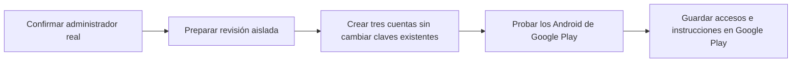
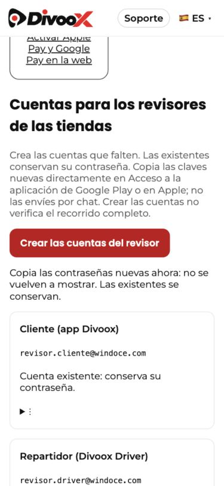

# Acceso de revisores de Divoox

Actualizado: 27 de octubre de 2026. Trabajo de corrección local; no enviado a Google Play.

**🔴 Pendiente: administrador real confirmado, escenario aislado completo y prueba de los tres Android cargados en Google Play. Las cuentas locales no son credenciales para Google.**

## Qué se corrigió

Crear cuentas y cambiar contraseñas son acciones distintas. El botón del Resumen crea solo las que faltan, en una operación que se revierte completa si falla. Repetirlo conserva las contraseñas. Un correo que ya exista sin estar marcado como revisor no se sobrescribe.

En ⋮ de cada cuenta se puede cambiar solo su contraseña, previa confirmación. La anterior deja de funcionar y se cierran sus sesiones. La nueva se muestra una vez, sin guardarse en claro; actualizar también el formulario de la tienda. Si se pierde la respuesta o se cierra la pantalla, usar esta acción explícita, nunca volver a crear esperando recuperar la contraseña.

## Identificar al administrador

La entrada es https://divoox.com/panel. Aunque el título diga restaurante, el administrador entra ahí y el servidor lo dirige a su dirección privada. El correo de Google Play o el perfil de Chrome no prueban cuál es el usuario administrador de Divoox.

El 27 de octubre, el panel de producción abierto en Chrome mostró el formulario sin sesión. No se consultó la base remota ni se cambió ningún permiso. El correo `tumbite.com@gmail.com` aparece en pendientes históricos como cuenta prevista; no se ha confirmado que exista con rol administrador. No convertir otra cuenta en administrador por deducción.

## Correspondencia de las cuentas

| Aplicación         | Paquete Android                 | Cuenta reservada                |
| ------------------ | ------------------------------- | ------------------------------- |
| Divoox             | com.windoce.tumbite             | revisor.cliente@windoce.com     |
| Divoox Driver      | com.windoce.tumbite.driver      | revisor.driver@windoce.com      |
| Divoox Restaurants | com.windoce.tumbite.restaurants | revisor.restaurante@windoce.com |

Son identidades internas; no hace falta abrir tres cuentas de Gmail. No se ha verificado que estos buzones reciban recuperación de contraseña. El cambio desde el administrador no depende del buzón.

## Flujo operativo y responsables

1. **Acceso administrativo — Richard y agente:** Richard habilita una sesión existente si solo él tiene el acceso. El agente confirma el rol y el destino correcto. Resultado comprobable: Resumen del superadmin del sitio Divoox.
2. **Escenario aislado — agente:** terminar la separación entre demostración y pedidos/cobros reales antes de crear datos de demostración en producción. El restaurante aprobado y cerrado y la exención de distancia actuales NO constituyen aislamiento. Definir y probar el recorrido de cliente, restaurante y driver, sus menús, ubicación, pedidos e incidencias.
3. **Cuentas — agente:** con el entorno y acceso confirmados, crear las que falten; cambiar solo la contraseña que realmente se haya perdido. Resultado: tres accesos estables; un reintento no invalida lo enviado a Google.
4. **Android — agente:** comprobar la versión y servidor de cada artefacto entregado, iniciar/cerrar sesión y recorrer sus funciones. No sustituir esto por una prueba web. En esta ronda no había dispositivos Android conectados; existe un emulador configurado, todavía sin iniciar ni probar estos artefactos.
5. **Google Play — agente:** guardar usuario, contraseña e instrucciones en inglés en «Acceso a la aplicación» de cada paquete. No enviar credenciales por chat ni incluirlas en Git/capturas. El envío de la publicación no se realizó en esta ronda.

Google exige accesos válidos y acceso a las funciones, incluidas las instrucciones para áreas restringidas: [requisitos oficiales](https://support.google.com/googleplay/android-developer/answer/15748846?hl=en).

## Evidencia local

- Pruebas del servidor: tres logins con su rol, autorización administrativa, repetición sin rotación, reversión del lote, concurrencia, protección de cuentas no marcadas, rotación individual y revocación de sesión.
- Pruebas del panel: deshabilitar solicitudes pendientes, conservar claves mostradas, confirmar o cancelar rotación y explicar cuentas existentes.
- Navegador integrado contra servidor y SQLite locales: administrador temporal, creación de tres cuentas, repetición conservando las claves y consulta posterior sin mostrarlas. Consola sin errores en esa comprobación.
- La captura usa cuentas exclusivamente locales; no contiene contraseñas.

## Límites y continuidad

Este cambio no agrega aislamiento de pedidos, no paga, no publica, no crea cuentas de producción, no identifica una credencial administrativa real y no certifica los binarios Android. No afirmar «listo para revisión» hasta cerrar esos puntos con evidencia.

Las correcciones de creación y estabilidad son garantía de la función existente. No se cotiza ni se da por aprobado un módulo nuevo independiente.
