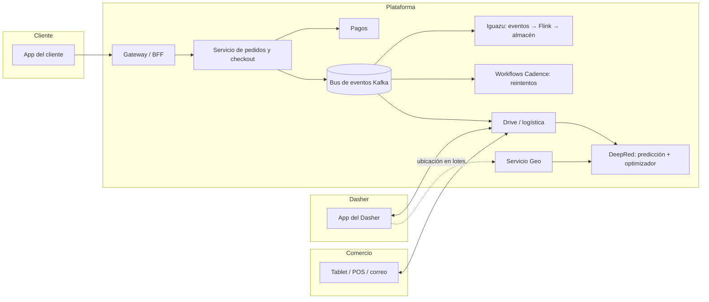
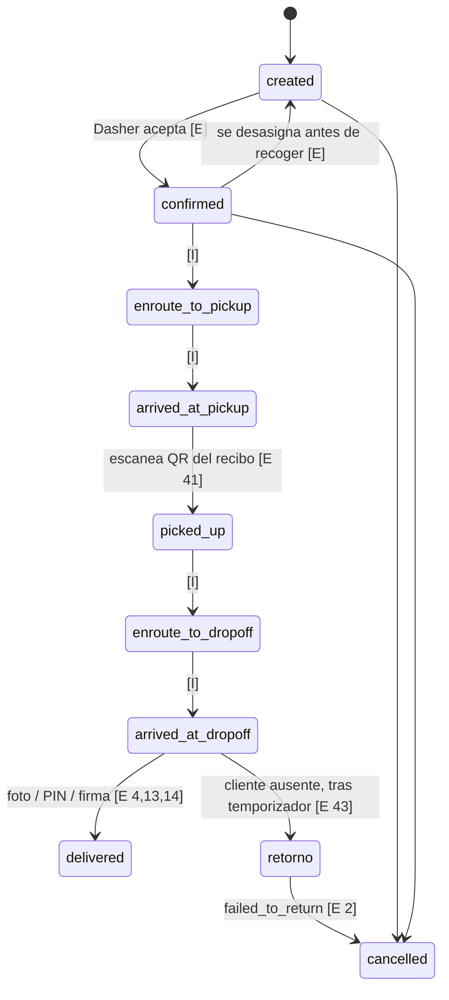

# Arquitectura de referencia: DoorDash

**Fecha:** 16 de octubre de 2026. **Fuente:** `docs/investigaciones-rea/EVIDENCIA-DOORDASH-FUENTES-PUBLICAS.md` (52 fuentes públicas, cada dato marcado). Aquí va solo lo **observado**; las flechas de los diagramas que no están publicadas se marcan como inferencia. **No se inventa ningún componente interno.**

Leyenda: **[E]** evidencia pública directa · **[Ei]** evidencia indirecta (blog de ingeniería leído por extractos, porque bloquea la lectura automática) · **[I]** inferencia nuestra.

## 1. Arquitectura funcional observada



- Monolito en Python migrado a **microservicios en Kotlin con gRPC**, con servicios BFF sin estado delante [Ei 28, 48].
- El **checkout** es un servicio que valida, guarda en Cassandra, **publica en Kafka** y engancha logística [Ei 28].
- Si el consumidor de Kafka falla, **Cadence** reintenta con reintentos configurables; la lección publicada: «no toda nuestra lógica era idempotente y ese fue el mayor reto» [Ei 49].
- Ubicación de los Dashers **en lotes cada pocos segundos por Kafka** al servicio Geo [Ei 37]; hacia socios, **cada 30 s** [E 2].
- Los números internos (≈500 servicios, ≈100 por pedido) son de terceros; no se usan como base de diseño.

## 2. Estados del pedido y de la entrega

**Lista exacta publicada (Drive)** [E 1]: `created`, `confirmed`, `enroute_to_pickup`, `arrived_at_pickup`, `picked_up`, `enroute_to_dropoff`, `arrived_at_dropoff`, `delivered`, `cancelled`. Regla publicada: puede **volver a `created`** si el Dasher se desasigna antes de recoger.



Del lado del **comercio** (Marketplace) [E 6, 7]: el pedido llega `NEW`; el comercio responde **éxito o fallo en 3 a 8 minutos** (la ventana la fija un planificador por pedido); fallo con motivo tipado (`ITEM_OUT_OF_STOCK`, `STORE_CLOSED`, `POS_OFFLINE`, `CAPACITY_THROTTLING`, `STALE_PICKUP_TIME`, …); confirmar dos veces da 400; la señal **`order_ready_for_pickup`** adelanta la asignación si el pedido está listo antes.

**Eventos de webhook** [E 2]: `DASHER_CONFIRMED`, `DASHER_CONFIRMED_PICKUP_ARRIVAL`, `DASHER_PICKED_UP`, `DASHER_CONFIRMED_DROPOFF_ARRIVAL`, `DASHER_DROPPED_OFF`, `DELIVERY_CANCELLED` (+ devolución y `DELIVERY_BATCHED`). Reintentos: **hasta 3** si no hay 200. Motivos de cancelación tipados (23 valores publicados).

## 3. Flujo de un pedido de punta a punta

```mermaid
sequenceDiagram
    autonumber
    participant Cli as Cliente
    participant Pla as Plataforma
    participant Com as Comercio
    participant Das as Dasher
    Cli->>Pla: Carrito + pago (checkout)
    Pla->>Pla: Valida, guarda, publica evento
    Pla->>Com: Pedido nuevo (tablet / webhook)
    Com-->>Pla: Confirma en 3-8 min, con tiempo de preparación opcional
    Pla->>Pla: DeepRed: predice «listo», viaje y aceptación; optimiza por región varias veces por minuto; retrasa la oferta a propósito
    Pla->>Das: Oferta con pago mínimo garantizado
    Das-->>Pla: Acepta (o rechaza sin mínimo de aceptación)
    Pla-->>Cli: Dasher asignado, mapa, ETA
    Pla->>Com: Alerta a pantalla completa: Dasher a ~5 min
    Com->>Pla: Pedido listo
    Das->>Pla: Llegó; escanea QR; recogido
    loop ubicación
        Das->>Pla: Posición (lotes)
        Pla-->>Cli: Mapa y ETA recalculado
    end
    Das->>Pla: Llegó a destino; foto / PIN / firma
    Pla-->>Cli: Entregado + foto por SMS y correo
    Pla->>Das: Pago (semanal o Fast Pay)
    Pla->>Com: Liquidación (semanal o diaria)
```

## 4. Comunicación entre componentes (reglas publicadas)

| Regla                                                                                                                                                                  | Fuente   |
| ---------------------------------------------------------------------------------------------------------------------------------------------------------------------- | -------- |
| Toda creación lleva **id externo como llave de idempotencia**; duplicado → 409                                                                                         | [E 3, 4] |
| Webhooks: **3 reintentos**; se responde 200 o se reintenta                                                                                                             | [E 2]    |
| Confirmación del comercio con **reloj** (3–8 min) y errores tipados                                                                                                    | [E 6]    |
| Fallos de un paso → **workflow con reintentos** (Cadence), y hacer idempotente la operación                                                                            | [Ei 49]  |
| Incidente 2021: reintentos agresivos contra pagos tumbaron otros servicios → **load shedding** en pagos, **circuit breaker** en el lado del Dasher, malla de servicios | [Ei 52]  |
| Autenticación de socios: JWT HS256 de ≤30 min                                                                                                                          | [E 51]   |

## 5. Manejo de errores y excepciones operativas

| Situación                           | Lo que hace DoorDash                                                                                              | Fuente |
| ----------------------------------- | ----------------------------------------------------------------------------------------------------------------- | ------ |
| Tablet sin conexión 5 min           | **Pausa automática** de la tienda (Tablet Heartbeat)                                                              | [E 16] |
| 2 cancelaciones evitables en un día | Pausa temporal por calidad                                                                                        | [E 16] |
| Artículo agotado                    | Marcar agotado (fin de día / 4 h / indefinido), **reemplazar**, reembolsar el artículo o cargo hasta $5           | [E 12] |
| Dasher se desasigna                 | La entrega vuelve a `created` y se reasigna                                                                       | [E 1]  |
| Cliente ausente                     | Llamar y escribir → temporizador → dejar con foto y descripción, o devolver (alcohol siempre se devuelve, pagado) | [E 43] |
| Cliente cancela                     | Reembolso **total / parcial / ninguno** según «comercio confirmó» × «Dasher asignado»                             | [E 11] |
| Tasa de finalización < 90 %         | Riesgo de desactivación del Dasher; la de aceptación **no tiene mínimo**                                          | [E 39] |

## 6. Seguimiento del repartidor

- Cliente: tres etapas (confirmado, en el restaurante, en camino), mapa desde que el Dasher acepta, botones de llamar y escribir [E 36].
- Comercio: alerta a ~5 min; «esperando» a 25 m; espera evitable medida (meta < 2 min) [E 12 y comparación anterior].
- Socios: ubicación cada 30 s en los 15 min previos a recogida y entrega [E 2].
- Interno: ingesta en lotes cada pocos segundos [Ei 37]; ETA como **suma de tramos** (patente con una subred por tramo entre eventos consecutivos) y como **distribución**, no un número [E 35, Ei 32–34].

## 7. Gestión de restaurantes

- Protocolos de recepción: POS, tablet, correo/fax, impresora opcional [E 15].
- Confirmación manual o automática; tiempo de preparación en saltos de 5 min, solo antes de asignar Dasher; «Busy Kitchen» suma minutos [E 12, 16].
- Menú público: categorías → artículos → grupos de modificadores → opciones, con precio en cada nivel y horarios por artículo [E 8, 9].
- Auto Order Release: la cocina recibe el pedido cuando el Dasher está cerca [E 6].
- Liquidación semanal (o diaria opcional) con comisión y cargos por error [E 17].

## 8. Relación con pagos y pedidos

- El checkout **procesa el pago** en el mismo servicio que engancha logística [Ei 28].
- Al cliente se le ve un cargo pendiente y luego el final (terceros) y los reembolsos tardan 3 o 5–7 días según si el cargo se asentó [E 31]. **Cuándo capturan exactamente no está publicado.**
- Dasher: base + promociones + 100 % de la propina; Fast Pay a $1,99 [E 10, 45].
- Las propinas van en centavos y se pasan íntegras [E 4].

## 9. Lo que NO se pudo confirmar

- El momento exacto de la captura del cobro.
- Cuánto dura una oferta en la pantalla del Dasher.
- La frecuencia exacta del GPS en la app del Dasher.
- Una tabla oficial de transiciones de estado.
- El texto completo del blog de ingeniería (bloqueado a lectura automática).
