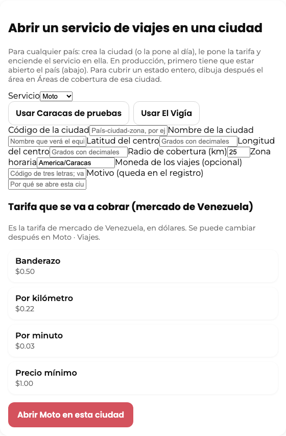
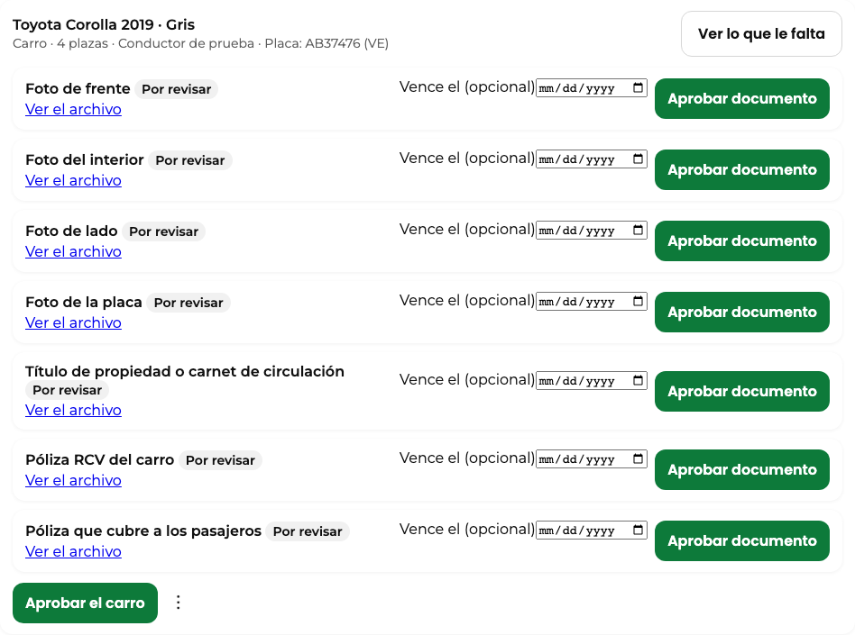

# Cómo abrir una ciudad nueva

Guía interna del equipo (no es pública). Sirve para cualquier país y cualquier ciudad: Detroit, Novi, todo Michigan, Caracas o la próxima. No hace falta tocar código ni pedir un cambio a desarrollo.

## Lo que ya no hay que preparar: la distancia por calles

El precio de los viajes se calcula con la distancia y el tiempo reales por calles (Google Routes, sin tráfico). Esa pieza es mundial: funciona para cualquier origen y destino del planeta y no tiene lista de ciudades. Abrir una ciudad no pide nada para eso. Si un día Google no responde, o se llega al tope de 320 consultas del día, la cotización sigue funcionando con la distancia estimada y el canario lo dice («rutas: estimada»).

## Viajes: Moto, Carro y Envíos (un solo paso)

En el panel del superadmin, en «Moto · Abrir y aprobar», está el formulario «Abrir un servicio de viajes en una ciudad». Se elige el servicio (Moto, Carro o Envíos), se escribe el código de la ciudad con su país al principio (por ejemplo US-MI-DETROIT o VE-CCS-CENTRO), el nombre, el centro en grados con decimales, el radio, la zona horaria y, si hace falta, la moneda. Si se deja vacía, se usa la del país.

La tarifa se escribe en el mismo formulario: banderazo, por kilómetro, por minuto y precio mínimo, en la moneda de los viajes. La única que viene ya puesta es la de Moto en Venezuela, que es la tarifa de mercado. Al tocar el botón, la ciudad queda creada (o puesta al día), con su tarifa, y el servicio encendido allí. Para abrir otro servicio en la misma ciudad se repite el formulario con el otro servicio: la ciudad no se duplica.

Los detalles de la tarifa (espera, cancelación, redondeo, Carro XL, tope del valor de un paquete) se ajustan después en «Moto · Viajes».

### Motos y carros por revisar

En la misma pantalla, la cola «Motos y carros por revisar» trae cada vehículo que un conductor envió desde su app: tipo (Moto o Carro), plazas, placa y cada papel con su foto. Se aprueba papel por papel, después el vehículo con «Aprobar el carro» (o la moto), y al final se habilita al conductor para el servicio. Rechazar está en los tres puntos del vehículo y pide el motivo, que el conductor ve en su app.

Capturas reales del servidor local (El Vigía, datos de prueba), tomadas con `node scripts/recorrido/capturas-carro.mjs`; están también en inglés (`-en.png`). No van a Docs públicos: el panel del equipo es interno.

## Un estado o un país entero

El radio llega hasta cien kilómetros. Para cubrir algo más grande, como todo Michigan, se abre la ciudad con su centro y después, en la lista de ciudades, se entra a «Áreas de cobertura» y se dibuja el contorno del estado como un área. Un punto dentro de un área activa cuenta como dentro de la ciudad, aunque quede lejos del centro. Así, un viaje de Novi a Lansing cotiza igual que uno dentro de Detroit. Ojo: apenas la ciudad tiene un área publicada, deja de contar el círculo del radio y solo se atiende dentro de las áreas activas, así que el contorno tiene que cubrir todo lo que se quiere atender.

## Producción

En el sitio de pruebas los servicios de viajes se encienden sin más. En producción no: Moto y Carro siguen apagados por candado y solo se encienden en un país que el superadmin abrió con su número de solicitud, en la sección de compuerta del país del mismo panel. En Estados Unidos no hay Moto. Nada de esto se enciende en producción sin la decisión de Richard.

## Comida (el mismo paso)

Comida se abre con el mismo formulario: en «Servicio» se elige Comida. Para las pruebas de Venezuela está el botón «Usar El Vigía de pruebas» (estado Mérida, en dólares). Al tocar «Abrir Comida en esta ciudad», la ciudad queda creada (o puesta al día) y la configuración del país queda en la moneda de esa ciudad, con sus tarifas de comida, sus topes y sus propinas sugeridas; se encienden el efectivo, el pago móvil y las recargas en puntos de venta, y Comida queda encendida en esa ciudad.

- En Venezuela, si el país todavía no tiene tarifas de comida, se ponen solas las de mercado, en dólares (envío por distancia desde 1,50, cargo de servicio del 5 %, pedido pequeño de 0,50, propinas de 0, 5, 10 y 15 %). En otro país hay que escribir antes las tarifas de comida del país en «Control de dinero»; si no, el paso lo dice y no abre nada.
- Si las tarifas del país ya están en otra moneda que la de la ciudad, el paso lo dice y no abre nada: primero se cambia la configuración del país.
- Si el país tiene una política de comisión de comida en otra moneda, el paso tampoco abre (la comisión no se cobraría). El canario de salud tiene la pieza «comidaPaises» para vigilarlo.
- El equivalente en bolívares que ven el cliente y el repartidor sale de la tasa del día que el equipo escribe en este mismo panel («Tasa de referencia»). Sin tasa de las últimas 48 horas, no se muestra.
- Para recibir pedidos por pago móvil, cada repartidor agrega su cuenta de pago móvil en Ganancias y el equipo la confirma (si no, entra en vigor a las 24 horas). Para cobrar en efectivo o pago móvil necesita saldo: el equipo es su propio punto de venta en dólares.
- En producción este paso no abre Comida en un país nuevo: es una decisión de Richard.
- En Estados Unidos no se usa: Comida sigue con la configuración de siempre.

## Cómo se comprueba

Con una cuenta de cliente de pruebas, cotizar un viaje dentro de la ciudad. La cotización tiene que salir con precio, kilómetros y minutos. En el canario de salud, la pieza «rutas» debe decir «ok» y el contador de consultas del día tiene que subir en uno; si dice «estimada», la llave de Google no tiene Routes habilitada.
