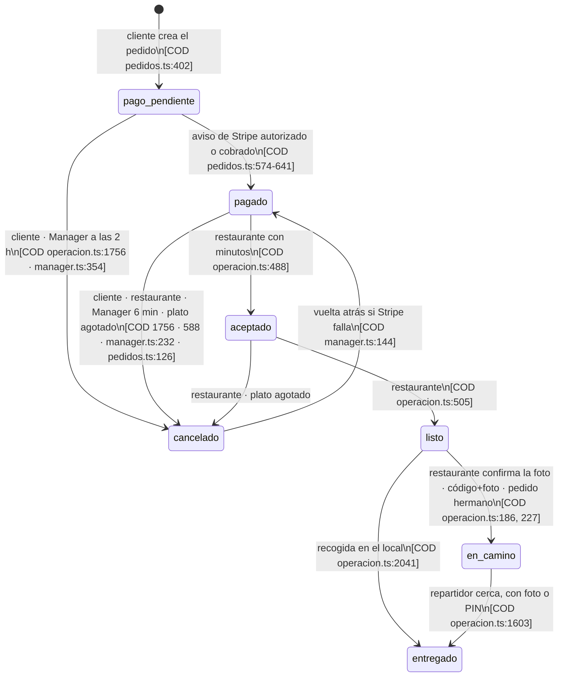
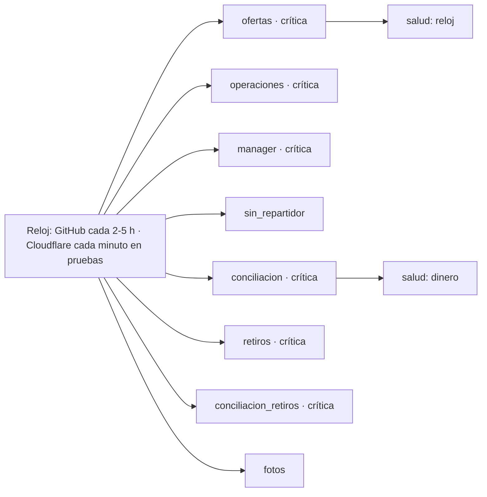

# Diagramas de Tumbite respaldados por evidencia

**Fecha:** 16 de octubre de 2026. Cada caja y cada flecha cita de dónde sale: **[COD archivo:línea]** (código leído en `main`, versión publicada `36f4e35`), **[REA]** (captura con hash en `docs/investigaciones-rea/evidencia-rea-2026-10-16.json`), **[PRUEBA archivo]** (comportamiento fijado por una prueba automática), **[INF]** (inferencia). Lo que no tiene etiqueta no está en este documento.

## 1. Componentes y dependencias

```mermaid
flowchart TB
    subgraph Apps Expo
        C[apps/cliente]
        R[apps/repartidor]
        T[apps/restaurante]
    end
    subgraph Web
        P[apps/panel · Vite\nlanding + Docs + panel]
    end
    subgraph Compartido
        K[packages/compartido\ndinero · despacho · mostrador · semáforo\nlistaRestaurantes · confirmarSesion · version]
        M[packages/movil\nsesión · llavero · UI · chat · QR]
    end
    subgraph Servidor Hono · _worker.js
        S[apps/servidor\n/datos/*]
        D[(D1 · schema.sql\n79 tablas)]
        B[(R2 · fotos)]
    end
    subgraph Externos
        ST[Stripe · modo prueba]
        TW[Twilio · pendiente]
        EX[Expo push]
        YA[YaDominios Cloud]
    end
    subgraph Cloudflare · solo staging
        DO[tumbite-tiempo-real\nDurable Object por zona]
        RL[tumbite-reloj\ncron cada minuto]
    end
    C --> M --> K
    R --> M
    T --> M
    P --> K
    C -- fetch /datos --> S
    R -- fetch /datos --> S
    T -- fetch /datos --> S
    P -- fetch /datos --> S
    S --> D
    S --> B
    S <-- webhooks firmados --> ST
    S --> EX
    S -. SMS .-> TW
    RL -- firma interna --> S
    DO -- lotes de ubicación --> S
    YA -- publica --> S
```

- Dependencias de paquetes: **[COD package.json de cada app y paquete]**; `packages/movil` depende de `@tumbite/compartido` y de `expo-constants`, `expo-secure-store`, `async-storage` **[COD packages/movil/package.json]**.
- Las apps llaman al servidor por `crearApi` **[COD packages/compartido/src/api.ts]**; el panel con `base: ''` y cookie **[COD apps/panel/src/panel/api.ts:4-9]**.
- El Durable Object y el reloj existen y están probados en el sitio de pruebas **[PRUEBA scripts/staging/probar-tiempo-real.mjs]**; **ninguna app abre la conexión** **[COD]** y **[REA registro 2: 0 WebSockets al abrir la app]**.
- Salud: `GET /datos/salud` con las piezas base, esquema, Stripe, correo, avisos, SMS, dinero, retiros, servicios, tiempo real, exclusividad, reloj, respaldo **[COD apps/servidor/src/app.ts:132-210]**.

## 2. Lo que ve un visitante al abrir la app (evidencia REA)

```mermaid
sequenceDiagram
    autonumber
    participant N as Navegador 375px
    participant Y as staging.tumbite.com
    participant CF as Cloudflare Insights
    N->>Y: GET /app/ (documento)
    Y-->>N: 200, x-yad-cache, HSTS
    N->>Y: GET css de Leaflet · GET entry-….js (un solo bundle)
    N->>CF: GET beacon.min.js · POST /cdn-cgi/rum
    Note over N: Se pinta «Sign in» con correo y contraseña; NINGUNA llamada a /datos
```

**[REA registro 2]**: 5 transacciones, 0 a `/datos`, 0 WebSockets, almacenamiento vacío, 1 aviso de consola. **[INF]** La app no necesita el servidor para mostrar el inicio de sesión; el catálogo se pide solo con sesión (`ConSesion`) **[COD apps/cliente/src/app/\_layout.tsx:13]**.

## 3. Máquina de estados del pedido (exacta, del código)

Estados **[COD schema.sql:134]**: `pago_pendiente, pagado, aceptado, listo, en_camino, entregado, cancelado`. No hay tabla de transiciones para pedidos: cada flecha es un `UPDATE … WHERE estado = …` **[COD]**.



Hitos del repartidor que **no** son estados **[COD operacion.ts:318-374, tabla hitos_pedido]**: `llego_restaurante`, `verificado`, «llega en 5», «sal a recibir», «casi llega», «llegó». (Brecha 2 de la comparación.)

## 4. Secuencia completa de un pedido de Comida (del código y las pruebas)

```mermaid
sequenceDiagram
    autonumber
    participant Cli as App cliente
    participant S as Servidor
    participant ST as Stripe
    participant Rest as Restaurante
    participant Rep as Repartidor
    Cli->>S: POST /datos/pedidos [COD pedidos.ts:288]
    S->>ST: PaymentIntent capture_method=manual, setup_future_usage [COD 489-492]
    S-->>Cli: pedidoId + client_secret; estado pago_pendiente
    Cli->>ST: confirma la tarjeta en la app (pago sin salto)
    ST->>S: webhook amount_capturable_updated (firmado, deduplicado) [COD 545, 582]
    S->>S: pagado + fila en cobros; correos
    S-->>Rest: alarma y semáforo [COD operacion.ts:386]
    Rest->>S: aceptar con minutos [COD 475]
    S->>S: Manager vigila: 1 y 3 min, cancela a los 6 [PRUEBA manager]
    S->>S: repartirOfertas cuando falten viaje+3 min para «listo» [COD 980-1091, despacho.ts]
    S-->>Rep: oferta 45 s con pago y propina
    Rep->>S: aceptar (una sola sentencia atómica) [COD 1175-1189 · PRUEBA fase3.test.ts]
    Rest->>S: listo [COD 503]
    Rep->>S: foto a ≤200 m + QR o código [COD 1356, 1417]
    S->>S: listo → en_camino [COD 186]
    Rep->>S: ubicación; hitos «casi llega», «llegó» [COD 885, 318-374]
    Rep->>S: entregado con foto o PIN, cerca [COD 1490-1626]
    S->>ST: captura con clave captura-{id} [COD 130-154]
    S->>S: movimientos de billetera; conciliación diaria [COD conciliacion.ts]
```

Las pruebas que fijan esta secuencia: `apps/servidor/src/rutas/operacion.test.ts` (recorrido con Stripe simulado), `fase3.test.ts` (exclusividad), `reloj.test.ts` (reloj), `fallosCriticos.test.ts` (los cinco fallos), y el recorrido completo en el sitio de pruebas en inglés y español **[PRUEBA e2e/recorrido]**.

## 5. Dependencias entre tareas del reloj y el dinero



**[COD operacion.ts:1709-1761]** lista `TAREAS_RELOJ`; **[COD reloj.ts:36]** cada tarea con su propio manejo de errores; **[PRUEBA reloj.test.ts]** 14 casos.

## 6. Lo que estos diagramas cambian frente a DoorDash (resumen)

| DoorDash (referencia)                     | Tumbite (diagramas de arriba)                           | Qué sigue                  |
| ----------------------------------------- | ------------------------------------------------------- | -------------------------- |
| 9 estados de entrega con nombres estándar | 7 estados + hitos aparte                                | Entrega 2 del plan v2      |
| Transiciones protegidas por la plataforma | `WHERE estado = …` en cada UPDATE                       | Entrega 1 del plan v2      |
| Ubicación en lotes por Kafka              | Durable Object listo, apps sin conectar                 | Entrega 4 del plan v2      |
| Webhooks con 3 reintentos e idempotencia  | Deduplicados; desde hoy también reintentables (fallo 1) | Hecho en `fallos-criticos` |
