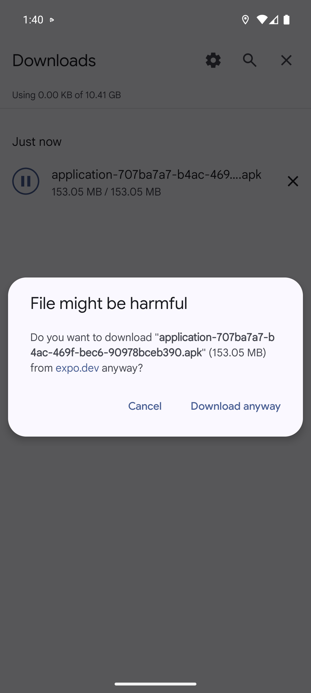
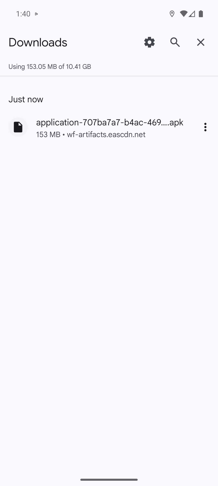
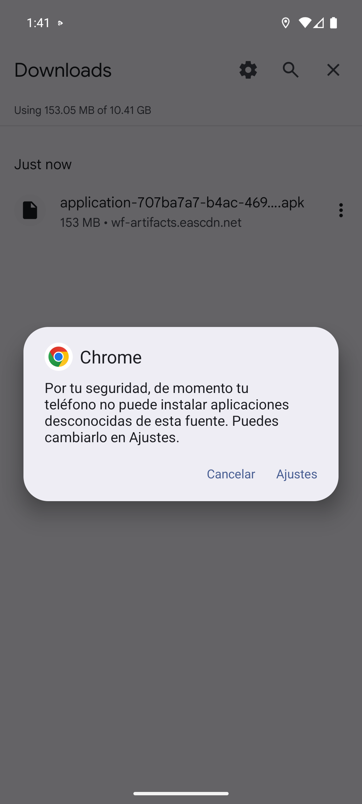
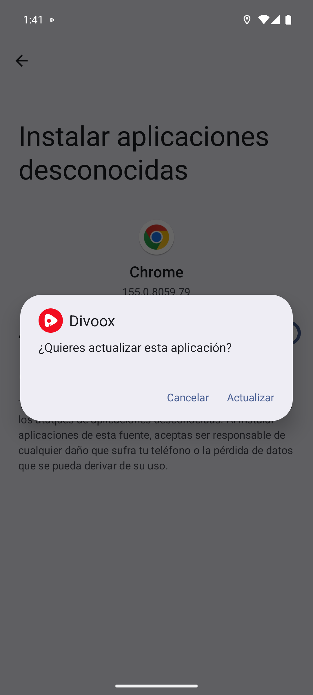
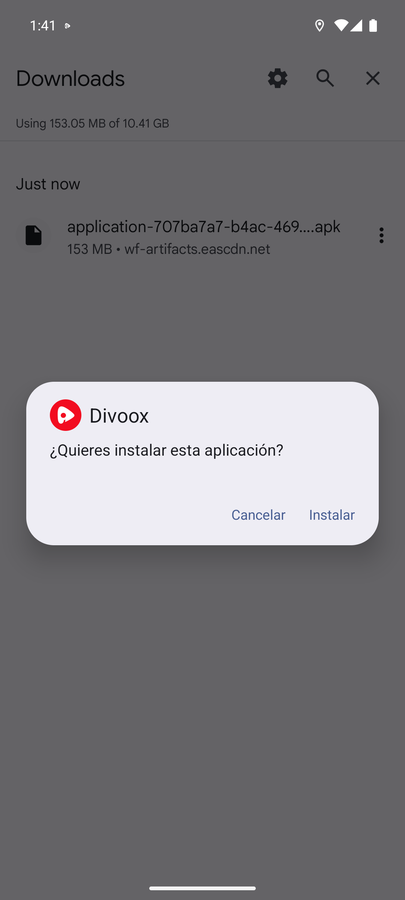
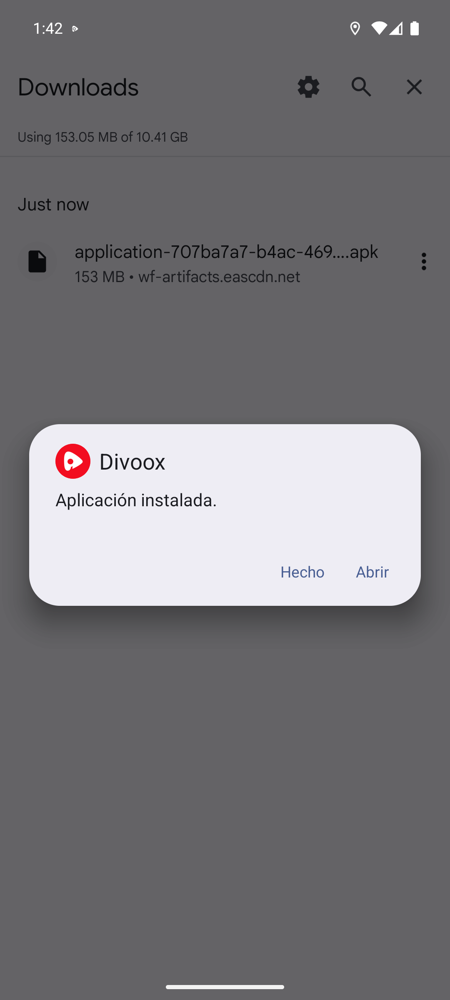

# Guía del responsable de zona — piloto de Divoox en El Vigía y Tucaní

Para la persona que coordina a los mototaxistas en su zona. Corta, en orden, para tenerla en el celular.

## 1. Instalar las apps (Android, sin Google Play)

Las apps del piloto se bajan directo, como un archivo. No se usa Google Play (allá todavía no salen para Venezuela). El archivo pesa unos 150 megas: mejor con wifi.

1. En el celular, abre en Chrome la página de apps de Divoox: **https://divoox-progreso.sitios.dev/apps**
2. Arriba está el bloque verde **«Versión real — para el piloto de El Vigía y Tucaní»**. Solo ese. Los de más abajo dicen «solo para el equipo»: no se usan.
3. Toca **Descargar** en **Divoox Driver** (conductores), **Divoox** (pasajeros) o **Divoox Restaurants** (restaurantes).
4. Chrome avisa que el archivo «podría ser dañino». Es el aviso normal de cualquier app que no viene de Google Play. Toca **Descargar de todos modos**.

   

5. Cuando termine, toca el archivo descargado (en la barra de avisos o en **Descargas** de Chrome).

   

6. La primera vez, Android dice que por seguridad no puede instalar aplicaciones desconocidas de esta fuente. Toca **Ajustes**.

   

7. Enciende **Autorizar de esta fuente** y vuelve atrás con la flecha.

   

8. Toca **Instalar**.

   

9. Cuando diga **Aplicación instalada**, toca **Abrir**.

   

- Si en vez de «instalar» dice **«actualizar»**, ese celular tiene la app de PRUEBAS: cancela, bórrala (mantén el ícono apretado → Desinstalar) y vuelve al paso 5.
- En algunos Samsung y Xiaomi el permiso se llama **«Instalar apps desconocidas»** o **«Fuentes desconocidas»**, y está en Ajustes → Aplicaciones → Chrome. Es el mismo interruptor.

## 2. Registrarse como conductor de moto

1. Abre **Divoox Driver** → **Crear cuenta**. Nombre real, correo, celular con +58 y fecha de nacimiento (mínimo 21 años).
2. Confirma el correo con el enlace que llega a la bandeja (revisa también «Spam»).
3. Elige la ciudad: **El Vigía** o **Tucaní**.
4. Sube los papeles (fotos claras, sin reflejos, las cuatro esquinas a la vista):
   - Cédula por delante y por detrás, y una selfie.
   - Licencia para moto.
   - Certificado de antecedentes penales.
   - De la moto: carnet de circulación, seguro RCV, seguro de pasajeros, foto de frente con la placa.
5. Toca **Enviar a revisión**. El equipo de Divoox lo revisa a mano y lo aprueba.

## 3. Saldo prepago (para poder recibir carreras)

- El pasajero le paga todo al conductor, en efectivo o por pago móvil. Divoox cobra el **10 %** de cada carrera, y lo descuenta del **saldo prepago** del conductor.
- **Sin saldo no le llegan carreras.** Con 5 dólares le alcanza para unas 25 carreras cortas.
- Por ahora el **equipo de Divoox es el punto de recarga**: el conductor paga la recarga al equipo, el equipo le pasa un **código**, y el conductor lo escribe en **Driver → Saldo → Recargar con código**. El saldo aparece al momento.

## 4. Recibir carreras

1. En Driver, desliza **Desliza para conectarte** de izquierda a derecha hasta el final. Deja el GPS encendido y la app abierta o en segundo plano.
2. Cuando entra una carrera suena y aparece la oferta con el precio y el recorrido: **Aceptar**.
3. Ve a la recogida y toca **Llegué**. Pídele al pasajero su **código de 4 números** y escríbelo para **Iniciar**.
4. Al llegar al destino, **Terminar**. Cobra lo que dice la pantalla (en dólares; los bolívares son solo referencia a la tasa del BCV).
5. Si fue por pago móvil, confirma **Sí me llegó** solo cuando lo veas en tu banco.

Los **envíos** (llevar un paquete de A a B) llegan igual que las carreras: recoges el paquete, lo llevas y terminas.

## 5. Si algo falla

- **Botón de pánico:** dentro de la carrera, el botón rojo de emergencia. Le llega un **aviso al responsable de la zona** (al celular si tiene la app de Divoox con ese número, y por correo al equipo; el SMS se suma cuando esté el proveedor de Venezuela) con el nombre, el teléfono, el enlace del mapa con la ubicación y la carrera. Además da el número de emergencias del país.
- **No me llegan carreras:** revisa que estés **Conectado**, que tengas **saldo**, GPS encendido y que tus papeles digan **Aprobado**.
- **El mapa se ve gris o la app no abre:** cierra la app y ábrela otra vez; si sigue, avisa al responsable con una captura.
- **Papel rechazado:** la app dice por qué. Se toma la foto otra vez y se reenvía.

## 6. A quién llamar

1. El conductor llama primero al **responsable de su zona** (El Vigía o Tucaní).
2. El responsable escribe al **equipo de Divoox**: **soporte@divoox.com**, con el nombre del conductor, la hora y una captura.

## Para el equipo (superadmin)

- **Aprobar a un conductor:** Superadmin → **Papeles de conductores** (licencia y antecedentes) → Aprobar; **Identidad** → Aprobar; **Vehículos** → los papeles de la moto y la moto → Aprobar; **Requisitos** → edad y casco → Aprobar; **Habilitaciones** → Moto y Envíos → Aprobada.
- **Cargar saldo:** el punto de recarga «Equipo Divoox Venezuela (piloto)» ya existe, es de la cuenta «Soporte Piloto Divoox» y tiene 10 dólares de fondo. Entrando con esa cuenta: Superadmin → **Dinero** → **Mi punto de recarga** → monto en dólares → **Emitir código** → se le pasa el código al conductor. Para sumar fondo: Dinero → **Puntos de venta de recargas** → fondear con el comprobante.
- **Responsable de cada zona:** Superadmin → **Zonas** → en la zona, «Responsable de la zona» → nombre y celular con +58 → Guardar. Ese celular recibe el SMS de pánico.
