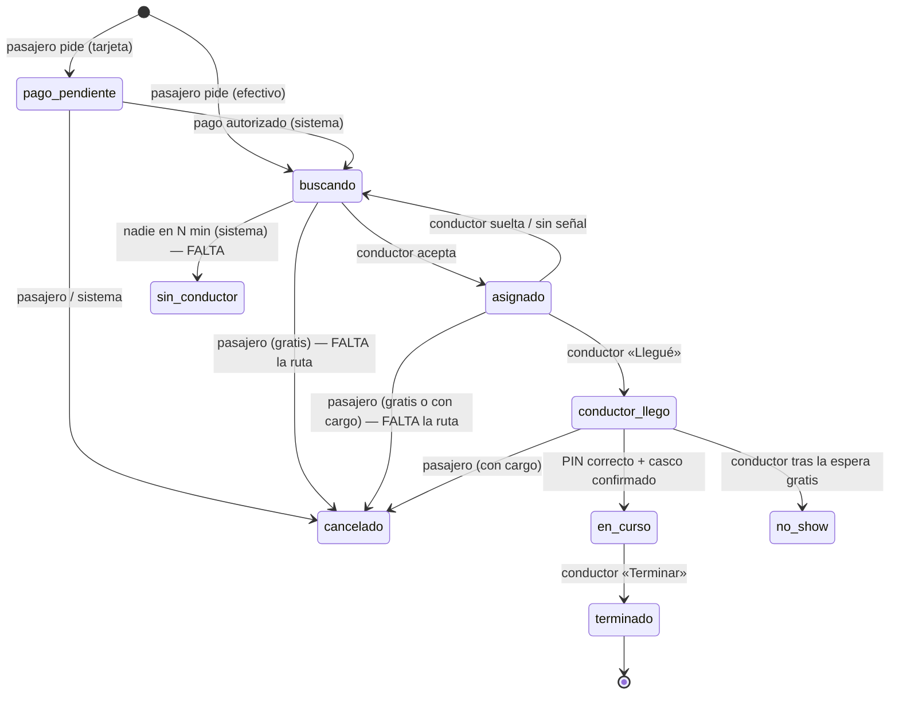
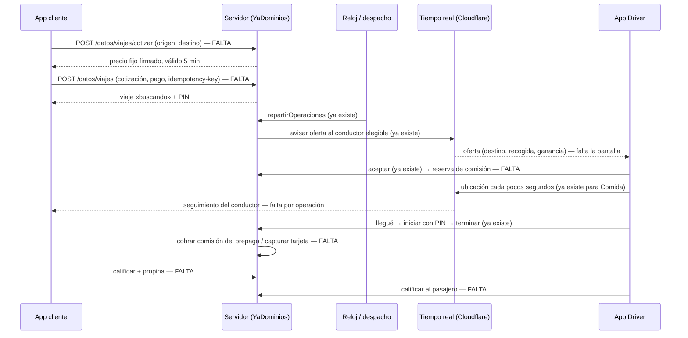

# Divoox Moto (pasajeros): investigación, comparación y plan

**Fecha:** 28 oct 2026 · **Pidió:** Richard («la de transporte de la moto… hacemos un plan… con REA, así no vamos a trabajar improvisando») · **Rama de trabajo:** `fase-moto-1` y siguientes, solo staging.

Ficha según `docs/METODOLOGIA-INGENIERIA-REA.md` §6. Evidencia completa con fuentes: `docs/investigaciones-rea/2026-10-28-moto-fuentes-publicas.md`.

## 0. Por qué Moto primero

- Es el servicio con **más base ya construida**: la Fase 3 dejó listas las tablas de operaciones y viajes, los estados, la aceptación atómica, la exclusividad con Comida, el despacho de ofertas cada minuto, las rutas del conductor (aceptar, llegué, PIN, iniciar, terminar, no se presentó), los vehículos con documentos y los requisitos de Moto sembrados.
- Carro comparte TODO eso: lo que se haga para Moto sirve para Carro cambiando el tipo de vehículo y la tarifa.
- Lo que falta es lo visible: cotizar, pedir, pantallas del pasajero y del conductor, seguridad, dinero y panel.

## 1. Referencias estudiadas

Uber Moto (Colombia, Brasil, India), DiDi Moto (Colombia, Argentina), inDrive (moto), Picap (Colombia, México), Rapido (India), GrabBike y Gojek GoRide, Bolt, y en Caracas Ridery, Yummy y Yango. Más la ley de Colombia, Venezuela y Florida.

**Límite legal (no se negocia):** REA no se usa sobre las apps de Uber, DiDi ni ninguna otra de terceros: sus términos lo prohíben y REA solo autoriza software propio. Los competidores se estudiaron con su documentación pública y su web como visitante. **REA sí se usa sobre nuestras propias apps** en staging al cerrar cada fase (`capture_browser_scenario`, `compare_application_versions`), para comprobar que nuestro flujo quedó como el estándar.

## 2. Evidencia (resumen; detalle y URL en el documento de fuentes)

**Estándar del mercado (lo hacen todos o casi todos → se copia):**

1. Moto es una categoría más dentro de la misma app: origen, destino, elegir Moto, ver precio, pedir. [DOC/OBS]
2. Precio fijo antes de pedir: base + km + minuto, con mínimo; dinámico con tope. Moto 20–50 % más barata que carro. [DOC/OBS]
3. Un solo pasajero con mochila. [DOC]
4. Seguimiento en vivo y hora estimada de llegada. [DOC]
5. El conductor ve destino, distancia a la recogida y ganancia antes de aceptar; rechazar pasa el viaje al siguiente (uno a uno, unos 15 s). [DOC]
6. Espera gratis desde que el conductor llega (unos 5 min); luego por minuto. Si se cobra cancelación, no se cobra espera. [DOC]
7. Cancelación gratis en una ventana corta (2–5 min); después, cargo pequeño. «No se presentó» tras el tiempo de gracia, con cargo. [DOC]
8. Casco obligatorio para los dos; el conductor ofrece casco al pasajero. [DOC]
9. Seguro de accidentes para el pasajero en cada viaje, gratis para él. [DOC/OBS]
10. Botón de emergencia (123 / 911), compartir el viaje, soporte. [OBS]
11. Verificación del conductor: documento, licencia de moto, registro, seguro obligatorio (SOAT), antecedentes, selfie. [OBS]
12. Calificación de ambos lados; propina aparte. [DOC]
13. PIN de 4 dígitos opcional para iniciar (siempre o solo de noche). [DOC]

**Lo que varía (→ interruptor por mercado):** modo de precio (fijo u oferta del pasajero tipo inDrive), PIN (no / siempre / de noche), selfie con casco, lista de seguridad antes del viaje, pausa del chat en viaje, límite de horas activas, chaleco de noche, requisitos de la moto (cilindrada, año), edad mínima, cobro al conductor (comisión, suscripción, tope legal), apagado por zona u horario.

**Ley:**

- **Colombia:** el Ministerio de Transporte dice que el transporte de pasajeros en moto no está autorizado; las alcaldías pueden restringir el parrillero. Uber Moto, DiDi Moto y Picap operan igual como servicio privado: zona gris. [DOC/OBS]
- **Venezuela:** sin norma vigente encontrada para moto de pasajeros por app; Ridery, Yummy y Yango ya lo ofrecen en Caracas. [OBS]
- **Florida:** la ley de plataformas no menciona motos; exige 1 millón de dólares de seguro durante el viaje. Nadie ofrece moto de pasajeros en EE. UU. [DOC]; la barrera real parece ser el seguro [INF].

**No verificable [NV]:** comisión de moto de Uber y DiDi en Colombia; radio de búsqueda; edad mínima del pasajero.

## 3. Diagramas

### 3.1 Estados del viaje (ya existen en la base; se agregan los actores que faltan)

### 3.2 Secuencia del viaje completo

## 4. Comparación con Divoox hoy

| Pieza del estándar                                   | Divoox hoy                                                                    | Veredicto                                                  |
| ---------------------------------------------------- | ----------------------------------------------------------------------------- | ---------------------------------------------------------- |
| Tablas, estados y transiciones del viaje             | `schema.sql` 2050-2183, `esquemaFase3.ts`; probado con 2.000 acciones al azar | ✅                                                         |
| Aceptación atómica, sin doble conductor              | `operaciones.ts` `aceptarOperacion`                                           | ✅                                                         |
| Exclusividad (no Comida y viaje a la vez)            | `conductor_ocupacion` y disparadores                                          | ✅                                                         |
| Conductor elegible por servicio, vehículo y papeles  | vista `conductores_elegibles`, requisitos de Moto sembrados                   | ✅                                                         |
| Oferta uno a uno, 15 km, 30 s, por tiempo real       | `repartirOperaciones` cada minuto                                             | 🟡 cada minuto (el estándar es al instante); ganancia en 0 |
| Rutas del conductor (aceptar, llegué, PIN, terminar) | `rutas/viajes.ts`                                                             | ✅                                                         |
| Cotización con precio fijo                           | No existe                                                                     | ❌                                                         |
| Pedir viaje (pasajero)                               | No existe ninguna ruta que cree un viaje                                      | ❌                                                         |
| Cancelación del pasajero y «sin conductor»           | Permitidas en la base, sin ruta ni tarea                                      | 🟡                                                         |
| PIN de inicio                                        | Se verifica al iniciar; nadie lo genera ni lo muestra                         | 🟡                                                         |
| Espera gratis y cobro por minuto                     | No existe                                                                     | ❌                                                         |
| Seguimiento en vivo del conductor por el pasajero    | Solo para pedidos de Comida                                                   | 🟡                                                         |
| Pantallas del pasajero                               | Solo vitrina «muy pronto» (`apps/cliente/src/app/service/[id].tsx`)           | ❌                                                         |
| Pantallas del conductor                              | Nada de viajes en `apps/repartidor`                                           | ❌                                                         |
| Casco, lista de seguridad, emergencia, compartir     | Requisito `casco_pasajero` en la habilitación; nada más                       | ❌                                                         |
| Seguro de accidentes del pasajero                    | Requisito `seguro_pasajeros` del vehículo; sin póliza de plataforma           | 🟡 depende de un proveedor                                 |
| Comisión del prepago del conductor                   | `cobrarComisionConductor` y servicio `ride` listos, sin enchufar              | 🟡                                                         |
| Pago con tarjeta del viaje                           | No existe para viajes (sí para Comida)                                        | ❌                                                         |
| Calificación de ambos lados y propina                | `calificaciones` atada a pedidos de Comida                                    | ❌                                                         |
| Panel: tarifas, interruptores, viajes en curso       | Solo API de servicios, sin pantallas                                          | ❌                                                         |
| Encender Moto                                        | Cinco candados lo impiden (correcto)                                          | ✅ se mantiene en producción                               |

## 5. Decisión

- **Se reutiliza todo lo de la Fase 3** (no se reconstruye nada) y la capa financiera de la Fase 4 de Flex (prepago, reserva, cobro, políticas).
- **Se construye primero para un mercado latinoamericano** (Caracas y Bogotá son donde los grandes ya operan); EE. UU. queda apagado por el seguro de Florida. Qué mercado se enciende primero lo decide Richard con su abogado; el código sirve para cualquiera.
- **Precio fijo primero**; la oferta del pasajero (tipo inDrive) queda como interruptor para una fase posterior.
- **Despacho uno a uno** como Uber, con la ganancia y el destino visibles.
- **Todo lo que varía va en la política del servicio por ciudad**, configurable en el panel, nunca en el código.
- **Moto sigue apagada en producción.** En staging se enciende con una bandera del entorno de pruebas, sin tocar los candados de producción.
- **Lo que se descarta por ahora:** grabación de audio, detección de desvíos con IA, selfies al azar durante el día. Quedan anotados para después.

## 6. Plan por fases

Cada fase: prueba primero en rojo, `npm run verify` en verde, staging, recorrido de punta a punta y guía en Docs (español e inglés) cuando el público la vea. Moto nunca se enciende al público sin la orden de Richard.

| Fase | Qué se hace                                                                                                                                                                                                                                                                                                                                                                                    | Cómo se comprueba                                                                                             |
| ---- | ---------------------------------------------------------------------------------------------------------------------------------------------------------------------------------------------------------------------------------------------------------------------------------------------------------------------------------------------------------------------------------------------- | ------------------------------------------------------------------------------------------------------------- |
| M1   | **Tarifa y cotización.** Política de tarifa por servicio y ciudad (base, km, minuto, mínimo, espera gratis, minuto de espera, ventana de cancelación gratis, cargo de cancelación y de no presentarse, tope dinámico), en centavos. `POST /datos/viajes/cotizar`: distancia y tiempo estimados, precio fijo firmado que vence a los 5 minutos. Bandera de staging que enciende Moto solo allí. | Pruebas de la fórmula, del mínimo, del vencimiento y de que una cotización alterada se rechace.               |
| M2   | **Pedir y cancelar.** `POST /datos/viajes` con la cotización y la clave de idempotencia: crea operación y viaje, genera el PIN. Efectivo directo a «buscando»; tarjeta en modo prueba a «pago_pendiente» (autorización, cobro al terminar). Cancelación del pasajero con su ventana gratis y su cargo; «sin conductor» automático a los N minutos con liberación del pago.                     | Doble toque no crea dos viajes; cancelar a tiempo no cobra; tarde, cobra el cargo; sin conductor libera todo. |
| M3   | **Despacho completo.** La oferta lleva la ganancia del conductor, la distancia a la recogida y el destino. Despacho al instante al pedir (no esperar el minuto del reloj), uno a uno, 15 segundos, y al rechazar pasa al siguiente.                                                                                                                                                            | Conductor sin moto aprobada no recibe; dos conductores no toman el mismo viaje; rechazar pasa al siguiente.   |
| M4   | **App del Driver.** Elegir Moto al conectarse, tarjeta de oferta (ganancia, recogida, destino, contador), viaje activo: ir a recoger con navegación, «Llegué» con contador de espera, lista de seguridad y casco, PIN, iniciar, terminar, «No se presentó» tras la espera, resumen de lo ganado.                                                                                               | Recorrido en el emulador de Android y capturas.                                                               |
| M5   | **App del cliente.** Pantalla Moto: origen (ubicación actual) y destino, precio fijo, método de pago, pedir; buscando conductor; conductor asignado (foto, nombre, placa, moto, calificación); seguimiento en mapa con hora de llegada; PIN visible; en curso; terminado con recibo. Nota del casco antes de pedir.                                                                            | Recorrido en el navegador a 375 px y en el emulador; capturas originales para Docs y la web.                  |
| M6   | **Seguridad.** Botón de emergencia en las dos apps (llama al número del país y avisa a soporte con la ubicación), compartir el viaje con un enlace de seguimiento público y firmado que muere al terminar, lista de seguridad obligatoria del conductor, casco confirmado por los dos, pausa del chat en viaje (interruptor), límite de horas activas (interruptor).                           | El enlace compartido deja de servir al terminar; emergencia llega al panel de soporte.                        |
| M7   | **Dinero.** Al aceptar, reserva de la comisión del prepago del conductor (donde rija); al terminar, cobro atómico e idempotente; al cancelar, la política de cancelaciones por servicio (libera, cobra parte o cargo fijo) — es la misma tarea que estaba en la fila. Espera por minuto y cargos al precio final. Conciliación de viajes.                                                      | Nunca dos cobros por un viaje; saldo nunca negativo; la conciliación sale en cero.                            |
| M8   | **Calificación y propina.** Calificación de ambos lados atada a la operación (no solo a pedidos), propina del pasajero al conductor, comentarios y reportes a soporte.                                                                                                                                                                                                                         | Una sola calificación por lado; la propina va entera al conductor.                                            |
| M9   | **Panel.** Superadmin: tarifas por ciudad, interruptores del servicio (PIN, casco, chat, horas), viajes en curso en mapa, emergencias, cancelaciones y reembolsos. Franquicia: sus viajes.                                                                                                                                                                                                     | Cambiar una tarifa en el panel cambia la próxima cotización sin publicar.                                     |
| M10  | **Cierre.** Recorrido de punta a punta en staging (pasajero, conductor, panel, español e inglés), comparación con REA sobre nuestras propias apps, guías públicas en Docs con capturas reales, informe de resultados. Moto queda lista en staging y apagada en producción.                                                                                                                     | Recorrido verde; informe entregado.                                                                           |

Carro se hace después con lo mismo: otra tarifa, otro tipo de vehículo, hasta cuatro pasajeros y sin casco.

## 7. Lo que solo decide Richard (no frena el desarrollo)

1. **Primer mercado** de Moto y la aprobación legal de ese país (Colombia es zona gris, Venezuela sin norma, Florida bloqueada por el seguro).
2. **Seguro de accidentes del pasajero:** con qué aseguradora (los grandes lo dan gratis en cada viaje).
3. **Tarifas y comisión reales** de cada ciudad. El sistema arranca con valores de referencia sacados de la investigación, marcados como «de prueba» en staging.
4. **La orden de encender** Moto en producción en una zona.

## 8. Pruebas de aceptación (las que fijan la fase completa)

- Un pasajero cotiza, pide y ve el precio fijo; el precio final es el cotizado más espera y cargos que la política permite, nada más.
- Un conductor sin moto aprobada, sin casco de pasajero o sin seguro no recibe ofertas de Moto.
- Dos conductores no aceptan el mismo viaje; un conductor no tiene Comida y Moto a la vez.
- Sin PIN correcto el viaje no empieza (cuando el PIN está encendido).
- Cancelar dentro de la ventana no cobra; fuera, cobra el cargo; «no se presentó» cobra su cargo.
- La comisión se cobra una sola vez y el prepago nunca queda negativo.
- El enlace de compartir deja de funcionar al terminar.
- Comida sigue igual con Moto encendida en staging (recorrido de Comida verde).
- En producción, Moto sigue apagada y el canario de salud lo confirma.
