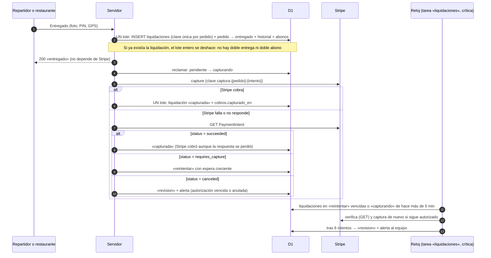
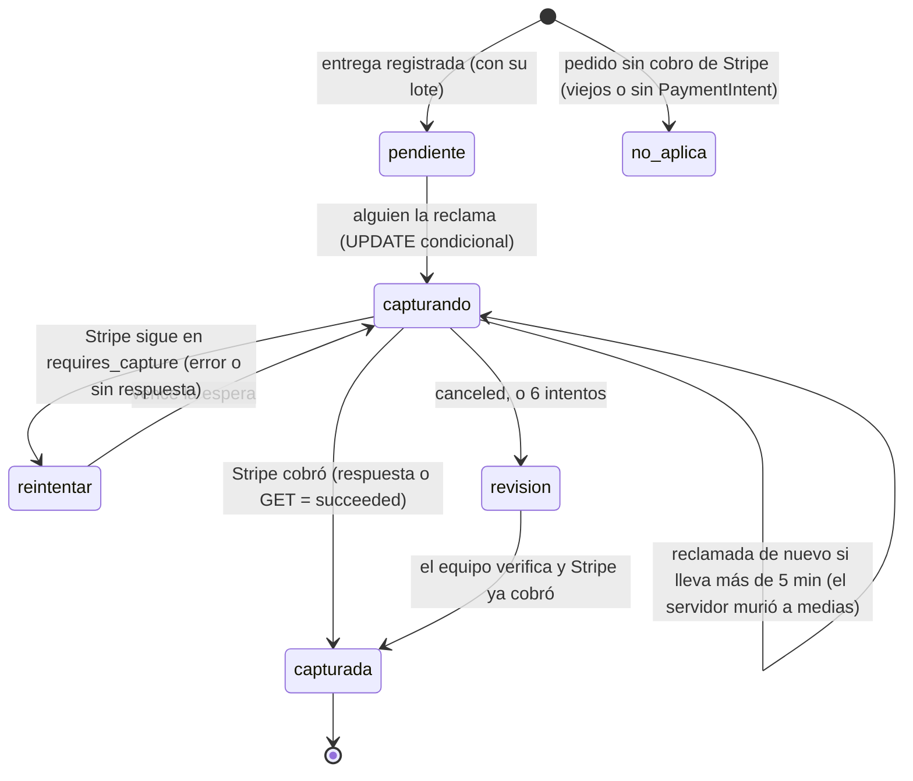

# Entrega 1b · Seguridad del cobro al entregar: investigación y decisión

**Fecha:** 16 de octubre de 2026. **Rama:** `cobro-al-entregar`. Sale de `fase-reloj-seguro` porque agrega una tarea del reloj; no modifica esa rama. El nombre no empieza por `fase-`. **Quién pidió:** Richard. **Stripe:** solo simulado. **Sin dinero real.**

## 1. Referencia estudiada

- **Stripe** (documentación oficial): idempotencia, autorizar y capturar por separado, webhooks.
- **DoorDash** (blog de ingeniería, ya en `EVIDENCIA-DOORDASH-FUENTES-PUBLICAS.md`, fuentes 28, 49 y 52):
  - cómo recuperan un paso que falla a medias;
  - lo que aprendieron del incidente de pagos de 2021.

## 2. Evidencia y sus limitaciones

**Stripe:**

- **[DOC]** Idempotencia (https://docs.stripe.com/api/idempotent_requests):
  - «Retries with the same key return the saved response, **including `500` errors**».
  - Las claves se pueden borrar «after they're at least 24 hours old».
  - Repetir con parámetros distintos da error.
  - Si la petición «conflicts with another request that's executing concurrently», no se guarda y se puede reintentar.
- **[DOC]** Autorizar y capturar (https://docs.stripe.com/payments/place-a-hold-on-a-payment-method):
  - autorizado, el PaymentIntent queda en `requires_capture`;
  - si la autorización vence sin capturar, «the funds are released and the payment status changes to `canceled`»;
  - en línea dura **7 días** (Visa iniciada por el cliente: 7; iniciada por el comercio: 4 días y 18 horas);
  - `amount_to_capture` permite capturar menos;
  - «**you can only perform one capture** on an authorized payment for most payments».
- **[DOC]** Webhooks (https://docs.stripe.com/webhooks):
  - en producción Stripe reintenta «for up to three days with an exponential back off»; en pruebas, tres veces en unas horas;
  - no garantiza el orden;
  - pide deduplicar por el id del evento.

**DoorDash:**

- **[Ei]** Si un paso falla, un workflow (Cadence) lo reintenta. La lección publicada: «no toda nuestra lógica era idempotente», y la solución fue volverla idempotente.
- **[Ei]** El incidente de 2021: reintentos agresivos contra pagos tumbaron otros servicios en cadena. Aprendieron a reintentar con espera creciente y a no bloquear al Dasher por un fallo de pagos (circuit breaker).

**Límites:**

- **[NV]** Cómo registra DoorDash por dentro la captura frente a la entrega.
- **[REA]** No aplica: es lógica de nuestro servidor.

## 3. Lo que hace Tumbite hoy (rama del reloj seguro)

`rutas/operacion.ts`, entrega del repartidor (`await capturarCobro`, línea 1596) y recogida en el local (línea 1998):

1. Validaciones (estado, GPS, foto, PIN).
2. `capturarCobro`:
   - si `cobros.capturado_en` está vacío, `POST /payment_intents/:id/capture` con la clave `captura-{pedido}`;
   - después, `UPDATE cobros SET capturado_en`.
3. Un lote: pedido → «entregado» (`WHERE id = ?`, sin estado), historial y movimientos (`INSERT OR IGNORE`, con el índice único `movimientos_unico` por usuario, pedido y concepto).

### Fallos reproducidos (pruebas en rojo, `cobroAlEntregar.test.ts`)

| Escenario                                                   | Qué pasa hoy                                                                                                                                                                                                                                                                |
| ----------------------------------------------------------- | --------------------------------------------------------------------------------------------------------------------------------------------------------------------------------------------------------------------------------------------------------------------------- |
| **A1.** Stripe cobra y falla la escritura de `capturado_en` | El repartidor recibe un error. El pedido sigue «en camino», sin movimientos. Si reintenta, la misma clave devuelve la respuesta guardada y el pedido se termina. **Si no reintenta, el dinero queda cobrado y el pedido sin entregar para siempre: nada lo recupera solo.** |
| **A2.** Stripe cobra y falla el lote de la entrega          | Igual que A1, pero ya con `capturado_en` puesto.                                                                                                                                                                                                                            |
| **B.** Stripe falla (un 500) al capturar                    | Hoy el pedido no se entrega y el repartidor no puede terminar aunque la comida ya esté en la puerta. Si reintenta con la misma clave, **Stripe devuelve el mismo 500 guardado durante 24 horas**: no puede entregar nunca.                                                  |
| **C.** Captura sin confirmar y retiro                       | Los abonos del pedido entran al saldo y se pueden retirar aunque el cobro no se haya confirmado.                                                                                                                                                                            |

## 4. Diagrama de la solución

## 5. Decisión de implementación

| Requisito de Richard                        | Cómo                                                                                                                                                                                                                                                                                                    |
| ------------------------------------------- | ------------------------------------------------------------------------------------------------------------------------------------------------------------------------------------------------------------------------------------------------------------------------------------------------------- |
| Idempotencia persistente                    | Tabla nueva `liquidaciones` (`pedido_id` es la clave primaria) insertada **dentro del mismo lote** que la entrega: una segunda entrega del mismo pedido hace fallar su lote entero. Los abonos ya tienen el índice único `movimientos_unico`                                                            |
| Estados claros de captura                   | `pendiente`, `capturando`, `capturada`, `reintentar`, `revision`, `no_aplica`                                                                                                                                                                                                                           |
| Reintentos seguros                          | Antes de reintentar se **pregunta a Stripe** (GET). Solo si sigue `requires_capture` se captura con la clave `captura-{pedido}-{intento}`. Nunca se reusa una clave con un 500 guardado. Espera creciente: 1, 5, 15, 60 y 240 minutos                                                                   |
| Conciliación                                | La conciliación diaria ya compara lo capturado con lo entregado (regla 3) y sigue igual. Los abonos se anotan **con la entrega**, así las reglas 1 y 2 cuadran el mismo día. Nueva pieza de salud `cobros`: `error` si hay liquidaciones en `revision`, o pendientes o en reintento hace más de 2 horas |
| Alertas                                     | Correo al equipo al pasar a `revision`. La salud se pone en rojo                                                                                                                                                                                                                                        |
| Protección contra doble cobro               | Stripe permite una sola captura por pago, se verifica con GET antes de cada reintento, y el reclamo `UPDATE … WHERE estado IN (…)` evita dos intentos a la vez                                                                                                                                          |
| Protección contra doble abono               | La clave primaria de `liquidaciones` en el lote de la entrega y el índice único de movimientos                                                                                                                                                                                                          |
| Abono antes del cobro (escenario C)         | **El retiro solo cuenta lo cobrado:** el saldo retirable excluye los movimientos de pedidos con la liquidación en `pendiente`, `capturando`, `reintentar` o `revision`. Se ve en la billetera; no se puede retirar hasta capturar                                                                       |
| El repartidor no queda bloqueado por Stripe | La entrega responde 200 en cuanto el lote se guarda. El cobro se termina después, solo                                                                                                                                                                                                                  |
| Aviso de Stripe                             | `payment_intent.succeeded` también marca la liquidación como `capturada` (cubre la respuesta perdida)                                                                                                                                                                                                   |

**Compatibilidad:**

- **Entrega 1 (transiciones):** el cambio a «entregado» ahora lleva `WHERE estado = 'en_camino'` (o `'listo'` en la recogida), que la tabla permite.
- **Fase 0:** los retiros siguen apagados; solo se endurece el saldo retirable.
- **Cinco fallos:** la propina posterior y los avisos no se tocan.
- **Reloj seguro:** una tarea crítica nueva, `liquidaciones`.
- **Producción:** los pedidos ya entregados no tienen liquidación y no se tocan; la tabla es nueva.
