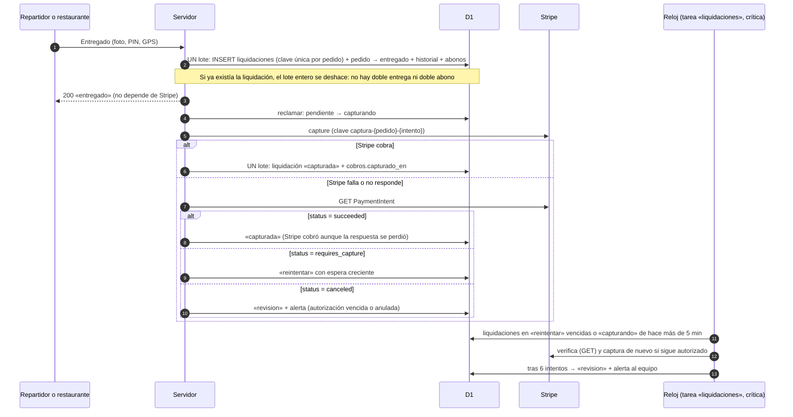
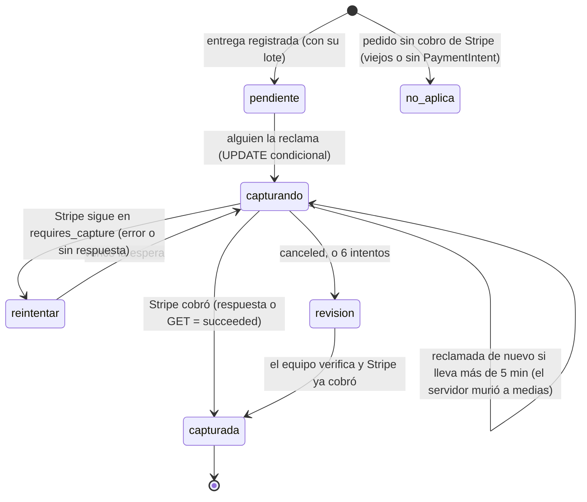

# Entrega 1b · Seguridad del cobro al entregar: investigación y decisión

**Fecha:** 16 de octubre de 2026. **Rama:** `cobro-al-entregar`. Sale de `fase-reloj-seguro` porque agrega una tarea del reloj; no modifica esa rama. El nombre no empieza por `fase-`. **Quién pidió:** Richard. **Stripe:** solo simulado. **Sin dinero real.**

## 1. Referencia estudiada

- **Stripe** (documentación oficial): idempotencia, autorizar y capturar por separado, webhooks.
- **DoorDash** (blog de ingeniería, ya en `EVIDENCIA-DOORDASH-FUENTES-PUBLICAS.md`, fuentes 28, 49 y 52):
  - cómo recuperan un paso que falla a medias;
  - lo que aprendieron del incidente de pagos de 2021.

## 2. Evidencia y sus limitaciones

**Stripe:**

- **[DOC]** Idempotencia (https://docs.stripe.com/api/idempotent_requests):
  - «Retries with the same key return the saved response, **including `500` errors**».
  - Las claves se pueden borrar «after they're at least 24 hours old».
  - Repetir con parámetros distintos da error.
  - Si la petición «conflicts with another request that's executing concurrently», no se guarda y se puede reintentar.
- **[DOC]** Autorizar y capturar (https://docs.stripe.com/payments/place-a-hold-on-a-payment-method):
  - autorizado, el PaymentIntent queda en `requires_capture`;
  - si la autorización vence sin capturar, «the funds are released and the payment status changes to `canceled`»;
  - en línea dura **7 días** (Visa iniciada por el cliente: 7; iniciada por el comercio: 4 días y 18 horas);
  - `amount_to_capture` permite capturar menos;
  - «**you can only perform one capture** on an authorized payment for most payments».
- **[DOC]** Webhooks (https://docs.stripe.com/webhooks):
  - en producción Stripe reintenta «for up to three days with an exponential back off»; en pruebas, tres veces en unas horas;
  - no garantiza el orden;
  - pide deduplicar por el id del evento.

**DoorDash:**

- **[Ei]** Si un paso falla, un workflow (Cadence) lo reintenta. La lección publicada: «no toda nuestra lógica era idempotente», y la solución fue volverla idempotente.
- **[Ei]** El incidente de 2021: reintentos agresivos contra pagos tumbaron otros servicios en cadena. Aprendieron a reintentar con espera creciente y a no bloquear al Dasher por un fallo de pagos (circuit breaker).

**Límites:**

- **[NV]** Cómo registra DoorDash por dentro la captura frente a la entrega.
- **[REA]** No aplica: es lógica de nuestro servidor.

## 3. Lo que hace Tumbite hoy (rama del reloj seguro)

`rutas/operacion.ts`, entrega del repartidor (`await capturarCobro`, línea 1596) y recogida en el local (línea 1998):

1. Validaciones (estado, GPS, foto, PIN).
2. `capturarCobro`:
   - si `cobros.capturado_en` está vacío, `POST /payment_intents/:id/capture` con la clave `captura-{pedido}`;
   - después, `UPDATE cobros SET capturado_en`.
3. Un lote: pedido → «entregado» (`WHERE id = ?`, sin estado), historial y movimientos (`INSERT OR IGNORE`, con el índice único `movimientos_unico` por usuario, pedido y concepto).

### Fallos reproducidos (pruebas en rojo, `cobroAlEntregar.test.ts`)

| Escenario                                                   | Qué pasa hoy                                                                                                                                                                                                                                                                |
| ----------------------------------------------------------- | --------------------------------------------------------------------------------------------------------------------------------------------------------------------------------------------------------------------------------------------------------------------------- |
| **A1.** Stripe cobra y falla la escritura de `capturado_en` | El repartidor recibe un error. El pedido sigue «en camino», sin movimientos. Si reintenta, la misma clave devuelve la respuesta guardada y el pedido se termina. **Si no reintenta, el dinero queda cobrado y el pedido sin entregar para siempre: nada lo recupera solo.** |
| **A2.** Stripe cobra y falla el lote de la entrega          | Igual que A1, pero ya con `capturado_en` puesto.                                                                                                                                                                                                                            |
| **B.** Stripe falla (un 500) al capturar                    | Hoy el pedido no se entrega y el repartidor no puede terminar aunque la comida ya esté en la puerta. Si reintenta con la misma clave, **Stripe devuelve el mismo 500 guardado durante 24 horas**: no puede entregar nunca.                                                  |
| **C.** Captura sin confirmar y retiro                       | Los abonos del pedido entran al saldo y se pueden retirar aunque el cobro no se haya confirmado.                                                                                                                                                                            |

## 4. Diagrama de la solución

## 5. Decisión de implementación

| Requisito de Richard                        | Cómo                                                                                                                                                                                                                                                                                                    |
| ------------------------------------------- | ------------------------------------------------------------------------------------------------------------------------------------------------------------------------------------------------------------------------------------------------------------------------------------------------------- |
| Idempotencia persistente                    | Tabla nueva `liquidaciones` (`pedido_id` es la clave primaria) insertada **dentro del mismo lote** que la entrega: una segunda entrega del mismo pedido hace fallar su lote entero. Los abonos ya tienen el índice único `movimientos_unico`                                                            |
| Estados claros de captura                   | `pendiente`, `capturando`, `capturada`, `reintentar`, `revision`, `no_aplica`                                                                                                                                                                                                                           |
| Reintentos seguros                          | Antes de reintentar se **pregunta a Stripe** (GET). Solo si sigue `requires_capture` se captura con la clave `captura-{pedido}-{intento}`. Nunca se reusa una clave con un 500 guardado. Espera creciente: 1, 5, 15, 60 y 240 minutos                                                                   |
| Conciliación                                | La conciliación diaria ya compara lo capturado con lo entregado (regla 3) y sigue igual. Los abonos se anotan **con la entrega**, así las reglas 1 y 2 cuadran el mismo día. Nueva pieza de salud `cobros`: `error` si hay liquidaciones en `revision`, o pendientes o en reintento hace más de 2 horas |
| Alertas                                     | Correo al equipo al pasar a `revision`. La salud se pone en rojo                                                                                                                                                                                                                                        |
| Protección contra doble cobro               | Stripe permite una sola captura por pago, se verifica con GET antes de cada reintento, y el reclamo `UPDATE … WHERE estado IN (…)` evita dos intentos a la vez                                                                                                                                          |
| Protección contra doble abono               | La clave primaria de `liquidaciones` en el lote de la entrega y el índice único de movimientos                                                                                                                                                                                                          |
| Abono antes del cobro (escenario C)         | **El retiro solo cuenta lo cobrado:** el saldo retirable excluye los movimientos de pedidos con la liquidación en `pendiente`, `capturando`, `reintentar` o `revision`. Se ve en la billetera; no se puede retirar hasta capturar                                                                       |
| El repartidor no queda bloqueado por Stripe | La entrega responde 200 en cuanto el lote se guarda. El cobro se termina después, solo                                                                                                                                                                                                                  |
| Aviso de Stripe                             | `payment_intent.succeeded` también marca la liquidación como `capturada` (cubre la respuesta perdida)                                                                                                                                                                                                   |

**Compatibilidad:**

- **Entrega 1 (transiciones):** el cambio a «entregado» ahora lleva `WHERE estado = 'en_camino'` (o `'listo'` en la recogida), que la tabla permite.
- **Fase 0:** los retiros siguen apagados; solo se endurece el saldo retirable.
- **Cinco fallos:** la propina posterior y los avisos no se tocan.
- **Reloj seguro:** una tarea crítica nueva, `liquidaciones`.
- **Producción:** los pedidos ya entregados no tienen liquidación y no se tocan; la tabla es nueva.

## 6. Resultados (16 oct 2026)

### Fallos reproducidos contra el código actual (las 12 pruebas en rojo antes de implementar)

- **A2, el más grave: si falla el registro de la entrega, Stripe ya cobró.** La prueba vio el cobro hecho (2.398 centavos) con el pedido todavía «en camino» y sin abonos. Hoy se cobra antes de registrar.
- **A1:** Stripe cobra y falla la escritura del cobro. El repartidor recibe un error 500 y el pedido no se entrega.
- **B1:** un 500 de Stripe bloquea la entrega: el repartidor no puede terminarla aunque la comida esté en la puerta. Además, reintentar con la misma clave devolvería el mismo 500 durante 24 horas.
- **C:** lo abonado se podía retirar sin cobro confirmado.

### Solución implementada (rama `cobro-al-entregar`)

| Pieza                                                                                               | Dónde                                                               |
| --------------------------------------------------------------------------------------------------- | ------------------------------------------------------------------- |
| Tabla `liquidaciones` (nueva)                                                                       | `schema.sql`, junto a `cobros`                                      |
| Registrar primero, en un lote: liquidación + pedido → entregado (con `estado` en el WHERE) + abonos | `rutas/operacion.ts`, entrega del repartidor y recogida en el local |
| Entrega repetida → 409, sin efectos (la clave de la liquidación deshace el lote)                    | `esEntregaRepetida`                                                 |
| Captura con reclamo, GET y una clave por intento; espera creciente; 6 intentos → revisión + correo  | `liquidaciones.ts` (`liquidar`)                                     |
| Tarea crítica del reloj `liquidaciones`                                                             | `TAREAS_RELOJ`                                                      |
| El aviso `payment_intent.succeeded` cierra la liquidación                                           | `rutas/pedidos.ts` (`liquidarDesdeAviso`)                           |
| Retiro solo de lo cobrado                                                                           | `retiros.ts` (`SOLO_LO_COBRADO`)                                    |
| Salud `cobros`                                                                                      | `app.ts` (`saludCobros`)                                            |
| Se quitó `capturarCobro` (cobraba antes de registrar)                                               | `rutas/operacion.ts`                                                |

### Pruebas

| Prueba                                                                                                                                                                           | Resultado                                                                                                                                                                                                                                                                                                                    |
| -------------------------------------------------------------------------------------------------------------------------------------------------------------------------------- | ---------------------------------------------------------------------------------------------------------------------------------------------------------------------------------------------------------------------------------------------------------------------------------------------------------------------------- |
| `cobroAlEntregar.test.ts` (13): A1, A2, B1 a B5, doble entrega simultánea, dos vueltas del reloj a la vez, retiro (C), aviso de Stripe, tarea crítica, salud                     | ✅ (las 12 primeras, en rojo contra el código anterior)                                                                                                                                                                                                                                                                      |
| Roturas a propósito                                                                                                                                                              | Misma clave en el reintento → 3 fallan. Retiro sin la condición → 1. Sin límite de intentos → 1. Sin reclamo condicional → 1 (tras endurecer la prueba: al principio no lo detectaba, porque Stripe impedía el doble cobro igual). Sin el GET previo → 0: es una defensa doble, porque después de un error se consulta igual |
| Suite del servidor en la rama                                                                                                                                                    | ✅ 349                                                                                                                                                                                                                                                                                                                       |
| `npm run verify` en la rama                                                                                                                                                      | ✅ (ver el commit)                                                                                                                                                                                                                                                                                                           |
| **Compatibilidad:** unión local, sin subir y borrada al terminar, de esta rama + Entrega 1 (`transiciones-pedido`) + los cinco fallos (`fallos-criticos`), sobre el reloj seguro | ✅ verificación completa con 603 pruebas, 0 vulnerabilidades. Destapó un ajuste en la prueba de la Entrega 1: ahora la entrega lleva el estado en el WHERE. Se corrigió en esa rama (`feb54fee`)                                                                                                                             |

### Riesgos que quedan

1. **Abono anotado antes del cobro.** Los abonos se anotan con la entrega, para que la conciliación del día cuadre. Si el cobro termina en `revision`, por una autorización vencida o un banco que rechaza, el restaurante y el repartidor tienen un saldo que **no se puede retirar** (C), pero sigue anotado. Decidir qué se hace con ese saldo es de negocio (👤): ¿lo absorbe Tumbite, se descuenta, se cobra de nuevo con la tarjeta guardada?
2. **Fuera de la ventana de 7 días** Stripe ya no deja capturar: `revision` y alerta. Con entregas en la hora, solo pasaría con Stripe caído varios días.
3. **El reloj de producción es impuntual** (GitHub, cada 2 a 5 horas) hasta encender el de Cloudflare. Un cobro que falla en el momento se reintenta tarde. El aviso de Stripe y la salud lo cubren en parte.
4. **La billetera muestra el saldo total**, no el retirable. Falta una línea en la pantalla: «X pendiente de cobro».
5. **La captura de Apple Pay y Google Pay** con captura manual sigue sin probarse con dinero real (ver `VERIFICAR-PAGOS.md`).
6. **La conciliación** sigue con sus tres reglas. Una liquidación en `revision` hace que la regla 3 no cuadre ese día: es lo correcto, porque es dinero sin cobrar, y se ve.

### Requisitos para validar en el sitio de pruebas

Después de publicar el reloj seguro, y con autorización:

- llevar esta rama, junto con la Entrega 1 y los fallos, a una integración del sitio de pruebas;
- correr el recorrido completo en los dos idiomas: la entrega ya pasa por la liquidación;
- correr S2 a S12, F3 y el reloj;
- correr una prueba **L1** contra Stripe en modo prueba, que cree un PaymentIntent con captura manual, registre la entrega, capture con la clave por intento, intente capturar otra vez y compruebe que Stripe lo rechaza y la liquidación sigue `capturada` (pendiente de escribir en el diagnóstico).

**Producción:** la tabla `liquidaciones` es nueva y no hace falta ninguna migración. Los pedidos ya entregados no tienen liquidación y no se tocan.

## 7. Prueba L1 contra Stripe en modo prueba y decisión de negocio (16 oct 2026)

### Decisión de Richard: un cobro en revisión

Implementada tal cual (`liquidaciones.ts`, `retiros.ts`, `rutas/dinero.ts`):

- **se conserva el saldo anotado**: no se borra ni se descuenta ningún movimiento;
- **se bloquea su retiro**: `saldoRetirable` y `pedirRetiro` usan `SOLO_LO_COBRADO`;
- **se avisa al administrador UNA vez**: `alertado_en` con un `UPDATE` condicional, aunque el reloj pase muchas veces;
- **no se intenta cobrar otra tarjeta** ni se vuelve a pedir nada a Stripe: el reloj no toca una liquidación en revisión;
- **la resolución final es administrativa**: `GET /datos/admin/liquidaciones`, solo para administradores, lista las que están en revisión y las atrasadas.

Pruebas:

- «decisión de Richard · en revisión…»: el reloj pasa 3 veces sin peticiones a Stripe ni cambios en los movimientos, y el saldo retirable es 0;
- «el administrador ve las liquidaciones en revisión (y nadie más)»: 403 para un repartidor.

### L1 (`POST /datos/interno/diagnostico/l1`, en `probar-staging.mjs`)

**Barreras:**

1. el secreto del reloj;
2. llaves `sk_test_`;
3. el dominio del sitio de pruebas;
4. en el dominio de producción, las pruebas de diagnóstico ni existen: responden «Not found».

**Seguridad y repetición:**

- usa pedidos propios `zz-l1-…` con un sufijo distinto en cada corrida;
- no manda correos (ADMIN_CORREOS vacío);
- al terminar anula cualquier autorización de prueba que quede abierta y borra todo lo que creó.

| Caso | Qué comprueba                                                                                                                                                                                 |
| ---- | --------------------------------------------------------------------------------------------------------------------------------------------------------------------------------------------- |
| A    | Captura manual correcta: autorizado (`requires_capture`) → la liquidación nace `pendiente` en el lote de la entrega → `liquidar` captura → `capturada`, y el cobro queda anotado con el monto |
| B    | Intento duplicado: `liquidar` otra vez no hace nada; una captura con otra clave la rechaza Stripe y el monto no cambia                                                                        |
| C    | Idempotencia: la misma clave devuelve la respuesta guardada sin cobrar de nuevo; registrar la misma entrega otra vez se rechaza en la base                                                    |
| D    | Recuperación tras «servidor caído» después de cobrar: se cierra preguntando a Stripe, sin segundo cobro                                                                                       |
| E    | Recuperación tras un **error real de Stripe guardado bajo la clave** (capturar más de lo autorizado): el reintento usa una clave nueva y cobra                                                |
| F    | Autorización anulada: `revision`, marcada como avisada, sin cobro                                                                                                                             |
| G    | El saldo retirable excluye lo de la entrega en revisión                                                                                                                                       |

**Ejecutada hoy en la computadora** (`l1Diagnostico.test.ts`), contra un Stripe simulado con varios pagos:

- 13 casos en verde;
- la limpieza no deja nada;
- no queda ninguna autorización abierta;
- las barreras se niegan con `sk_live_` y en el dominio de producción.

**Comprobada en rojo:**

- sin la regla «solo lo cobrado» falla G;
- con la clave de siempre en el reintento falla E. Al principio no fallaba: el caso E no tenía un error guardado bajo la clave. Se agregó el error real de Stripe para que lo detecte.

**Falta:** correrla contra Stripe en modo prueba en el sitio de pruebas. Eso requiere la integración autorizada.
