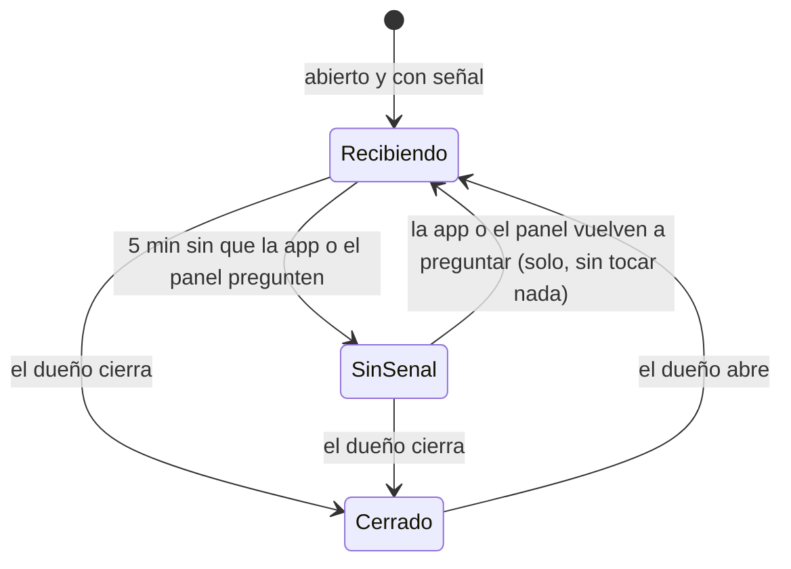

# Pausa automática del restaurante sin señal: investigación y decisión

**Fecha:** 16 de octubre de 2026. **Rama:** `pausa-sin-senal` (sale de `fase-reloj-seguro` porque usa su lista de tareas del reloj; no modifica esa rama; el nombre no empieza por `fase-`, así que no se publica sola en el sitio de pruebas). **Quién pidió:** Richard, Entrega 3 del plan v2, autorizada a continuar tras cerrar la Entrega 1. Separada de la Entrega 1: no se fusionan entre sí.

## 1. Referencia estudiada

- **DoorDash Merchant (tablet):** «Tablet Heartbeat».
- **Uber Eats Manager:** cómo trata una tableta sin conexión.

## 2. Evidencia y sus limitaciones

- **[DOC]** DoorDash: si la tablet no puede recibir pedidos durante **5 minutos o más**, la tienda se **pausa sola**. Para reabrir: tablet → Change status, o en el portal → Store Availability. Fuente 16 de `EVIDENCIA-DOORDASH-FUENTES-PUBLICAS.md` (centro de ayuda de comercios, «Temporary deactivation»).
- **[DOC]** DoorDash también pausa por calidad: dos cancelaciones evitables en un día (misma fuente). **Fuera de esta entrega.**
- **[NV]** Uber Eats Manager: no encontré en fuentes públicas leídas hoy una regla con cifra. No se usa como referencia.
- **[INF]** El motivo de negocio: un pedido que llega a una tienda que no está mirando se vence, el Manager lo cancela a los 6 minutos y el cliente pierde 6 minutos y la confianza. Es mejor no dejar pedir.
- **[REA]** No aplica: regla del servidor, sin artefacto de terceros.

## 3. Diagrama técnico

```mermaid
sequenceDiagram
    autonumber
    participant T as App o panel del restaurante
    participant S as Servidor
    participant C as App del cliente
    participant R as Reloj
    loop cada 5 s mientras está abierta
        T->>S: GET /datos/restaurante/pedidos
        S->>S: senal_en = ahora (como mucho una escritura cada 30 s)
    end
    C->>S: lista de restaurantes / crear pedido
    S->>S: abiertoAhora = abierto Y horario Y señal ≤ 5 min
    S-->>C: «sin señal» → no aparece abierto; crear pedido → 409 con motivo
    R->>S: tarea pausa_sin_senal (no crítica)
    S->>S: abierto + sin señal + sin aviso → aviso al dueño y al equipo, marca pausa_aviso_en
    S->>S: volvió la señal → borra la marca y avisa «ya recibes pedidos»
```



## 4. Comparación con Tumbite

| Hallazgo                                        | Tumbite hoy (rama del reloj seguro)                                                                                       | Veredicto       |
| ----------------------------------------------- | ------------------------------------------------------------------------------------------------------------------------- | --------------- |
| Saber si la tablet está escuchando              | La app y el panel preguntan cada 5 s (`GET /datos/restaurante/pedidos`, `operacion.ts:386`), pero el servidor no lo anota | ❌              |
| Pausar si no escucha                            | Nada: la tienda sigue «abierta» aunque nadie mire                                                                         | ❌              |
| «Abierto ahora» calculado en un solo lugar      | `aRestaurante` (`catalogo.ts:39`) y la comprobación al crear pedido (`pedidos.ts:297-305`)                                | ✅ reutilizable |
| Avisos al dueño                                 | `notificar` + `AVISOS` y `enviarCorreo`                                                                                   | ✅ reutilizable |
| Tarea del reloj con su propio manejo de errores | `TAREAS_RELOJ` (reloj seguro)                                                                                             | ✅ reutilizable |

## 5. Decisión de implementación

- **Columnas nuevas** por COLUMNAS (nunca un `ALTER` suelto en `schema.sql`), las dos con `NULL` por defecto:
  - `restaurantes.senal_en`: la última vez que la app o el panel del restaurante preguntó por sus pedidos;
  - `restaurantes.pausa_aviso_en`: cuándo se avisó de la pausa.
- **Anotar la señal** en `GET /datos/restaurante/pedidos`, con una sola escritura cada 30 segundos como mucho, para no escribir en cada consulta.
- **«Abierto ahora» sin depender del reloj:**
  - se calcula como `abierto` + horario + **señal de hace 5 minutos o menos**, al leer;
  - así funciona aunque el reloj de producción sea el impuntual de GitHub;
  - la regla vive en `packages/compartido` (`conSenal`) y la usan el catálogo y la creación del pedido.
- **Un restaurante sin `senal_en` todavía (NULL) cuenta como con señal.** Es la compatibilidad con producción: al publicar, ninguno tiene la marca y no se puede cerrar a todos de golpe. En cuanto la app o el panel preguntan una vez, la regla aplica.
- **Al crear un pedido sin señal:** 409 con un mensaje claro en los dos idiomas: «El restaurante no está recibiendo pedidos en este momento».
- **A diferencia de DoorDash, la tienda vuelve sola** en cuanto la tableta vuelve a preguntar. No se toca `abierto`: el dueño no tiene que reabrir a mano. **[INF]** Es más simple y no castiga un corte de internet.
- **Tarea del reloj `pausa_sin_senal`, no crítica:**
  - si está abierto, sin señal y todavía sin aviso: aviso al celular y correo al dueño, y correo al equipo; marca `pausa_aviso_en`;
  - si volvió la señal: borra la marca y avisa «ya recibes pedidos».
  - Si la tarea falla, la pausa ya funciona igual, porque se calcula al leer.
- **Interruptor:** `config.pausa_sin_senal_minutos`, 5 por defecto; con 0 se apaga.
- **Guía pública en Docs,** en los dos idiomas, para el restaurante: «¿Por qué mi tienda aparece sin recibir pedidos?».

**Qué no se toca:**

- el dinero;
- las transiciones (Entrega 1, en otra rama);
- la exclusividad;
- el resto de tareas del reloj.

## 6. Pruebas de aceptación

1. `conSenal`: sin marca → sí; 4 minutos → sí; 6 minutos → no; interruptor en 0 → siempre sí.
2. El catálogo muestra `abiertoAhora: false` a un restaurante abierto con la señal vieja, y `true` cuando la app vuelve a preguntar.
3. Crear un pedido en un restaurante sin señal → 409 con el motivo; con señal → 200.
4. Preguntar cada 5 s no escribe más de una vez cada 30 s.
5. Tarea del reloj:
   - avisa una sola vez por pausa;
   - avisa la vuelta;
   - no avisa a restaurantes cerrados ni sin marca;
   - si falla, las demás tareas corren (reloj seguro).
6. Registros viejos (`senal_en` NULL) siguen abiertos.
7. En el sitio de pruebas, después de publicar el reloj y con autorización, el recorrido completo en los dos idiomas.

Cada prueba se comprueba primero en rojo.

## 7. Resultados (16 oct 2026)

### Qué se corrigió

- Hoy una tienda abierta sigue recibiendo pedidos aunque nadie mire su app ni su panel. El Manager los cancela a los 6 minutos y el cliente espera en vano.
- Ahora el servidor anota la señal y la tienda sin señal no aparece abierta ni acepta pedidos.
- La tienda vuelve sola en cuanto la app o el panel vuelven a preguntar.

### Pruebas

| Prueba                                                                                                                                                                                                                                                        | Resultado                          |
| ------------------------------------------------------------------------------------------------------------------------------------------------------------------------------------------------------------------------------------------------------------- | ---------------------------------- |
| `senal.test.ts` (5): sin marca, 4 y 6 minutos, límite exacto, interruptor en 0, formato ISO                                                                                                                                                                   | ✅                                 |
| `pausaSinSenal.test.ts` (6): anotar la señal con una escritura cada 30 s, cerrada en la lista y 409 al pedir, vuelta sola, compatibilidad con NULL, interruptor, reloj (un aviso por pausa, aviso de vuelta, cerrada no cuenta), tarea no crítica en la lista | ✅                                 |
| En rojo con la regla siempre «con señal»                                                                                                                                                                                                                      | 3 fallan                           |
| En rojo sin anotar la señal                                                                                                                                                                                                                                   | 2 fallan                           |
| Servidor y parte compartida                                                                                                                                                                                                                                   | ✅ 456                             |
| `npm run verify` completo                                                                                                                                                                                                                                     | ✅ 564 pruebas, 0 vulnerabilidades |

### Compatibilidad con producción

- Las columnas son nuevas y nacen vacías.
- Vacío cuenta como «con señal»: los 5 restaurantes aprobados de hoy siguen abiertos al publicar.
- La regla aplica a cada uno desde que su app o su panel preguntan por primera vez.

### Migraciones necesarias

**Ninguna a mano.** Las dos columnas entran por COLUMNAS al arrancar. La configuración usa 5 minutos si `pausa_sin_senal_minutos` no existe.

**Vuelta atrás:** poner `pausa_sin_senal_minutos = 0` en `config`, sin publicar nada.

### Riesgos que quedan

1. **La app del restaurante en segundo plano.** En el celular, cuando la app no está en pantalla, el sistema detiene sus consultas, y a los 5 minutos la tienda se pausa. La tableta de DoorDash funciona igual. Hay que decirlo al dar de alta a cada restaurante: la guía de Docs ya lo explica.
   - **[INF]** Si al lanzar muchos restaurantes usan el celular en segundo plano, la salida rápida es subir los minutos o poner 0. La de fondo es la ubicación y las consultas en segundo plano de la compilación propia de la app.
2. **El cliente recuerda la lista 60 segundos** (Hito 1). Una tienda recién pausada puede verse abierta hasta un minuto; el servidor igual rechaza el pedido con el motivo claro.
3. **Los avisos dependen del reloj.** En producción, con GitHub, llegan con horas de atraso hasta que se encienda el reloj de Cloudflare. La pausa misma no depende del reloj.
4. **Un panel abierto en otra pestaña cuenta como señal.** Si el dueño deja el panel abierto en una computadora sin mirar, la tienda sigue abierta. Es lo mismo que pasa hoy.

### Qué falta para validarlo en staging

Después de publicar el reloj seguro, y con autorización:

- llevar esta rama a una integración del sitio de pruebas;
- correr el recorrido completo en los dos idiomas, S2 a S12, F3 y el reloj;
- comprobar en D1 real que una tienda con la señal vieja no recibe pedidos y que vuelve al abrir el panel.
