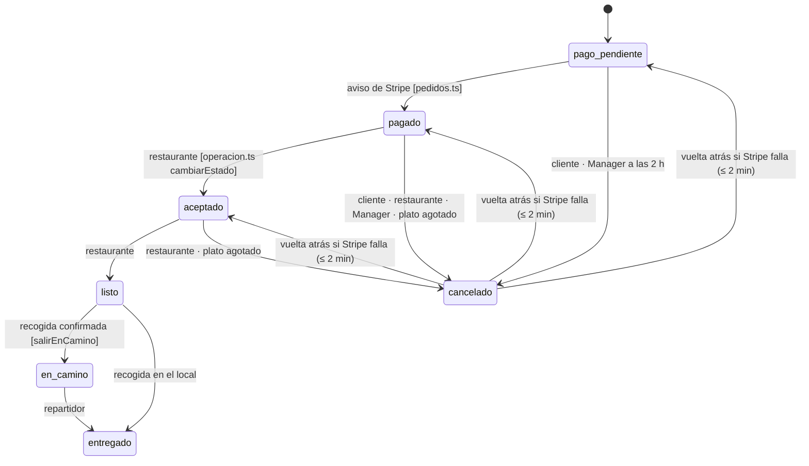

# Transiciones del pedido forzadas por la base: investigación y decisión

**Fecha:** 16 de octubre de 2026. **Rama:** `transiciones-pedido` (sale de `main`; el nombre no empieza por `fase-` para no publicarse sola en el sitio de pruebas mientras ese sitio está reservado para el reloj seguro). **Quién pidió:** Richard («sí, sigue»), Entrega 1 del plan v2.

## 1. Referencia estudiada

- **DoorDash Drive** (API pública para socios): estados de la entrega y sus reglas. Es la única referencia con una lista oficial de estados.
- **Uber Direct** (API pública): estados de la entrega, como contraste.
- **Nuestro propio patrón:** `transiciones_viaje` + `viajes_transicion_valida` (Fase 3), que ya fuerza las transiciones de los viajes en la base.

## 2. Evidencia y sus limitaciones

- **[DOC]** DoorDash publica 9 estados: `created`, `confirmed`, `enroute_to_pickup`, `arrived_at_pickup`, `picked_up`, `enroute_to_dropoff`, `arrived_at_dropoff`, `delivered`, `cancelled`. Una entrega puede **volver a `created`** si el Dasher se desasigna antes de recoger (fuente 1 de `EVIDENCIA-DOORDASH-FUENTES-PUBLICAS.md`).
- **[DOC]** La API responde 409 «Update is not allowed» o «Cancel is not allowed» cuando un cambio no corresponde al estado (fuente 5): **el sistema rechaza transiciones indebidas**, no solo las evita en la interfaz.
- **[DOC]** Confirmar un pedido dos veces da 400 (fuente 6).
- **[INF]** DoorDash no publica la tabla de transiciones; la regla «rechazar lo que no corresponde» sí está publicada.
- **[NV]** Cómo lo implementan por dentro (base, servicio o workflow).
- **[REA]** No aplica: es una regla del servidor, sin artefacto de terceros que analizar.

## 3. Diagrama técnico

Las transiciones permitidas, tomadas una por una del código actual (cada `UPDATE pedidos SET estado`):

Prohibido todo lo demás. Por ejemplo:

- `entregado → *`;
- `cancelado → entregado`;
- `pago_pendiente → aceptado` (aceptar sin pago);
- `pagado → en_camino` (salir sin aceptar);
- `en_camino → cancelado` (cancelar con la comida en la calle);
- revivir un pedido cancelado hace más de 2 minutos.

## 4. Comparación con Tumbite

| Hallazgo                         | Tumbite hoy                                                                                                                                   | Veredicto       |
| -------------------------------- | --------------------------------------------------------------------------------------------------------------------------------------------- | --------------- |
| Estados del pedido definidos     | 7 estados con `CHECK` en `schema.sql:134`                                                                                                     | ✅              |
| Rechazar una transición indebida | Cada `UPDATE` lleva `WHERE estado = …`; dos `UPDATE … 'entregado'` (`operacion.ts:1602, 2003`) no lo llevan y confían en una lectura anterior | 🟡              |
| La regla vive en la base         | Solo en el código; una consulta a mano o un error nuevo pasa en silencio                                                                      | ❌              |
| Reversión controlada             | `manager.ts:144` revive el pedido si Stripe falla, sin límite de tiempo                                                                       | 🟡              |
| Mismo patrón ya probado          | `transiciones_viaje` + disparador (Fase 3)                                                                                                    | ✅ reutilizable |

## 5. Decisión de implementación

- Tabla `transiciones_pedido (desde, hacia, reversion)` en `schema.sql`, con las 13 filas del diagrama.
- Disparador `pedidos_transicion_valida` (`BEFORE UPDATE OF estado ON pedidos`) que aborta con `transicion_de_pedido_no_permitida` si la pareja no está en la tabla. Las filas de **reversión** solo valen si el mismo `UPDATE` borra `cancelado_en` y la cancelación tiene **2 minutos o menos**.
- El disparador **no va en `schema.sql`** (C-EXCLUSIVIDAD: la plataforma parte mal los disparadores). Va en una lista nueva `ESQUEMA_PEDIDOS` que `esquema.ts` crea al arrancar, en un solo lote y solo si falta.
- Pieza nueva de la salud: `transiciones`, que vale `ok` si el disparador existe y `error` si no.
- **Sin columna de actor**, a diferencia de los viajes. Agregarla obligaría a tocar cada `UPDATE` y el riesgo no lo justifica hoy. La bitácora ya guarda quién hizo cada cambio.
- **No se toca:** el dinero (Fase 0), la exclusividad (Fase 3), el reloj. Los `INSERT` no pasan por el disparador: pruebas y diagnósticos que crean pedidos en cualquier estado siguen igual.

## 6. Pruebas de aceptación

1. Cada transición permitida pasa (11 normales + 3 reversiones dentro de 2 minutos), como prueba en la base de pruebas.
2. Cada pareja **no** permitida falla con `transicion_de_pedido_no_permitida`. Se prueban las 49 parejas posibles entre los 7 estados.
3. La reversión con más de 2 minutos falla, y la reversión que no borra `cancelado_en` también.
4. 2.000 cambios al azar: la base nunca queda en un estado al que no se pueda llegar por la tabla.
5. Toda la suite del servidor sigue en verde, incluido el recorrido simulado y las Fases 0 y 3.
6. La salud dice `transiciones: ok`, y `error` si se borra el disparador.
7. **En el sitio de pruebas**, después de publicar el reloj seguro: el recorrido completo en los dos idiomas y una prueba nueva `T1` que intenta un salto indebido en D1 real y comprueba que falla.

Cada prueba se comprueba primero en rojo.

## 7. Resultados (16 oct 2026)

### Qué se corrigió

- Hoy la base de producción **acepta cualquier salto**: aceptar sin pagar, cancelar un pedido entregado o revivir uno cancelado hace días. Lo reprodujo la prueba de las 49 parejas: **en rojo** la primera fallaba en `pago_pendiente → aceptado`.
- Con el disparador, solo pasan las 9 transiciones del diagrama y las 3 vueltas atrás recientes del Manager.

### Qué pruebas pasaron

| Prueba                                                                                                                                                                                                                                     | Resultado                                                                                                                                                          |
| ------------------------------------------------------------------------------------------------------------------------------------------------------------------------------------------------------------------------------------------ | ------------------------------------------------------------------------------------------------------------------------------------------------------------------ |
| `transicionesPedido.test.ts` (6): 49 parejas, vueltas atrás, 2.000 cambios al azar, salud, disparador fuera de `schema.sql`                                                                                                                | ✅ (5 en rojo sin el disparador)                                                                                                                                   |
| `transicionesRutas.test.ts` (6): aceptar y rechazar a la vez (5 vueltas), cancelar y aceptar a la vez (5 vueltas), reintentos de aceptar, listo y rechazar, cancelar desde en camino, listo o entregado, lote con dinero, registros viejos | ✅ (2 en rojo sin el disparador; las 4 de simultaneidad, reintentos y compatibilidad ya pasaban por las guardas de cada ruta y quedan como red contra regresiones) |
| Toda la suite del servidor                                                                                                                                                                                                                 | ✅ 324                                                                                                                                                             |
| `npm run verify` completo                                                                                                                                                                                                                  | ✅ 547 pruebas, 0 vulnerabilidades                                                                                                                                 |

**Once pruebas viejas fallaron al poner el disparador.** Las once eran atajos de la propia prueba que ponían un estado a mano (por ejemplo, de pagado a entregado de un salto). Ningún camino del producto hacía esos saltos. Se corrigieron con `llevarA`, que camina los pasos legales. Una de ellas simulaba que el Manager revivía un pedido como «listo», algo que el código real nunca hace: ahora revive a «aceptado», como `manager.ts`.

### Compatibilidad con producción (solo lectura, 16 oct 2026)

- En producción hay 3 pedidos cancelados, 11 entregados y 2 en pago pendiente.
- El disparador solo mira los cambios de estado, no los registros que ya existen.
- Los 2 en pago pendiente siguen pudiendo pasar a pagado o a cancelado (el Manager los cierra a las 2 horas).

### Migraciones necesarias

**Ninguna a mano.** Al publicar:

- `schema.sql` crea la tabla y sus filas (`CREATE TABLE IF NOT EXISTS` + `INSERT OR IGNORE`, igual que `transiciones_viaje`);
- el servidor crea el disparador al arrancar.

Ninguna columna nueva en tablas que ya existen.

**Vuelta atrás:**

- `DROP TRIGGER pedidos_transicion_valida`;
- quitar la lista de `esquemaPedidos.ts`;
- la tabla queda sin uso.

### Riesgos que quedan

1. **Captura antes del cambio de estado.** En la entrega, `capturarCobro` cobra en Stripe y después el lote pasa el pedido a «entregado». Si el disparador rechazara ese cambio, el dinero quedaría capturado sin el pedido entregado. Hoy no puede pasar, porque la ruta exige «en camino» antes y «en camino → entregado» está permitido. Pero el orden «primero cobrar, después cambiar el estado» es anterior a esta entrega. Se anota para la Entrega 1b.
2. **Sin columna de actor.** La base sabe que la transición es legal, no quién la hizo. La bitácora sí lo guarda.
3. **La prueba de propiedades de la Fase 3** (`fase3.test.ts`, acciones al azar) ahora ve rechazados algunos de sus cambios aleatorios ilegales. Sigue en verde porque tolera fallos, pero ejercita menos combinaciones que antes.
4. **La ventana de 2 minutos** de la vuelta atrás. Si Stripe tardara más de 2 minutos en fallar, el pedido quedaría cancelado sin devolución. Hoy la llamada a Stripe tiene su propio tiempo de espera, mucho menor.

### Qué falta para validarlo en staging

Después de publicar el reloj seguro, y con autorización:

- llevar esta rama a una integración del sitio de pruebas;
- correr el recorrido completo en los dos idiomas, S2 a S12, F3 y el reloj;
- correr una prueba `T1` en D1 real que intente un salto indebido y compruebe que falla (pendiente de escribir en el diagnóstico).
