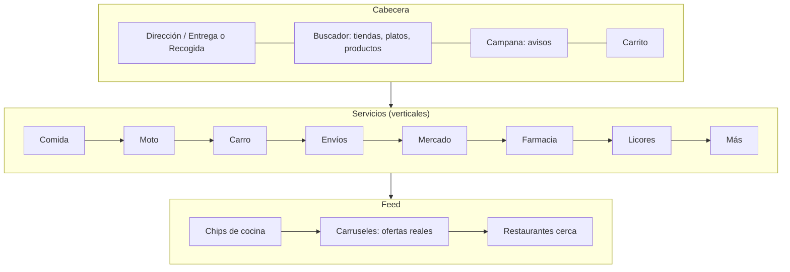
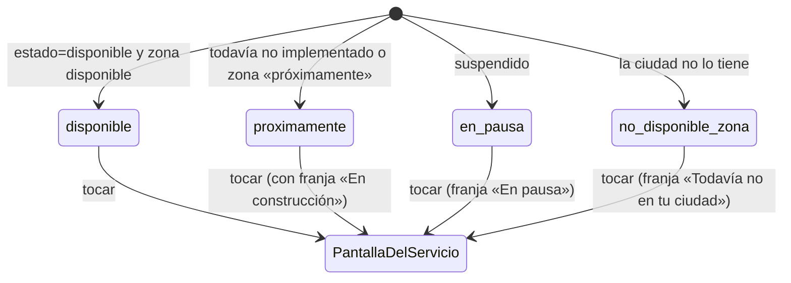
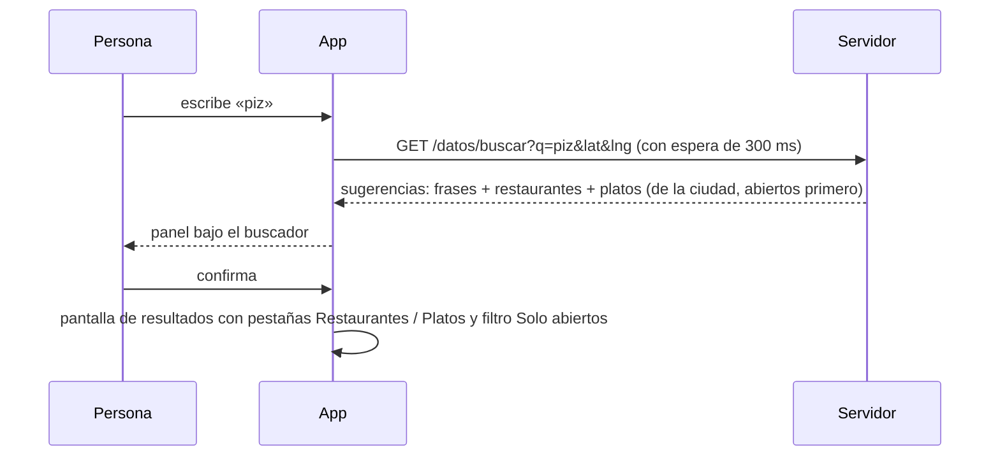

# Inicio del cliente (servicios, buscador y campana): investigación y decisión

**Fecha:** 18 oct 2026 · **Rama:** `inicio-cliente-rea` · **Quién pidió:** Richard, probando la app en el simulador de iPhone: «la campana no funciona, el buscador no funciona, Comida lleva a una pantalla sosa, los demás servicios sacan un cartel; quiero Comida, Moto, Carro, Envíos y después el resto; usa REA».

## 1. Referencia estudiada

| Plataforma                        | Qué parte                                                                                                                                | Cómo                                                                |
| --------------------------------- | ---------------------------------------------------------------------------------------------------------------------------------------- | ------------------------------------------------------------------- |
| DoorDash (web del cliente)        | Portada con dirección, fila de categorías, buscador y sus sugerencias, resultados, campana, verticales (Grocery, Retail, Alcohol…)       | Como visitante, en celular (560 px) y escritorio (1280 px)          |
| Uber Eats (web del cliente)       | Portada, portada con dirección, carril de verticales, chips de cocina, filtros, buscador y sugerencias, resultados, un vertical (Health) | Como visitante, en celular                                          |
| Tumbite (nuestra app del cliente) | Qué carga el inicio y qué piezas ya existen                                                                                              | REA sobre staging (`capture_browser_scenario`) y lectura del código |

Límite legal respetado: nada se descompiló de DoorDash ni de Uber Eats; solo lo que ve cualquier visitante. REA se usó únicamente sobre nuestra app.

## 2. Evidencia y sus limitaciones

Capturas en `docs/capturas/inicio-observacion/` (doordash-01…07, ubereats-01…06). Paquete REA: `evidencia-rea-inicio-2026-10-18.json`.

### DoorDash

- **[OBS]** Portada en celular (captura 01): barra con **lupa, ícono de recogida, campana con punto rojo y carrito**; título «What are you in the mood for?»; **fila horizontal de chips** (Meal Box, Burgers, Deals, Sushi, Fast Food, Pizza, Healthy, Desserts…); aviso «Service fees apply» cerrable; carruseles «Shop the Meal Box collection», «Hot & ready · 40 min · DashMart & more», «Best $12 meals»; un banner de concurso.
- **[OBS]** En escritorio (captura 06) los **verticales van en un carril lateral**: Home, Grocery, Retail, Deals, Reservations, Late Night, Apparel, Alcohol, Gifts, Flowers, Convenience, Electronics, Beauty, Pets, Sports, Gift Cards, Health, CBD/THC, Party, Home Goods, Large Order, Browse All. Arriba: buscador «Search DoorDash», dirección, **Delivery / Pickup**, campana, carrito.
- **[OBS]** Buscador (capturas 02–04): campo «**Search stores, dishes, products**». Mientras se escribe «pizza» aparecen **sugerencias de texto** («pizza», «pizza rolls») y **tiendas** con logo, calificación, distancia, cocinas y promoción («Buy 1, get 1 free»). Al confirmar, página de resultados con **pestañas por vertical** (All, Restaurant, Grocery, Retail, Pets, Alcohol) y **filtros** (Delivery Fees: Under $3, Schedule, Deals, Over 4.5, Fastest, Price, DashPass); cada resultado es **plato + precio** dentro de su tienda, con calificación, distancia, minutos, tarifa, promoción y «#1 Most Liked».
- **[OBS]** Campana (captura 07): abre un panel «**Notifications**» a la derecha. Sin sesión muestra una sola tarjeta: «$0 delivery fee on your first order · Sign up to get this deal or sign in to access your available deals and credits» con botón «Sign up or sign in». Con sesión no se pudo observar.
- **[OBS]** Página pública de Miami (captura 05): «Best Nearby Restaurants Open Now», cada tienda con calificación, reseñas, cocina, «$0 delivery fee», millas, minutos y promoción.
- **[NV]** Qué muestra la campana con sesión (pedidos, promociones); el orden exacto de la fila de verticales en la app nativa.

### Uber Eats

- **[OBS]** Sin dirección (ubereats-01, 02): portada «Order delivery near you» con **un solo campo: «Enter delivery address»**; al escribir, sugerencias de lugares (Bayfront Park, 301 Biscayne Blvd…). Pie con «Cities near me» y países.
- **[OBS]** Con dirección (ubereats-03): cabecera **Delivery / Pickup**, dirección, «Now», buscador «**Search Uber Eats**», carrito; **carril de verticales**: Home, Grocery, Convenience, Alcohol, Health, Retail, Pet, Flowers, Baby, Personal Care, Electronics, Offers; **chips de cocina** (Pizza, Sushi, Soup, Chinese, Wings, Healthy…); **filtros** (Offers, Delivery fee, Under 30 min, Best overall, Rating, Sort); carruseles de promociones; secciones «Under $2 Delivery Fee», «Popular in your area»; tarjeta de tienda con promoción, calificación, cantidad de reseñas, minutos, «Great value», «New».
- **[OBS]** Buscador (ubereats-04, 05): al escribir «pizza», panel con pestañas **All / Restaurants / Grocery / Alcohol**, **dos tiendas** (logo, cocina) y **frases sugeridas** («pizza cubana», «dominos pizza», «kosher pizza», «gluten free pizza») y «Search for "pizza"». Resultados: «532 results for “pizza”», mismos filtros, tarjetas de tienda.
- **[OBS]** Un vertical (Health, ubereats-06): su propia pantalla con título, «Stores near you» (Target, CVS, Walgreens…, con minutos o «Opens at 8:00 AM»), «Save on wellness», «Featured deals» con productos. Un vertical no es un cartel: es una pantalla completa.
- **[NV]** Qué pasa cuando un vertical no tiene tiendas en la zona (en Miami todos tienen).

### Lo que REA pudo y no pudo hacer con DoorDash y Uber Eats

- **Autorización de Richard (18 oct 2026):** pidió usar REA sobre DoorDash, Uber Eats y Rappi para estudiar sus planos, no para copiar código. Queda registrada.
- **[REA]** Se intentó capturar con REA la página pública de resultados de DoorDash (`ev_45a1edc0…`) y la página pública de Miami de Uber Eats (`ev_feffd8c6…`). Las dos respondieron **403 y un reto de Cloudflare** (Turnstile) al navegador controlado: sus webs bloquean la navegación automatizada. No se saltó ningún reto (regla de la metodología y del uso aceptable de esas webs), así que de esas capturas solo queda la evidencia del bloqueo.
- **Qué sí sirve:** la observación como visitante en el navegador normal (capturas 01–07 y 01–06 de arriba) da todo lo que hace falta para los planos: estructura, orden, textos, estados y flujos. Para copiar **cómo funciona** no hace falta mirar su código.
- **Qué no se hace y por qué, en una línea:** descompilar sus apps de tienda (los binarios de iPhone y Android). Lo prohíben sus términos de uso y expondría a Windoce; además REA solo autoriza software propio o con permiso del dueño. Rappi se estudia igual, como visitante, cuando toque una función que ellos hagan distinto.

### Tumbite hoy

- **[REA]** Al abrir `https://staging.tumbite.com/app/` sin sesión la app pide solo el paquete JS, la hoja de Leaflet y el contador de Cloudflare; **ninguna llamada a `/datos`** hasta entrar (evidencia `ev_8d9515…`).
- **[OBS]** (código) `apps/cliente/src/Inicio.tsx`: campana y cupón llevan a «Mi cuenta»; el buscador **solo filtra por nombre y categoría la lista ya cargada**; los ocho servicios son una cuadrícula fija (`inicio/Servicios.tsx`, orden Comida, Mercado, Envíos, Farmacia, Moto, Licores, Carro, Más) y **todos menos Comida abren la ventanita «Muy pronto»**; las ofertas son de muestra («Ejemplo»); los restaurantes son reales.
- **[OBS]** (código) El servidor ya tiene el **catálogo de servicios por zona** (`GET /datos/servicios`, `rutas/servicios.ts`): por cada servicio devuelve `estado` (disponible, proximamente, suspendido, no_disponible_zona) y `accion` (abrir, muy_pronto, en_pausa, no_disponible_zona, actualizar_app). **La app del cliente no lo usa.**
- **[OBS]** (código) No existe una ruta de búsqueda en el servidor, ni una de avisos del cliente (solo `avisos_pedido`, que son hitos internos de un pedido, y `dispositivos` para push). Los regalos del cliente viven en `regalosDisponibles` dentro del pedido, sin pantalla propia.

## 3. Diagrama técnico

### Componentes del inicio (lo que hacen los dos grandes, resumido, y lo que haremos)



### Estados de un servicio en la pantalla (sale de `/datos/servicios`, ya existente)



### Secuencia del buscador (como DoorDash y Uber Eats: sugerencias mientras se escribe, resultados al confirmar)



### Secuencia de la campana

```mermaid
sequenceDiagram
  participant A as App
  participant S as Servidor
  A->>S: GET /datos/mis-avisos
  S-->>A: pedidos en curso (estado y hora), regalos disponibles, avisos del equipo
  A-->>A: punto rojo si hay algo sin leer; pantalla «Avisos» con la lista
```

## 4. Comparación con Tumbite

| Hallazgo                                                                  | Tumbite hoy (archivo:línea)                                                                                | Veredicto                                                                  |
| ------------------------------------------------------------------------- | ---------------------------------------------------------------------------------------------------------- | -------------------------------------------------------------------------- |
| Buscador busca tiendas, platos y productos, con sugerencias y resultados  | `Inicio.tsx:52` filtra la lista cargada por nombre/categoría; sin sugerencias ni platos                    | ❌                                                                         |
| Campana abre un panel de avisos                                           | `Inicio.tsx:85` → «Mi cuenta»                                                                              | ❌                                                                         |
| Cupón/ofertas con datos reales                                            | `inicio/Ofertas.tsx` datos de muestra «Ejemplo»                                                            | 🟡 (regalos existen en el pedido, no en el inicio)                         |
| Verticales con estado por ciudad                                          | `rutas/servicios.ts:141` lo da; `inicio/Servicios.tsx:8` orden fijo y sin estado                           | 🟡                                                                         |
| Cada vertical es una pantalla completa                                    | Todos menos Comida abren `ModalMuyPronto`                                                                  | ❌                                                                         |
| Orden de servicios por lo que vamos a activar                             | Comida, Mercado, Envíos, Farmacia, Moto, Licores, Carro, Más                                               | ❌ (Richard: Comida, Moto, Carro, Envíos, Mercado, Farmacia, Licores, Más) |
| Comida entra a una pantalla con chips de cocina, filtros y tarjetas ricas | `app/restaurants.tsx`: buscador, chips de categoría reales, tarjetas con foto, distancia, tiempo y abierto | 🟡 (funciona; falta la cabecera «bonita», ordenar y los filtros rápidos)   |
| Entrega o Recogida visible arriba                                         | Se elige al pagar, no en el inicio                                                                         | 🟡 (se deja para después; no está en el pedido de Richard)                 |
| Chips de cocina en el inicio                                              | Solo dentro de Comida                                                                                      | 🟡                                                                         |

## 5. Decisión de implementación

Se construye sobre lo que hay; nada se rehace desde cero.

1. **Servicios en el orden de Richard** y **alimentados por `/datos/servicios`**: Comida, Moto, Carro, Envíos, Mercado, Farmacia, Licores, Más. Cada loseta lleva su estado (una marca «Pronto» discreta cuando no está disponible). Licores y Más no existen en el catálogo del servidor: se agregan como servicios `proximamente` (`schema.sql`, mismo `INSERT OR IGNORE`).
2. **Cada servicio abre su pantalla** (`app/service/[id].tsx`): cabecera con su ícono grande y su nombre, texto de qué es (ya está en el catálogo en los dos idiomas), **franja discreta arriba** «Estamos construyendo este servicio. Pronto estará listo.» (o «En pausa», o «Todavía no llega a tu ciudad»), y debajo una muestra de cómo se verá (lista de tiendas de ejemplo marcadas «Ejemplo», como manda la regla de nada falso comprable). Se elimina la ventanita «Muy pronto» de los servicios (queda solo para Favoritos hasta que exista).
3. **Comida** sigue entrando a `restaurants.tsx`, que se mejora: cabecera con título grande y la dirección actual, chips de cocina (ya están), **filtros rápidos** (Solo abiertos, Más cerca, Más rápido) y las tarjetas que ya existen. Sin rehacerla.
4. **Buscador real**: ruta nueva `GET /datos/buscar?q=&lat=&lng=` que busca en restaurantes (nombre, categoría) y platos (nombre en es/en) de la ciudad de la dirección, abiertos primero, con tope de 10 y 10; la app muestra sugerencias mientras se escribe (espera de 300 ms) y una pantalla de resultados (`app/search.tsx`) con pestañas Restaurantes / Platos; tocar un plato abre su restaurante. Validación con zod; sin SQL armado a mano (LIKE con parámetros).
5. **Campana real**: ruta nueva `GET /datos/mis-avisos` que arma la lista desde lo que ya existe: pedidos en curso (`pedidos` del cliente en pagado/aceptado/listo/en_camino, con su estado en palabras), regalos disponibles (`regalosDisponibles`) y, si la ciudad tiene áreas «próximamente», la próxima apertura. Pantalla `app/notifications.tsx`. Punto rojo cuando hay pedido en curso o regalo nuevo. No se crea tabla nueva: no hay «leído» todavía (se anota como siguiente paso).
6. **Cupón**: abre la lista de regalos disponibles (misma ruta de avisos, filtrada), en vez de «Mi cuenta».
7. **Ofertas del día**: se mantienen de muestra, pero el bloque pasa debajo de los restaurantes reales y solo se muestra si no hay regalos reales; cuando haya regalos, se muestran esos.
8. **Riesgos y candados**: no se toca el ciclo del pedido ni el pago (C-TRANSICIONES, C-COBRO); la búsqueda y los avisos son solo lectura; `C-CATALOGO-ESTABLE` se respeta (la lista de Comida sigue siendo una sola).
9. **Fuera de alcance ahora** (anotado en PENDIENTES): Entrega/Recogida en la cabecera, «leído» de avisos, filtros de precio y calificación (no tenemos calificaciones todavía).

## 6. Pruebas de aceptación

| Criterio                                                                                                                                     | Prueba (en rojo primero)                                                                                                     |
| -------------------------------------------------------------------------------------------------------------------------------------------- | ---------------------------------------------------------------------------------------------------------------------------- |
| `/datos/servicios` trae los ocho en el orden de Richard, con Licores y Más en «proximamente»                                                 | `servicios.test.ts` nueva                                                                                                    |
| `/datos/buscar` devuelve restaurantes y platos de la ciudad, abiertos primero, y nada de otra ciudad; rechaza consultas de menos de 2 letras | `buscar.test.ts` nueva                                                                                                       |
| `/datos/mis-avisos` lista el pedido en curso y los regalos; vacío sin sesión → 401                                                           | `avisos.test.ts` nueva                                                                                                       |
| Las losetas salen en el orden pedido y cada una abre su pantalla (ninguna abre «Muy pronto»)                                                 | `Servicios.test.tsx` (panel/jsdom no aplica a RN: prueba del orden en `configMovil`-estilo sobre el código, y recorrido e2e) |
| Recorrido completo sigue en verde en staging (es/en)                                                                                         | `pruebas-rama`                                                                                                               |
| Guía pública en Docs: «Buscar en Tumbite», «Tus avisos», «Los servicios de Tumbite», es/en                                                   | guias.ts                                                                                                                     |

## 7. Principio rector: «No inventemos la rueda» (dictado por Richard, 18 oct 2026)

Eslogan y regla del proyecto desde hoy: **se copia el estándar del mercado**. Lo que DoorDash, Uber Eats y Rappi hicieron igual entre ellos es el estándar, y a ellos les funcionó: la interfaz, parte del estilo, los menús, el orden de las cosas. Tumbite lo adapta con su marca y sus colores, no lo reinventa.

Lo que Richard describió como el estándar del inicio, y que esta ficha implementa:

- Arriba: el logotipo, «Hola, fulano», la campana de avisos y el ticket o cupón.
- Debajo: el buscador (real, de restaurantes y platos de la ciudad).
- Los servicios, en el orden en que van a llegar: Comida, Moto, Carro, Envíos, Mercado, Farmacia, Licores, Más. Cada uno con su pantalla; lo que viene lleva una franja discreta de «en construcción», nunca una ventana.
- Abajo: todas las opciones y órdenes que publicó el vendedor (los restaurantes y lo que ofrecen), con las ofertas reales cuando las haya.

Cómo se aplica de aquí en adelante: cada ficha REA empieza preguntando «¿cuál es el estándar?» y la decisión lo copia salvo motivo de negocio escrito. Richard autorizó estudiar los planos de los grandes con REA y observación pública; no se descompilan sus apps de tienda (sus términos lo prohíben y expondría a Windoce) y no hace falta: lo visible alcanza para copiar el estándar.

## 8. Implementación (18 oct 2026)

- Servidor: `GET /datos/buscar` (rutas/buscar.ts), `GET /datos/mis-avisos` (rutas/avisos.ts); `licores` y `mas` en `schema.sql`; `/datos/servicios` y `/datos/buscar` caen en la ciudad inicial cuando no hay ubicación (como `/datos/restaurantes`).
- Compartido: `ORDEN_SERVICIOS` + `ordenarServicios` (servicios.ts), `filtrarRestaurantes` (filtrosComida.ts).
- App del cliente: `inicio/Servicios.tsx` con el catálogo real y etiquetas; `app/service/[id].tsx` con `FranjaEstado`; `app/search.tsx`; `app/notifications.tsx`; `inicio/RegalosEnMarcha.tsx`; Comida con título, «n abiertos ahora» y filtros rápidos.
- Pruebas: `servicios.test.ts` (compartido y servidor), `filtrosComida.test.ts`, `buscar.test.ts`, `avisos.test.ts`, y el recorrido (servicio con franja, buscador, campana con pedido en curso).
- Docs: guías «Buscar en Tumbite», «La campana y el cupón» y «Los servicios de Tumbite», más la del inicio actualizada, en los dos idiomas.
