# Divoox Moto: investigación con REA (28 oct 2026)

Ficha de la metodología REA para Moto de pasajeros (fase M1 y siguientes). Complementa
`2026-10-28-moto-fuentes-publicas.md` y `docs/PLAN-MOTO-PASAJEROS.md`.

Etiquetas: **[REA]** evidencia de REA con su `evidence_id` y hash · **[OBS]** observación pública ·
**[DOC]** documentación o código publicado · **[INF]** inferencia nuestra · **[NV]** no verificable.

Paquete de evidencia exportado: `docs/investigaciones-rea/evidencia-rea-moto-2026-10-28.json.gz`
(12 registros, 0 incógnitas abiertas, 17 475 309 bytes, SHA-256
`c0c30dfe7694921c88f971ac89475705327ed6c62b1d39c632ef1921fff8049f`).

## 0. Límites que se respetaron

- No se descompiló ni analizó ninguna app ni paquete de Uber, DiDi, inDrive ni Picap.
- No se usaron cuentas, no se inició sesión y no se tocó ningún reto anti-robots.
- Las páginas de terceros se abrieron con el navegador que lanza REA (Chromium 156, sin perfil, sin
  cookies previas, sin aceptar cookies) como lo haría cualquier visitante. Solo se escribieron
  direcciones en los buscadores públicos de origen y destino, igual que un visitante.
- El análisis estático con REA se hizo solo sobre código abierto con licencia que lo permite:
  - **Namma Yatri** (`github.com/nammayatri/nammayatri`), licencia **AGPL-3.0**, commit
    `a95867737059ace92fa0c608557e41be2ed4c3a7`. Es una app real de autos, mototaxis y motos en India.
    Su servidor está en Haskell; se leyó directamente (REA no analiza Haskell).
  - **Locomotion** de Autofleet (`github.com/Autofleet/locomotion`), licencia **MIT**, commit
    `f03dff2f20104e4dc4064d7380f94bf40cca29cb`. App de pasajero en React Native (JS/TS). Esta sí se
    analizó con `analyze_javascript_application`.
- Ningún código descargado se ejecutó. Clonado superficial y parcial en
  `/private/tmp/claude-501/-Users-windocellc-tumbite/6db6248d-e08a-4867-b64a-030ddfdf8ea5/scratchpad/rea-oss/`.
- Nota de licencia: AGPL obliga a publicar el código si se copia. **No copiamos código**, solo ideas de
  diseño (qué campos y qué reglas existen). Nuestra implementación es propia.

## A. Páginas públicas como visitante

### A.1 Uber Moto Colombia (`uber.com/co/es/ride/uber-moto/`)

Capturas REA:

| Captura                                            | evidence_id                                                           | hashes                                                                                                                                                        |
| -------------------------------------------------- | --------------------------------------------------------------------- | ------------------------------------------------------------------------------------------------------------------------------------------------------------- |
| Carga, red y accesibilidad (390 px)                | `ev_c79cfe69a3b0e98e133de9dba1f1861b534e9075246da0769e3469e4368bf822` | escenario `92cc1f8f…56c9c8`, accesibilidad `7291506cb51e9029f20cfbd825499f22b6af255730f8ca0a94cd9fa2cc866a7b`                                                 |
| DOM y pantalla                                     | `ev_933a1dee2db1158d02383e10ec7a88dac1acd9e96a52e2d14cd8501e607b5768` | DOM `594b47af205308219f88b3ffa5b80477cf77c1e866acf09b4a45fc9bb63f73bc`, pantalla `2b0fcaeb9caab169d7e2402f83f17067f2f0f18586e1b1397d928636e88f5797`           |
| Origen y destino escritos, red con cuerpos pedidos | `ev_231d3998c425c27d72fb839e7bda73fb643122df5e835aa4fb4cc5c74a9b62ce` | accesibilidad `4067e2fe9b175145c63c1d444e296a4e65e8f7c75906ad819404c3c4e7ad48e8`, pantalla `5c2da01f5e753f4a8c9f11868fdef009e57d116abf0ed6fbf04f6b6b0e5ad629` |

Hallazgos:

- Pasos que ofrece al público: «Punto de partida» (con «Completar mi ubicación automáticamente»),
  «Entrega» (destino) y el enlace «Ver precios sugeridos». No hay selector de categoría en la página:
  la categoría la fija la página misma (Moto). [REA `ev_c79c…`]
- Cómo pedir, en tres pasos: solicitud (origen, destino, elegir Uber Moto), trayecto («sigue la
  llegada del socio… confirma los detalles de tu trayecto antes de abordar y monitorea tu ruta en
  tiempo real») y llegar (pagar con el método elegido y calificar). [REA `ev_c79c…`]
- **Casco (pregunta frecuente, texto del DOM):** el casco es obligatorio en todos los trayectos; Uber
  recomienda llevar el propio por comodidad e higiene y, si no se tiene, consultar con el conductor
  si tiene uno adicional. Es decir, **no garantiza** casco para el pasajero. [REA `ev_933a…`]
- No muestra en la página textos de seguro, cancelación ni tarifas de Moto. [REA `ev_933a…`]
- Al escribir origen y destino, la red solo mostró el autocompletado `api/pudoLocationSearch` y el
  detalle del lugar `api/loadTSPlaceDetails`. **No hubo ninguna llamada de cotización.** [REA `ev_231d…`]
- El enlace «Ver precios» se arma con el lugar elegido como JSON en la dirección:
  `pickup={addressLine1, addressLine2, fullAddress, id, latitude, longitude, provider, title}` y
  **`drop[0]=…`**: el destino es una lista (admite paradas). [REA `ev_231d…`]
- Limitación: el navegador sin cookies quedó ubicado por IP en Detroit, así que las sugerencias
  salieron de allá; el texto escrito era de Bogotá. Los cuerpos de respuesta llegaron vacíos (el
  proveedor no los expuso). [REA `ev_231d…`]

### A.2 Estimador público de Uber (`uber.com/global/es/price-estimate/`)

- REA `ev_03ac7cbf6e5a1e47133f920c28d25259ac079be837b76e99c82811d493e9524e`, accesibilidad
  `3dbbf92ff3ca36e063b53447600f68321ac8043a88687595f256c243a052d14a`.
- Mismo formulario (partida, entrega, «Ver tarifas sugeridas»). **No calcula nada en la página**: el
  botón lleva a `m.uber.com/looking`. [REA]
- Texto «Cómo se estiman las tarifas»: en la mayoría de las ciudades el costo se calcula **antes de
  confirmar**; en otras se muestra un **rango**. Factores: **tarifa base** (según duración y
  distancia), **tarifa de operación** (un cargo **fijo por viaje** para costos operativos,
  reglamentarios y de seguridad) y **horarios y zonas de alta demanda** (sube temporalmente hasta
  equilibrar). [REA]
- `m.uber.com/looking` redirige a `m.uber.com/go/home` (REA
  `ev_54f2c5b0bbd39be1ddee4cee4edf900b1d9622ef26046e84051d6b840faded7c`). Esa pantalla muestra
  «Solicita un viaje» con «Punto de partida», «Destino», «Iniciar viaje», «Para mí» y el botón
  «Iniciar sesión» (REA `ev_3669b961b08b46e6cd705c6458c7f7cb4c5555af4373e67483e890d3f2fc557b`,
  accesibilidad `6663614a197f64814b2116d5bee20c9804f60b2c583823e3ef2fb8d26131e774`).
  **Ahí se paró**: ver precios exige sesión y no se inició. [REA]
- **[NV]:** la estructura de la cotización de Uber (campos de tarifa, rango, moneda, vencimiento) no
  es observable sin sesión.

### A.3 DiDi Moto Colombia (`web.didiglobal.com/co/pasajero/moto/`)

- REA `ev_9fc42e9c8b76f3c11eebc84e9c1be60f3b7a5bc7607a5a231f138738627e9bca`, accesibilidad
  `6c998c02ee6eff5c4ff094fb1c723b6a6b05121ae8b1eead4a0899cfb4a6de99`.
- La página no cotiza: solo «Descarga DiDi». Lema: precios justos, llegar antes pagando menos.
  Ventajas: accesible, «te conectas con **arrendadores** verificados», evitas el tráfico. [REA]
- Seguridad visible: «Siempre utiliza un casco correctamente ajustado», mantener la postura durante
  todo el viaje, evitar objetos de gran tamaño. [REA]
- Página de seguridad `web.didiglobal.com/co/seguridad/` (REA
  `ev_b47c69ccf7f0000d52ecd1d69004be8f2c8c2b518b00b1cb43470caf2497ec3d`, accesibilidad
  `33fce5ff91cf971dc0ec7d35e9d744df6b5bcf7e219c629fb6ca9beda47eb6fc`): funciones «antes, durante y
  después de cada **arrendamiento**», separadas para «Arrendadores» y «Usuarios Arrendatarios». [REA]
- [INF] DiDi presenta el servicio en Colombia como **arrendamiento**, no como transporte. Es la misma
  zona gris legal anotada en el plan.

### A.4 Picap (`picap.app`)

- REA `ev_1c4b82e044f95b2a4af4841a9f227f8cbdce802b84bf3b9482c67bbac426b98d`, accesibilidad
  `0c1d7ad871246f44cb6eba78ffa599bc081a3bbae099b8d92bf8afe19c09ed01`.
- Categorías: **Moto rent** («renta una moto con piloto»), **Moto VIP** (motos de mayor cilindraje),
  Carro, Taxi y Corporativo. Saldo propio «Picash» (se recarga). Dato que publican: en un trancón un
  bus va a 12 km/h y una moto a 33 km/h. [REA]
- No cotiza en la web: solo enlaces de descarga. Mostró un aviso de cookies con «Aceptar» y
  «Rechazar»; no se tocó. [REA]
- [INF] Picap también usa la figura de **renta con piloto**.

## B. Código abierto

### B.1 Locomotion (MIT), análisis con REA

- `analyze_javascript_application` sobre `examples/client/Locomotion`, artefacto SHA-256
  `befeb3733685a935659881c5f2ac2a9be1c23198ca0ecfbc9fba444e508456c4`, Evidence padre
  `ev_c3eece95122399796035bf6883aa811bc159d30c8478be404a59277a060b17b7` y resumen
  `ev_589a24a8b208c25d3d76d5fda57bdc6386b7c7e5efa19d8168794a4455d485e0` (vista de módulos
  `ev_d8907f30ae38d313d5d3c7f439a9b30e06e923a827013bb46f6d00f6806ff85d`). Cinco archivos
  seleccionados, 7 512 nodos, 0 errores de lectura. Encontró 5 temporizadores y 85 promesas;
  cobertura parcial, porque los otros 384 archivos quedaron fuera a propósito. [REA]
- **Estados del viaje del lado del pasajero:** `offer`, `offer-rejected`, `matching`, `rejected`,
  `canceled`, `completed`, `dispatched`, `pending`, `active`, `failed`. Los activos son pending,
  matching, dispatched y active (`src/lib/commonTypes/index.ts:30-48`). [DOC]
- **Cotización con id que se manda al pedir:** `POST api/v1/services/service-estimations` con las
  paradas (`src/context/newRideContext/api.js:3-5`). Al pedir, `POST api/v1/client-rides` lleva
  **`estimationId`** junto con `serviceId`, el pago y las paradas
  (`src/context/newRideContext/index.tsx:1173-1192`). El precio final va aparte, en
  `price-calculation/{id}` (`api.js:75-76`). [DOC]
- **La app vuelve a cotizar sola cada 60 segundos** mientras el pasajero mira las opciones (ajuste
  `riderApp.preRide.estimationsInterval`, valor por omisión 60; `index.tsx:494-503`). Es uno de los
  temporizadores que encontró REA. [REA/DOC]
- Cancelar es `PUT api/v1/client-rides/{id}/cancel` (`api.js:58-59`). Si al crear la respuesta es
  `rejected`, la app lo trata como «ocupados» (`index.tsx:1194-1196`). [DOC]
- Límite: el servidor de Autofleet no es abierto, así que la fórmula no se ve en este proyecto. [NV]

### B.2 Namma Yatri (AGPL-3.0), lectura directa

Las rutas son relativas a
`Backend/app/provider-platform/dynamic-offer-driver-app/Main/` (lado del conductor), salvo cuando se
indica otra.

**Máquina de estados**

- Viaje: `UPCOMING | NEW | INPROGRESS | COMPLETED | CANCELLED` (`src-read-only/Domain/Types/Ride.hs:162`).
  Reserva: `NEW | TRIP_ASSIGNED | COMPLETED | CANCELLED | REALLOCATED` (`src-read-only/Domain/Types/Booking.hs:132`).
  Búsqueda: `ACTIVE | CANCELLED | COMPLETED` (`SearchTry.hs:64`). Oferta del conductor: `Active | Inactive` (`DriverQuote.hs:68`). [DOC]
- **«Llegué» no es un estado**: es la hora `driverArrivalTime` (`Ride.hs:64`). Solo se acepta si el
  conductor está dentro de `arrivedPickupThreshold` metros del punto de recogida; si no, falla con
  `DriverNotAtPickupLocation` (`src/Domain/Action/UI/Ride.hs:283-285`). [DOC]
- **Inicio con código:** el conductor manda `rideOtp` y, salvo que el pasajero tenga el viaje sin
  código (`enableOtpLessRide`), si no coincide falla con `IncorrectOTP`
  (`src/Domain/Action/UI/Ride/StartRide.hs:109, 238`). Algunos tipos de viaje generan además un
  código para terminar (`StartRide.hs:258-262`). Hay un radio para restringir el inicio con código,
  `otpRideStartRestrictionRadius` (`src-read-only/Domain/Types/TransporterConfig.hs:298`). [DOC]
- Si **cancela el conductor**, la reserva se **reasigna** (`REALLOCATED`) y la demanda sigue viva para
  el siguiente conductor. Cualquier otra cancelación termina la reserva
  (`src/Domain/Action/UI/Ride/CancelRide/Internal.hs:224-230`). [DOC]
- Quién mueve cada paso: el pasajero busca y elige. El despacho manda ofertas y el conductor
  acepta. El conductor marca la llegada (con geocerca), inicia (con código) y termina. Cancelan el
  pasajero, el conductor (y entonces se reasigna) o el sistema (sin conductor o vencida). [DOC/INF]

**Tarifa**

- La política de tarifa es por comercio, ciudad y nivel de servicio. Tiene moneda, unidad de
  distancia, **límites de distancia permitida (mínima y máxima)**, cargo de servicio, cargo por
  parada, **multiplicador de congestión**, cargo adicional de congestión, recargo nocturno con
  horario, **seguro por distancia**, tarifa de plataforma, impuestos, opciones de propina, tope de
  recálculo y **tolerancias de negociación** (mínima y máxima en porcentaje). Además enlaza una
  **política de cancelación aparte** (`src/Domain/Types/FarePolicy.hs:72-120, 124-128`). [DOC]
- Detalle «progresivo» (el de ciudad): `baseFare` con **`baseDistance` incluida**, tramos de precio
  por km (`perExtraKmRateSections`, cada uno con `startDistance` y `perExtraKmRate`), tramos de precio
  por minuto, **`deadKmFare`** o `pickupCharges` mín./máx. (cobro por la distancia hasta la recogida),
  `waitingChargeInfo` y `nightShiftCharge`
  (`src/Domain/Types/FarePolicy/FarePolicyProgressiveDetails.hs:37-48`). [DOC]
- **No existe un campo «mínimo» en el detalle progresivo**: lo mínimo es la base, que ya trae sus
  primeros metros. [DOC] (búsqueda de `minFare` sin resultados en tipos y calculadora).
- Cálculo (`src/SharedLogic/FareCalculator.hs`):
  - Km extra = distancia − `baseDistance`, cobrada por tramos (líneas 908-953).
  - Minutos sobre la **duración estimada con tráfico**, o solo sobre la demora por encima de la
    duración sin tráfico, según la política (`TotalDuration` o `TrafficDelayDuration`, 913-924).
  - Congestión: por multiplicador sobre el costo del viaje, más un monto por minuto y un fijo
    adicional, con **tope por componente** (604-619).
  - Espera: `freeWaitingTime` en minutos y luego por minuto, o un **cargo fijo**
    (`ConstantWaitingCharge`). Suma también la espera en paradas (1002-1009;
    `Domain/Types/FarePolicy/Common.hs:56-65`).
- **Tope al recalcular al terminar:** cada componente puede quedar congelado (`Frozen`), con tope
  porcentual con mínimo y máximo, o con tope fijo (`FarePolicy.hs:255-300`). Al terminar el viaje, el
  módulo de decisión cobra la **distancia estimada** salvo que la diferencia supere unas bandas de
  umbral. Hay presupuesto diario y semanal de km extra por conductor, recálculo hacia abajo si el
  destino cambió y ventana de perdón de tiempo de 5 minutos por omisión
  (`src/Domain/Action/UI/Ride/EndRide/RecomputeDecision.hs:15-34, 104-145`). [DOC]
- El conductor puede sumar un **extra acotado** por tramos (`DriverExtraFeeBounds`: `stepFee`,
  `minFee`…, `Domain/Types/FarePolicy/DriverExtraFeeBounds.hs:22-27`). Es la base del modo de
  oferta. [DOC]

**Cotización y vencimiento**

- La búsqueda, la oferta del conductor y el estimado tienen `validTill` (`SearchTry.hs:55`,
  `DriverQuote.hs:61`, `src/Domain/Types/Quote.hs:38`; pasajero
  `rider-app/Main/src-read-only/Domain/Types/Estimate.hs:83`). [DOC]
- Valores de la configuración de desarrollo (`Backend/dhall-configs/dev/dynamic-offer-driver-app.dhall:664-666`):
  búsqueda 3 600 s, búsqueda multimodal 14 400 s y **oferta del conductor 60 s**. En el pasajero, la
  búsqueda vale 600 s (`dhall-configs/dev/rider-app.dhall:548`) y **1 800 s si no se configura**
  (`rider-app/Main/src/Domain/Action/UI/Search.hs:879-882`). Los valores de producción no están en el
  repositorio. [DOC/NV]

**Despacho**

- **Por lotes, no estrictamente uno a uno:** `driverBatchSize`, `singleBatchProcessTime` (tiempo de
  cada lote), `maxNumberOfBatches`, radio mínimo y máximo con `radiusStepSize`, `driverQuoteLimit`,
  `maxParallelSearchRequests`, lotes divididos por distancia a la recogida y lotes para conductores
  que están terminando otro viaje (`src-read-only/Domain/Types/DriverPoolConfig.hs:20-66`). [DOC]
- Ciclo: si la búsqueda ya no vale (asignada, cancelada o vencida), para. Si llegaron suficientes
  ofertas, para. Si se pasó del límite de lotes, avisa al pasajero «búsqueda vencida» y cancela.
  Si no, calcula el siguiente lote, **vuelve a comprobar que la búsqueda siga viva** (alguien pudo
  aceptar o cancelar mientras calculaba), manda y se reprograma
  (`src/SharedLogic/Allocator/Jobs/SendSearchRequestToDrivers/Handle.hs:67-136`). [DOC]
- Los valores numéricos (tamaño de lote, segundos, radios) están en la base de producción, no en el
  repositorio. [NV]

**Cancelaciones y cargos**

- Política de cancelación: `freeCancellationTimeSeconds`, **`maxWaitingTimeAtPickupSeconds`**,
  `minCancellationCharge`, `maxCancellationCharge`, **`perMetreCancellationCharge`**,
  **`perMinuteCancellationCharge`** y `percentageOfRideFareToBeCharged`
  (`src-read-only/Domain/Types/CancellationFarePolicy.hs:14-25`). Es decir, el cargo puede crecer con
  lo que el conductor ya recorrió y esperó, entre un mínimo y un máximo. [DOC]
- **Veredicto de culpa:** `DriverAtFault | CustomerAtFault | SharedFault | NoFault`, por reglas con
  nombre, calculado una vez por viaje (`src/SharedLogic/CancellationFault.hs:15-68`). Una matriz de
  consecuencias decide si se cobra, si se devuelve o si se le quitan puntos al conductor
  (`src/SharedLogic/CancellationConsequence.hs:76, 201-230`). [DOC]
- **Deuda de cancelación:** lo que no se cobró queda como deuda del pasajero y se salda después
  (`settleCancellationDuesUpTo` y `settleCustomerCancellationDues`, `src/SharedLogic/CancellationDues.hs:69-160`). [DOC]
- Hay tasa de cancelación del conductor con bloqueo temporal por tramos diarios y semanales
  (`TransporterConfig.hs:108-112, 434-452`). [DOC]

**Seguridad**

- SOS (`Backend/lib/shared-services/spec/Safety/Storage/Sos.yaml:38-46`), con los tipos `Police`,
  `CustomerCare`, `EmergencyContact`, `SafetyFlow`, `AudioRecording`… Estados `Pending`,
  `Resolved`, `NotResolved` y **simulacros** (`MockPending`, `MockResolved`). Seguimiento `LiveTracking`
  o `SosActive`, dentro o fuera de un viaje. [DOC]
- Rutas del pasajero: crear SOS, cambiar su estado, «marcar como seguro», llamar a la policía,
  actualizar la ubicación y seguimiento (`rider-app/Main/spec/API/sos.yaml:107-161`). [DOC]
- Ajustes de seguridad por persona: controles nocturnos, simulacro hecho, avisar a la policía, llamar
  solo al contacto por omisión, avisar a los contactos, **chequeo de eventos inesperados**,
  **chequeo después del viaje**, agitar el celular para activar, viaje sin código y compartir el viaje
  (`Backend/lib/shared-services/spec/Safety/Storage/SafetySettings.yaml`, campos 2-18). [DOC]

## C. Diagrama (lo observado frente a lo nuestro)

```mermaid
stateDiagram-v2
  [*] --> cotizado: POST cotizar (precio fijo, vence)
  cotizado --> buscando: POST viajes con cotizacionId + idempotencia
  buscando --> asignado: conductor acepta (lote o uno a uno)
  buscando --> sin_conductor: se acaban los lotes o el tiempo
  asignado --> buscando: cancela el CONDUCTOR (reasignar, como REALLOCATED)
  asignado --> conductor_llego: «Llegué» DENTRO de la geocerca
  conductor_llego --> en_curso: PIN correcto (cerca de la recogida)
  conductor_llego --> no_show: espera gratis vencida (lo valida el servidor)
  en_curso --> terminado: precio cotizado + espera (+ recálculo solo fuera de umbral)
  asignado --> cancelado: pasajero (gratis en ventana; si no, cargo acotado)
  conductor_llego --> cancelado: pasajero (cargo)
```

## Qué cambia en nuestro plan

Comparación con `docs/PLAN-MOTO-PASAJEROS.md` y con el diseño de M1 en
`packages/compartido/src/viajes.ts`.

**La fórmula base está bien.** Base + km + minuto, con mínimo, dinámico con tope y redondeo, coincide
con lo que Uber publica: base por duración y distancia, más demanda [REA `ev_03ac…`]. También coincide
con Namma Yatri [DOC]. Guardar la cotización en el servidor con id y vencimiento es el estándar:
Locomotion manda `estimationId` y Namma usa `validTill` en estimados y ofertas [DOC]. Cinco minutos
está dentro de lo observado: 60 s la oferta del conductor, de 10 a 30 min la búsqueda del pasajero.
**Nada de lo visto indica que la fórmula esté mal.** Sí está **incompleta** en estos puntos, por
orden de importancia:

1. **Falta el cargo fijo por viaje** («tarifa de operación» de Uber [REA], `serviceCharge` y
   `platformFee` en Namma [DOC]). Agregar `cargoFijo` (unidad menor, por omisión 0) que se suma
   aparte de la base y **no** cuenta para el mínimo. Sirve también para cobrar el seguro del pasajero
   por viaje (Namma tiene `perDistanceUnitInsuranceCharge` [DOC]).
2. **La cotización debe guardar una copia de la tarifa** (o su versión) con la que se calculó. Así,
   la espera, la cancelación y un recálculo usan esa tarifa y no la que el superadmin cambió después.
   Namma guarda la política en la cotización y en los parámetros de la reserva. [DOC/INF]
3. **Regla de recálculo al terminar:** el precio final es el cotizado (más espera) salvo que el
   **destino cambie** o la distancia real pase un umbral. Recomendado: más del 20 % o más de 2 km,
   con la tarifa guardada. Es lo que hace Namma con bandas, presupuesto de km y perdón de 5 min.
   Sin esta regla, «precio fijo» se presta para abusos al cambiar el destino. Campo sugerido:
   `umbralRecalculoPb`. [DOC/INF]
4. **Cancelación: la ventana gratis se cuenta desde que se ASIGNA conductor, no desde que se pidió.**
   Antes de asignar, cancelar siempre es gratis. Además, el cargo depende de la culpa: si el
   conductor se demoró más que su hora estimada, o canceló él, no se cobra (veredicto de culpa de
   Namma [DOC]; regla pública de Uber de las 2 min [DOC], ver la ficha de fuentes). El cargo fijo
   actual sirve; agregar `cargoCancelacionMax` para poder subir por distancia recorrida es opcional
   (Namma: `perMetre`/`perMinute` entre mínimo y máximo).
5. **Efectivo: el cargo de cancelación o de «no se presentó» no se puede cobrar en el momento.**
   Debe quedar como **deuda del pasajero** que se suma a su siguiente viaje, como
   `CancellationDues` de Namma [DOC]. Esto es de M2 y M7.
6. **«Llegué» debe exigir la geocerca y «No se presentó» debe exigir el tiempo.** Hoy
   `apps/servidor/src/rutas/viajes.ts:135-170` deja marcar «llegue» sin revisar la ubicación y «no se
   presentó» sin comprobar que pasó `esperaGratisS`. Namma rechaza la llegada fuera de
   `arrivedPickupThreshold` [DOC] y tiene `maxWaitingTimeAtPickupSeconds` [DOC]. Sin esto, un
   conductor puede cobrar «no se presentó» sin haber ido. Agregar a la tarifa o a la configuración
   `radioLlegadaM` (por ejemplo 150 m) y validarlo en el servidor (M2/M4). Además, limitar los
   intentos de PIN (por ejemplo 5) y, si se puede, exigir cercanía para iniciar
   (`otpRideStartRestrictionRadius` [DOC]).
7. **Distancia mínima del viaje.** Tenemos máxima (40 km) pero no mínima. Namma tiene
   `minAllowedTripDistance` [DOC]. Agregar `DISTANCIA_MINIMA_M` (por ejemplo 300 m) para que no se
   cotice un viaje de cero metros (el mínimo ya cubre el precio; esto evita los pedidos basura).
8. **Línea recta × 1,3 y 24 km/h son supuestos [INF], no datos.** Nadie de los observados lo hace
   así: Namma usa rutas reales con tráfico [DOC]. Picap publica 33 km/h para la moto en trancón [REA
   `ev_1c4b…`], así que **24 km/h es conservador** (estima más tiempo y más precio por minuto; a
   favor del conductor). Se puede quedar hasta tener mapa, con estas condiciones: (a) factor y
   velocidad por **ciudad** en la tarifa, no constantes globales (Caracas y Medellín tienen más
   relieve); (b) cotizar el tiempo con un tope para que el componente por minuto no dispare el
   precio. Recomendado: `factorCalle` y `velocidadKmh` como campos opcionales de la tarifa con los
   valores de hoy por omisión.
9. **La app del pasajero debe volver a cotizar sola** antes de que venza la cotización, como
   Locomotion cada 60 s [REA/DOC], en vez de dar error al pedir con una cotización vencida.
   Con 5 minutos de vigencia, pedir otra a los 4 minutos (M5).
10. **Recargo nocturno** (Namma `nightShiftCharge` con horario [DOC]). Es opcional y por mercado;
    puede esperar. Si se agrega, usar `recargoNocturnoPb` con su horario.
11. **Despacho:** el plan dice uno a uno de unos 15 s; Namma despacha por lotes con radio que crece
    [DOC]. Recomendado: un `tamanoLote` configurable (1 = uno a uno), radio inicial y máximo con paso,
    y **volver a comprobar que el viaje siga buscando después de calcular el lote** (Namma lo hace
    para no mandar ofertas de un viaje ya aceptado o cancelado). Si cancela el conductor, el viaje
    vuelve a «buscando», no a «cancelado».
12. **Seguridad (M6):** además del botón de emergencia y de compartir, Namma trae contactos de
    emergencia con aviso automático, chequeo de eventos inesperados (parada larga o desvío),
    chequeo después del viaje, controles nocturnos y modo simulacro [DOC]. Uber no garantiza casco al
    pasajero y DiDi pide postura y nada de bultos grandes [REA]: la nota del casco antes de pedir
    debe decir «lleva tu casco si puedes; tu conductor debe llevar uno de repuesto» y el interruptor
    `casco_pasajero` queda como requisito del conductor.
13. **Lenguaje legal en Colombia:** DiDi dice «arrendadores y arrendatarios» y Picap dice «renta una
    moto con piloto» [REA]. Es una decisión de Richard con su abogado. No frena el código, pero los
    textos de Colombia deben poder cambiarse por mercado.

**Lo que no se pudo ver [NV]:** la cotización interna de Uber, DiDi y Picap (todas exigen la app o
iniciar sesión), y los valores de producción de Namma (lotes, radios, ventanas, montos).
