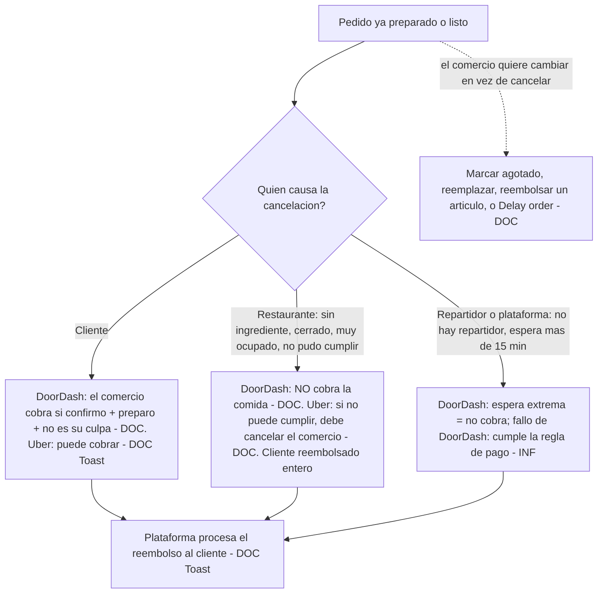
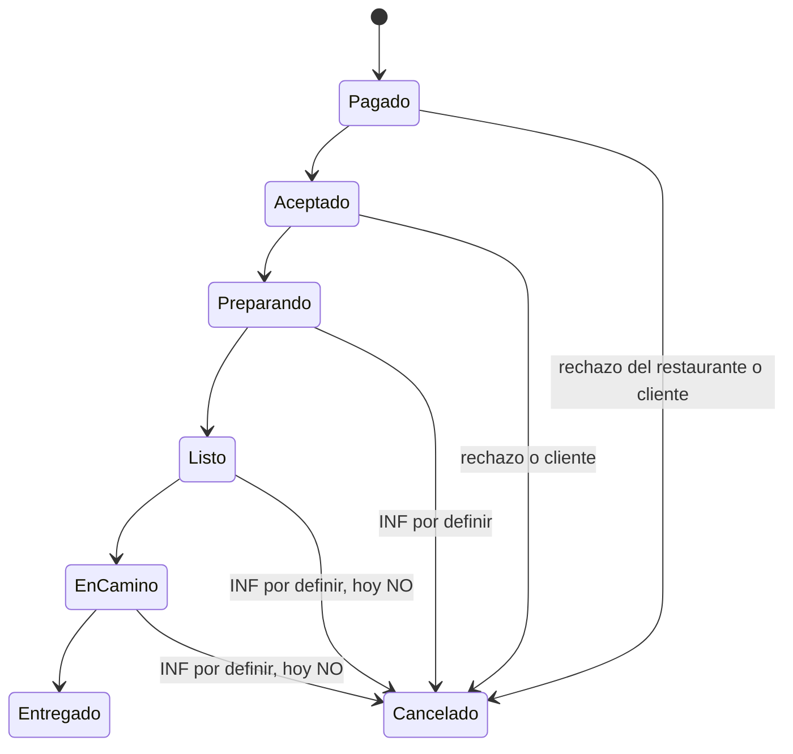

# Cancelar un pedido que ya está preparado o listo: investigación y decisión

**Fecha:** 10 de noviembre de 2026. **Rama:** sin rama (solo ficha; no se tocó código). **Quién pidió:** Richard, vía la fila de la fábrica. **País que aplica el estándar:** todos; la parte de dinero se confirma por país (Estados Unidos, Chile y Venezuela cobran distinto).

**Ejecución de REA: ninguna.** Esta ficha es «sin ejecución de REA; fuentes [DOC]». Se leyeron las páginas públicas de ayuda de comercios y la documentación para desarrolladores como visitante, sin cuenta. El método prohíbe analizar con REA las apps o tablets de terceros y no hay hash que guardar. Las páginas que exigen cuenta (tablet, portal) quedan como **[NV]** salvo lo que su centro de ayuda público cuenta.

## 1. Referencia estudiada

- **DoorDash Merchant** (tablet y portal): cómo cancela el comercio, cuándo debe llamar a soporte, motivos, y la política de pago al comercio por pedidos cancelados.
- **Uber Eats** (Orders y Manager): cancelación por el comercio, motivos, y lo que se encuentra sobre el pago.
- **Rappi:** lo que haya publicado sobre cancelaciones del comercio.
- **Estudios de Richard:** ya consultados en `docs/COMPARACION-CICLO-PEDIDO.md`; esta ficha cierra la parte «el pedido ya está preparado».

## 2. Evidencia y sus limitaciones

### DoorDash: cómo cancela el comercio

- **[DOC]** Con la **tablet de DoorDash**: Orders, «Manage Order», «Cancel Order», «Yes, Cancel this Order». La tablet muestra los cargos antes de terminar y pide el motivo. Advertencia textual de DoorDash: cancelar puede afectar a clientes y Dashers y «puede generar cargos». Fuente: https://merchants.doordash.com/en-nz/learning-center/manage-orders
- **[DOC]** **Un comercio con caja (POS) integrada no puede cancelar**; debe llamar a soporte. Misma fuente.
- **[DOC]** Otras páginas oficiales dicen otra cosa y se contradicen: en el portal del comercio hay «Cancel order» bajo el número de pedido, y la tablet solo permite cambios por artículo (marcar agotado, reemplazar, reembolsar un artículo, agregar cargo de hasta 5 dólares). Fuente: https://help.doordash.com/en-ca/merchants/article/how-do-i-cancel-a-live-order . **[INF]** Las pantallas cambian por país y versión de la tablet; se toma como cierto que existe cancelación completa desde tablet o portal, y que depende del caso.
- **[DOC]** Soporte de pedidos en vivo: chat desde la app Business Manager o la tablet, o teléfono; para cuenta, correo o formulario del portal. Fuente: https://help.doordash.com/en-us/merchants/article/do-i-get-paid-for-cancelled-orders
- **[DOC]** Cuando falta un artículo, DoorDash propone ir por artículo antes que cancelar todo: marcar agotado, reemplazar, reembolsar el artículo; chat con el cliente y llamada con número enmascarado al cliente o al Dasher. Fuente: https://help.doordash.com/en-us/merchants/article/what-if-i-cannot-fulfill-an-order

### DoorDash: quién paga la comida

**Regla exacta publicada** (centro de ayuda para comercios): un comercio cobra por un pedido cancelado **solo si se cumplen las tres cosas**: (1) la cancelación ocurre después de que el comercio confirmó el pedido, (2) el pedido fue preparado, y (3) el comercio no inició la cancelación ni tiene la culpa. Fuente: https://help.doordash.com/en-us/merchants/article/do-i-get-paid-for-cancelled-orders

- **[DOC]** Motivos por los que el comercio **no cobra** (14, con sus etiquetas):
  1. «Did not confirm»: se canceló antes de confirmar.
  2. «Staff Requested - Could Not Fulfill»: el comercio no pudo cumplirlo.
  3. «Staff Requested to Cancel»: el comercio pidió cancelar.
  4. «Staff Requested - Too Busy»: demasiado ocupado.
  5. «Order Not Prepared»: DoorDash determinó que no estaba preparado después de confirmar. Si sí lo preparó, se **disputa** con soporte desde el portal.
  6. «Store Closed»: el restaurante se reportó cerrado.
  7. «Item Out of Stock»: un artículo no estaba disponible.
  8. «Unable to Place Order»: no se pudo colocar el pedido.
  9. «Extreme Dasher Wait Time»: el Dasher esperó más de 15 minutos.
  10. «Wrong Order Handed to Dasher»: se entregó al Dasher un pedido equivocado.
  11. «Merchant Unresponsive»: el comercio no respondió.
  12. «Duplicate Order»: se reportó como duplicado.
  13. «Entire Order Not Placed by Staff»: el personal no colocó todo el pedido.
  14. «Long Fulfillment Time»: tardó demasiado; DoorDash pide ajustar bien los tiempos de preparación.
- **[INF]** Lo que NO aparece en esa lista y sí cumple las tres condiciones (cliente que cancela después de que se cocinó; caso en que falla DoorDash o el Dasher) es lo que sí se le paga al comercio. DoorDash no escribe esa frase; se deduce de la regla y de la lista.
- **[DOC]** Para ver si le pagaron y por qué: portal, pestaña Orders, columna de estado y el número de pedido. En la tablet, el aviso sale en la tarjeta del pedido. Fuente: https://help.doordash.com/en-ca/merchants/article/an-order-that-i-was-prepping-was-just-cancelled-what-can-i-do
- **[NV]** Cuándo hay que llamar a soporte «porque ya está listo»: DoorDash no publica un corte (por ejemplo «después de que el Dasher llega»). Lo que sí dice: los POS deben llamar; en los demás casos se disputa un cargo desde el portal o se pide ayuda por chat.
- **[NV]** Cuánto cobra el comercio cuando sí le pagan la comida (¿el subtotal? ¿menos comisión?) y la compensación del Dasher en una cancelación: DoorDash no lo publica en el centro de ayuda de comercios. Páginas de terceros dicen que el cliente que cancela cuando el restaurante ya empezó o el Dasher ya recogió recibe solo un reembolso parcial, sin fuente oficial.

### Uber Eats

- **[DOC]** En la app Uber Eats Orders se cancela con «Adjust order», que incluye la opción de cancelar. Si se marca un artículo agotado en un pedido vivo, el cliente recibe aviso y tiene **10 minutos** para confirmar o cambiar el pedido; si no, se cancela. La guía no cubre cancelar con el pedido ya listo, los motivos ni el pago. Fuente: https://merchants.ubereats.com/gb/en/resources/learning-center/uber-eats-orders-app/
- **[DOC]** Alternativa a cancelar: «Delay order», agrega 5, 10, 20 o 30 minutos si todavía no hay repartidor asignado; con repartidor asignado ya no se cambia el tiempo, y el aviso de recogida sale solo cuando faltan 7 minutos. Fuente: https://help.uber.com/h/64ca9a31-7dfd-45c1-91a2-f871a2d0d2b3
- **[DOC]** Motivos de cancelación (documentación para desarrolladores, punto de cancelación): `OUT_OF_ITEMS`, `KITCHEN_CLOSED`, `CUSTOMER_CALLED_TO_CANCEL`, `RESTAURANT_TOO_BUSY`, `CANNOT_COMPLETE_CUSTOMER_NOTE` y `OTHER` (obliga a explicar). Fuente: https://developer.uber.com/docs/eats/references/api/v1/post-eats-order-orderid-cancel . **[DOC, tercero]** Un conector de integración lista además códigos como `ITEM_ISSUE`, `STORE_CLOSED`, `TECHNICAL_FAILURE`, `POS_NOT_READY`, `POS_OFFLINE`, `CAPACITY`, `ADDRESS`, `SPECIAL_INSTRUCTIONS`, `PRICING`; son del punto de rechazo de pedido, no del de cancelación, y no están en una página oficial de ayuda. Una caja con interfaz propia de comercios (Owner) muestra: artículo agotado, cliente llamó para cancelar, no se puede cumplir la nota del cliente, otro.
- **[DOC]** El punto de cancelación solo actúa sobre pedidos «vivos»; uno en estado final da 404. La página no dice si se puede cancelar después de que el repartidor recogió y no habla de pago ni responsabilidad. Hay un campo `cancelling_party` (MERCHANT o CUSTOMER) pero solo para Uber Direct.
- **[DOC]** Pago al comercio: Toast (caja de restaurantes) indica que cuando un cliente cancela y no le corresponde reembolso, **«el restaurante puede igualmente recibir el pago del pedido cancelado»**, y que DoorDash y Uber Eats son quienes procesan la anulación y el reembolso al cliente. Fuente: https://support.toasttab.com/en/article/Manage-Orders-Canceled-by-Third-Party-Partners . No dice el monto ni las condiciones.
- **[NV]** La regla de Uber para pagar al comercio un pedido cancelado: no hay página oficial pública que la diga. Noticias y blogs de terceros dicen que si el cliente cancela cuando el restaurante ya empezó a cocinar, no hay reembolso al cliente y el restaurante fue compensado «por Uber», pero son anécdotas, no política.
- **[DOC]** Pausa automática: Uber pausa la tienda cuando varios pedidos seguidos no se aceptan. Es el castigo de calidad; ver `2026-10-16-pausa-sin-senal.md`.
- **[DOC, blog para repartidores]** Cuando el repartidor no puede completar la entrega, la tarifa que le paga el restaurante baja según la etapa: si falla en el local, no cobra recogida, distancia ni entrega; si falla en camino, cobra recogida y la mitad de distancia; si llega al cliente y sigue los pasos recomendados, cobra todo. Si el comercio no puede cumplir, «debe ser quien cancele». Fuente: https://www.uber.com/en-EG/blog/cancellations-when-you-cannot-complete-the-delivery . **[INF]** Quien cancela es quien paga el costo del repartidor, en la práctica el comercio cuando el fallo es suyo.

### Rappi

- **[NV]** No se encontró documentación pública de Rappi sobre cancelaciones hechas por el comercio ni sobre quién paga una comida ya preparada.
- **[OBS indirecta, reclamos de clientes]** En reclamos de consumidores chilenos, Rappi cobró el total de un pedido cancelado por el cliente «porque el restaurante ya había empezado a prepararlo» (reclamos.cl). Eso es la política de cara al cliente, vista por terceros; no es regla publicada.
- **[NV]** Un documento parcial de aliados (origen incierto) dice que el comercio asume la pérdida cuando incumple el procedimiento de entrega. No aplica de forma segura a cancelaciones.

### Límites de esta investigación

- Las reglas de DoorDash para comercios sí son documentación oficial; las de Uber y Rappi sobre pago a comercios no están publicadas y quedan como **[NV]** o prensa.
- No se ejecutó REA. Los textos exactos de la tablet de cada país pueden variar.

## 3. Diagrama técnico

(Los estados «Preparando» y «Cancelado desde Listo» del segundo diagrama son lo que se decide en la sección 6; los nombres exactos de los estados se verifican en la tabla de transiciones antes de implementar.)

## 4. Estándar que se copia

1. **La regla de pago de DoorDash para el comercio** (tres condiciones) es el único texto oficial y exacto; se copia como base [DOC].
2. **Antes de cancelar todo, ofrecer lo pequeño:** marcar un artículo agotado, reemplazarlo, reembolsar un artículo o atrasar el pedido; el cliente tiene 10 minutos para decidir (Uber) [DOC DoorDash y Uber].
3. **La cancelación pide un motivo de una lista cerrada**, y el motivo decide el pago; el comercio puede disputarlo desde el panel [DOC DoorDash, Uber].
4. **El comercio ve antes de confirmar** cualquier cargo que le cueste cancelar [DOC DoorDash].
5. **Un comercio con caja integrada no cancela solo; pasa por soporte** [DOC DoorDash]. En Divoox aplica a quien conecte un POS en el futuro.
6. **La plataforma procesa el reembolso al cliente**, no el comercio [DOC Toast].

## 5. Comparación con Divoox

| Hallazgo                                             | Divoox hoy                                                                                                                                                                                                    | Veredicto |
| ---------------------------------------------------- | ------------------------------------------------------------------------------------------------------------------------------------------------------------------------------------------------------------- | --------- |
| Restaurante rechaza un pedido                        | `POST /restaurante/pedidos/:id/rechazar` (`apps/servidor/src/rutas/operacion.ts:837-850`): solo desde `pagado` o `aceptado`, devuelve TODO al cliente, avisa al repartidor                                    | A medias  |
| Cancelar después de preparado o listo                | No hay camino: desde `listo` o `en_camino` no se puede cancelar; `docs/investigaciones-rea/2026-10-16-transiciones-pedido.md` lo fija con un disparador. Verificar la tabla antes de tocar                    | Falta     |
| Motivos de cancelación                               | Solo tres eventos de bitácora: `cancelado_por_cliente`, `rechazado_por_restaurante`, `cancelado_sin_respuesta` (`operacion.ts:2905-2925`); no hay lista de motivos del restaurante ni campo de motivo elegido | Falta     |
| Cobro al cancelar                                    | Se autoriza al pedir y se captura al entregar (`C-CAPTURA`, `docs/COMPARACION-CICLO-PEDIDO.md` fila 1); cancelar antes de entregar libera la autorización. No existe «cobrar la comida preparada»             | Falta     |
| Pago al restaurante por comida preparada y cancelada | No existe                                                                                                                                                                                                     | Falta     |
| Pago al repartidor cuando el pedido se cancela       | No existe; hoy el aviso `repCancelado` solo informa                                                                                                                                                           | Falta     |
| Cambiar un pedido en vez de cancelarlo               | Existe «plato agotado» antes de que salga el repartidor (`operacion.ts:657` y siguientes); el estudio pide ítem por ítem (`COMPARACION-CICLO-PEDIDO.md` línea 143)                                            | A medias  |
| Disputa del restaurante                              | Existen disputas del cliente (`disputas.ts`, `devoluciones.ts`); no hay disputa del restaurante por una cancelación                                                                                           | Falta     |

## 6. Decisión recomendada para Divoox

**Copiar la regla de DoorDash, con una lista de motivos propia que decide quién paga la comida, y no permitir la cancelación cuando el repartidor ya recogió.** Todo lo que mueve dinero se aprueba por Richard (👤).

**La regla de «quién paga la comida» por quién causa la cancelación:**

| Quién causa                                        | Motivos                                                                                                               | Cliente                                                                                                                                      | Restaurante                                                                                                                                        | Repartidor                                                                                 |
| -------------------------------------------------- | --------------------------------------------------------------------------------------------------------------------- | -------------------------------------------------------------------------------------------------------------------------------------------- | -------------------------------------------------------------------------------------------------------------------------------------------------- | ------------------------------------------------------------------------------------------ |
| **Cliente** (después de que el restaurante aceptó) | «El cliente pidió cancelar»                                                                                           | Antes de que empiece la preparación: reembolso total. Después: paga la comida (subtotal) y se le devuelve el envío si no salió el repartidor | Cobra el subtotal si aceptó, preparó y no es su culpa (la regla de DoorDash)                                                                       | Si ya iba o llegó: cobra una compensación fija por cada etapa (modelo de la tabla de Uber) |
| **Restaurante**                                    | «Sin ingredientes», «Local cerrado», «Muy ocupado», «No pude cumplirlo», «Pedido equivocado», «No respondió»          | Reembolso total (comida, envío y propina)                                                                                                    | **No cobra la comida.** Cuenta contra su calidad (pausa automática)                                                                                | Cobra compensación por la etapa en que estaba, **pagada por el restaurante** (Uber)        |
| **Repartidor o plataforma**                        | «No hay repartidor», «El repartidor no llegó», «Falla de Divoox», «Espera extrema (más de 15 min) por el restaurante» | Reembolso total                                                                                                                              | Cobra el subtotal si estaba preparado y no es su culpa (regla de DoorDash). Si la espera extrema fue porque no lo tenía listo, no cobra (DoorDash) | Cobra compensación cuando Divoox causa el fallo, pagada por Divoox                         |
| **Otro**                                           | «Otro» obliga a escribir el detalle (Uber)                                                                            | Decide soporte                                                                                                                               | Decide soporte                                                                                                                                     | Decide soporte                                                                             |

**Reglas de implementación:**

1. **Lista cerrada de motivos** (la de la tabla), elegida por el restaurante; el motivo queda en la bitácora y decide el pago. «Otro» exige texto.
2. **Primero ofrecer lo pequeño:** botón «cambiar en vez de cancelar» con agotado, reemplazo, reembolso de un artículo y atrasar (ya existe a medias).
3. **Hasta `listo` el restaurante puede cancelar con motivo; con el repartidor ya en camino, no** (el repartidor ya recogió: es entrega fallida, no cancelación). Con el repartidor en el local el restaurante puede cancelar y se paga la compensación de la etapa.
4. **El panel muestra los cargos antes de confirmar** (DoorDash) y, después, por qué se pagó o no.
5. **Disputa del restaurante:** botón «disputar» en el pedido cancelado, que abre un caso para soporte (DoorDash).
6. **El dinero:** el cobro es autorizar y capturar al entregar. Cobrar «la comida preparada» exige capturar el subtotal en una cancelación; **eso toca dinero real y la regla de pagos: debe probarse de punta a punta en el sitio de pruebas con Stripe de prueba y aprobarse por Richard (👤).** Los porcentajes de compensación al repartidor y la política con clientes también son decisión de Richard.
7. **Por país:** el mismo código; la moneda y los montos son del perfil del país (Chile: pesos enteros; ver `2026-11-10-perfil-chile.md`).
8. Se pone en la fila `[para: desarrollador]` como funciones separadas: (a) motivos y bitácora, (b) cancelar desde `listo` con reembolso total, (c) cobro de comida preparada y compensación del repartidor (esta última espera 👤).

## 7. Pruebas de aceptación

Cada una se comprueba primero en rojo.

1. El restaurante cancela un pedido en estado `listo` con el motivo «Sin ingredientes»: el cliente recibe reembolso total y el restaurante no cobra la comida.
2. El restaurante no puede cancelar un pedido cuando el repartidor ya lo recogió; el servidor responde 409 con un mensaje claro en los dos idiomas.
3. Sin motivo no se cancela; con «Otro» sin texto tampoco.
4. El motivo elegido queda en la bitácora y el panel muestra «por qué» al restaurante y al cliente (hoy solo cliente, restaurante o sin respuesta).
5. Cancelación por el cliente con el pedido preparado: el cliente paga el subtotal, no el envío, y el restaurante cobra su parte (solo en pruebas, con Stripe de prueba, y tras la aprobación de Richard).
6. Cancelación causada por Divoox (no hay repartidor): reembolso total al cliente y el restaurante cobra la comida si estaba preparada.
7. Dos cancelaciones a la vez (el cliente y el restaurante) dejan un solo resultado y un solo reembolso (la prueba de carreras de `transicionesRutas.test.ts` se extiende).
8. El repartidor que iba hacia el local recibe el aviso inmediato y la compensación de su etapa.
9. Una disputa abierta por el restaurante llega a soporte con el pedido, el motivo y la bitácora.
10. Recorrido completo en el sitio de pruebas, en los dos idiomas, con datos neutros de Novi.
