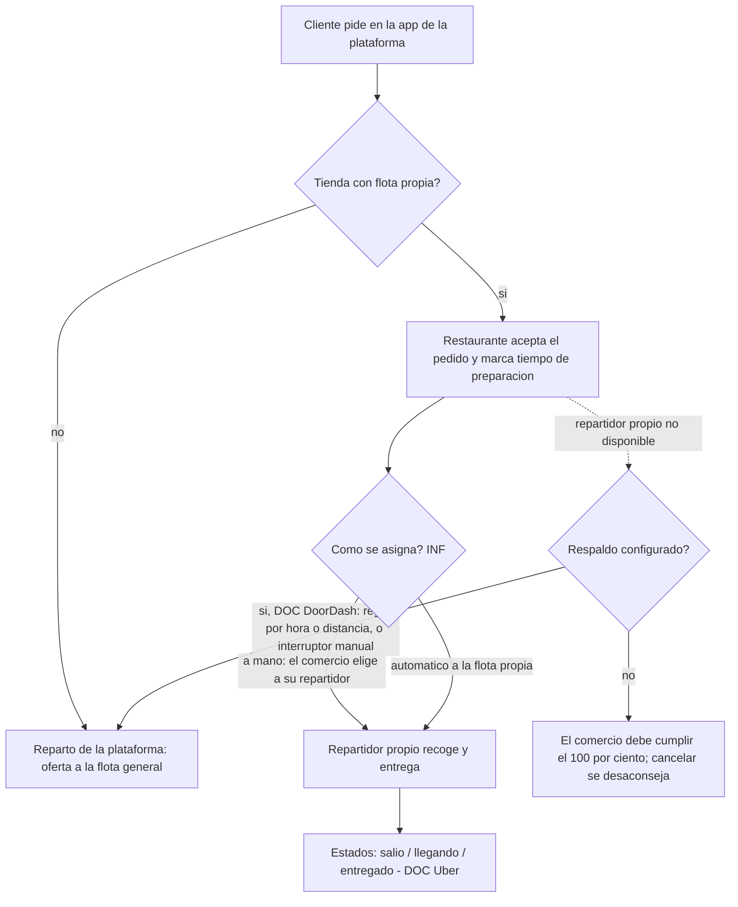
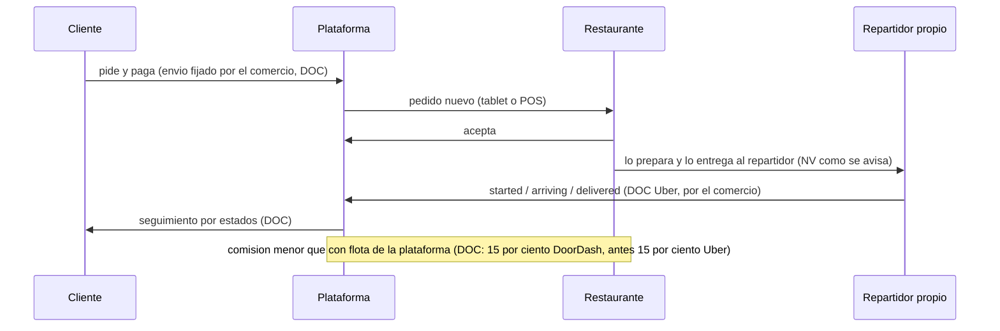

# Flota propia de un restaurante: investigación y decisión

**Fecha:** 10 de noviembre de 2026. **Rama:** sin rama (solo ficha; no se tocó código). **Quién pidió:** la fila de la fábrica, punto B3 de `docs/FALTA-PARA-PRODUCCION-2026-11-10.md`. **País que aplica el estándar:** todos (lo que cambia por país se anota aparte). **Caso que lo motiva:** un restaurante de Chile con 14 repartidores propios y muchos clientes.

**Ejecución de REA: ninguna.** Esta ficha es «sin ejecución de REA; fuentes [DOC]». Los competidores se estudiaron solo con su documentación pública y sus páginas de ayuda para comercios, leídas como visitante, sin cuenta. No hay paquete de evidencia con hash porque no hubo artefacto propio ni de código abierto que analizar; el método (`docs/METODOLOGIA-INGENIERIA-REA.md`, sección 4) prohíbe analizar con REA las apps o webs de terceros. La comparación con nuestro código sí se hizo leyendo el repositorio.

## 1. Referencia estudiada

| Plataforma                 | Qué parte                                                                                         | Por qué                                                        |
| -------------------------- | ------------------------------------------------------------------------------------------------- | -------------------------------------------------------------- |
| DoorDash Self-Delivery     | El comercio vende en el mercado de DoorDash y reparte con SUS repartidores; Dashers como respaldo | Es exactamente el caso del restaurante chileno                 |
| DoorDash Drive             | Lo inverso: el comercio vende en su propio canal y pide repartidores de DoorDash por API          | Marca el límite: qué NO es flota propia                        |
| Uber Eats (reparto propio) | «Merchant-coordinated couriers»: el comercio reparte; Uber solo recibe estados                    | Su API pública enseña qué datos pide la plataforma al comercio |
| Uber Direct                | Servicio de reparto de Uber para pedidos que vienen de fuera de Uber Eats                         | Igual que Drive: otro producto                                 |
| Rappi                      | Modalidad «domicilio propio» frente a repartidores de Rappi («Rappitenderos»)                     | Mercado de Chile y América Latina                              |
| PedidosYa                  | Reparto propio del comercio frente a su logística; fuerte en Chile                                | Competidor local principal                                     |

## 2. Evidencia y sus limitaciones

### DoorDash Self-Delivery

- **[DOC]** El comercio se publica en el mercado de DoorDash y reparte con sus propios repartidores. El cliente pide en la app o web de DoorDash; al pagar se le avisa que el negocio reparte sus propios pedidos. El comercio recibe y confirma el pedido en la tablet de DoorDash, por correo, por fax o por su caja (POS). Fuente: https://merchants.doordash.com/en-us/products/self-delivery
- **[DOC]** **Quién fija y cobra el envío:** el comercio elige la tarifa de envío que paga el cliente y se la queda; también se queda las propinas. Fija su propia zona de entrega. Misma fuente.
- **[DOC]** **Comisión:** la página de Estados Unidos publica 15 % de comisión de entrega, 12 % si el cliente es DashPass, y un cargo fijo de 6,00 dólares por entrega solo cuando se usan Dashers. La página de Canadá publica cifras menores (12 % y 8 %). Las cifras cambian por país y por fecha; se confirman en el portal. Fuentes: https://merchants.doordash.com/en-us/products/self-delivery y https://merchants.doordash.com/en-ca/products/self-delivery
- **[DOC]** **Radio de entrega:** el comercio lo define como círculo alrededor del local o como zona a medida (la zona a medida exige un archivo KML). Fuente: https://developer.doordash.com/docs/marketplace/how_to/self_delivery
- **[DOC]** **Respaldo con Dashers («Flexible Fulfillment»):** el comercio puede enviar pedidos a Dashers según reglas por hora del día o por distancia (línea recta en millas), siempre dentro del horario de la tienda. También hay un interruptor manual en la tablet («un repartidor faltó por enfermedad»): al encenderlo, todos los pedidos NUEVOS van a Dashers; los ya asignados no se reasignan. No es compatible con un radio personalizado, solo con radios en millas enteras. Cuando entrega un Dasher, el comercio recibe avisos (asignado, llegó) y debe marcar cuándo está listo; el cargo aparece en las pestañas Orders y Finance del portal. Fuentes: https://merchants.doordash.com/en-ca/blog/how-self-delivery-works y la página de producto.
- **[DOC]** Sin ese respaldo, el comercio debe poder cumplir el 100 % de sus entregas; lo que no puede entregar se manda a un Dasher con el formulario web de Drive («cancelar el pedido se desaconseja»). La documentación para desarrolladores es más vieja y dice que la asignación por reglas «está planeada»; la página de producto ya la ofrece. Se toma la más reciente. Fuente: https://developer.doordash.com/docs/marketplace/how_to/self_delivery
- **[NV]** Cómo se dan de alta los repartidores del comercio y si usan la app Dasher: las páginas públicas no lo dicen. Nada indica que el repartidor propio use la app Dasher; lo más probable es que el comercio lo gestione fuera de DoorDash.
- **[NV]** Si el cliente ve el recorrido del repartidor propio en el mapa: la documentación pública no lo describe.

### DoorDash Drive (otro producto, no es flota propia)

- **[DOC]** Servicio de «marca blanca»: el comercio tiene su propio canal de pedidos y pide a DoorDash un Dasher por API. Precio dinámico por distancia; en la documentación consultada, base de 9,75 dólares hasta 5 millas, más 0,75 por milla hasta 15 millas, con 2,75 de descuento si el comercio pasa el 100 % de la propina del cliente al Dasher. Se cobra a una tarjeta al pedir cada entrega. Devolver al punto de recogida cuesta el 60 % del envío. Fuente: https://developer.doordash.com/docs/drive/overview/pricing_payment

### Uber Eats y Uber Direct

- **[DOC]** El comercio elige: repartidores de la red de Uber, repartidores propios o solo retiro en local. Con repartidores propios define su zona por radio, forma libre o códigos postales; con los de Uber, el algoritmo define la zona. Fuente: https://merchants.ubereats.com/pl/en/s/signup/
- **[DOC]** Para pedidos entregados por repartidores propios existe el punto de la API `POST /v1/eats/orders/{order_id}/restaurantdelivery/status` con tres estados: `started`, `arriving`, `delivered`. No sirve para pedidos coordinados por Uber ni para retiro. Uber recomienda enviar los tres «para que el cliente esté lo más informado posible». Se requiere permiso por escrito de Uber. Fuente: https://developer.uber.com/docs/eats/references/api/v1/post-eats-orders-orderid-restaurantdelivery-status
- **[DOC, fuente de tercero]** Existe también un punto para enviar la ubicación en vivo de un repartidor propio (`/v1/eats/byoc/restaurants/orders/event/location`), listado por un índice de terceros. **[NV]** No se confirmó en la página oficial.
- **[DOC, reporte de prensa de 2019]** Uber Eats cobraba 15 % si el restaurante usaba sus propios repartidores, frente a 30 % con repartidores de Uber, y el restaurante podía fijar su tarifa de envío (Axios, 10 de septiembre de 2019). Es antiguo; blogs de terceros hoy citan 15 % y 25 %. **[NV]** La tasa vigente.
- **[DOC]** Respaldo: en Australia, Uber informó que los restaurantes pueden usar repartidores de Uber «en horas pico, como último recurso» cuando no dan abasto. Fuente: https://www.uber.com/au/en/newsroom/mpfau/
- **[DOC, comercial]** Uber Direct (pedidos desde el sitio, app o teléfono del comercio): se piden entregas desde un panel, por API o desde el sistema de pedidos; el comercio puede compartir el enlace de seguimiento de Uber por SMS o el suyo. Siempre usa la red de repartidores de Uber. Fuente: https://merchants.ubereats.com/at/en/services/uber-direct-test
- **[NV]** Propinas con repartidor propio en Uber Eats, y si el cliente ve el recorrido del repartidor propio: no se encontró página oficial.

### Rappi

- **[DOC, guía de terceros]** Al registrarse como aliado, el comercio confirma si hará entregas con personal propio («domicilio propio») o si usará Rappitenderos (guía de Crehana). Fuente: https://www.crehana.com/mx/blog/negocios/alta-negocio-en-rappi
- **[DOC, prensa]** La comisión de Rappi para restaurantes en Chile y Colombia depende de volumen, exclusividad y acuerdos (ejecutivo de Rappi citado por La República); en 2018 se reportaba un promedio de 17 %, y en Colombia, hasta 25 % según restaurantes consultados por Gestión. No se encontró una tasa distinta por usar reparto propio.
- **[NV]** Los nombres «marketplace» y «full service» como modalidades de Rappi: una guía de Crehana dice que «full service» es lo que prefieren la mayoría de aliados porque evita la logística; no se encontró la página oficial ni sus condiciones. Cómo se asigna, qué ve el cliente y cómo se cobra el envío con reparto propio en Rappi: no verificable sin cuenta de aliado.

### PedidosYa

- **[DOC, prensa 2021, Argentina]** Un acuerdo con asociaciones de comercios fijó 18 % de comisión cuando se usa la logística de PedidosYa y 10 % cuando el comercio tiene reparto propio. Fuente: Bae Negocios, 2 de marzo de 2021 (https://www.baenegocios.com/amp/Pedidos-Ya-debera-bajar-sus-comisiones-para-pizzerias-heladerias-y-franquicias-20210302-0092/). Es de otro país y de hace años.
- **[DOC, prensa 2018, Costa Rica]** Un directivo dijo que armar reparto propio cuesta «alrededor del 30 o 35 %» de cada orden. Fuente: El Financiero (Costa Rica).
- **[NV]** Todo lo demás (alta de repartidores, app, asignación, quién fija el envío en Chile): no se encontró la página oficial de PedidosYa Partners. Pedir las condiciones por escrito al socio comercial.
- **[INF]** En los tres mercados grandes de Chile (PedidosYa, Uber Eats, Rappi) la tarifa por reparto propio es menor que con su logística; el dato cuantitativo para Chile no está publicado.

### Límites de esta investigación

- Las páginas de ayuda de los comercios no explican cómo se registra el repartidor propio ni qué app usa. Esa parte es **[NV]** en las cinco plataformas.
- Las comisiones cambian por país y fecha; las cifras de arriba son orientativas, no un precio vigente en Chile.
- Ninguna evidencia fue capturada con REA ni guardada con hash.

## 3. Diagrama técnico

## 4. Estándar que se copia

1. **La flota propia es una propiedad de la tienda, no de la cuenta.** El comercio decide «reparto propio», «reparto de la plataforma» o «mixto con respaldo» por tienda [DOC DoorDash, DOC Uber].
2. **El comercio fija su tarifa de envío y su zona** (radio o polígono; códigos postales en Uber) y se queda con el envío y las propinas del reparto propio [DOC DoorDash].
3. **La plataforma cobra comisión menor** cuando no pone repartidor [DOC DoorDash, Uber 2019, PedidosYa 2021].
4. **Respaldo opcional con la flota general:** regla por hora o distancia, y un interruptor manual para «hoy me faltan repartidores»; el interruptor solo afecta pedidos nuevos [DOC DoorDash].
5. **Estados mínimos de entrega:** salió, llegando, entregado; sirven para el seguimiento del cliente [DOC Uber].
6. **Sin respaldo, el comercio debe cumplir todas las entregas** [DOC DoorDash].

## 5. Comparación con Divoox

| Hallazgo                                           | Divoox hoy                                                                                                                                                                           | Veredicto  |
| -------------------------------------------------- | ------------------------------------------------------------------------------------------------------------------------------------------------------------------------------------ | ---------- |
| Modo «flota propia» de un restaurante              | No existe. Está en la fila como B3 (`docs/FALTA-PARA-PRODUCCION-2026-11-10.md`, líneas 25 y 26): «sus repartidores reciben solo sus pedidos, con la app Driver»                      | Falta      |
| Conductores propios de una empresa                 | Existe en Divoox Flex (paquetes): la empresa invita a sus conductores y la ruta los ocupa (`docs/LOGISTICA-COMO-FUNCIONA.md`, `C-FLEX-OCUPACION`). Se puede reutilizar la invitación | A medias   |
| Despacho de pedidos de comida a la flota general   | Existe: oferta al repartidor, estados de pedido, Manager (`docs/COMPARACION-CICLO-PEDIDO.md`)                                                                                        | Lo tenemos |
| Tarifa de envío fijada por el comercio             | No hay: la tarifa la fija Divoox. Verificar en el código antes de decidir                                                                                                            | Falta      |
| Radio de entrega propio por tienda                 | Verificar: hay territorios y polígonos por franquicia, no necesariamente por tienda                                                                                                  | A medias   |
| Respaldo a la flota general (reglas e interruptor) | No existe                                                                                                                                                                            | Falta      |
| Estados para el seguimiento del cliente            | Existen para la flota general; con flota propia reutilizan los mismos con el repartidor propio                                                                                       | Lo tenemos |

## 6. Decisión recomendada para Divoox

**Construir «Flota propia» como una propiedad de la tienda, con la app Driver de siempre, y copiar el interruptor de respaldo de DoorDash.**

1. **Alta del repartidor propio:** el dueño del restaurante invita a sus repartidores desde el panel (mismo mecanismo de invitación de conductores de Flex). El repartidor entra con la app Driver, pasa su verificación normal y queda marcado como «de la flota de la tienda X». **[INF]** No se encontró un estándar público de alta; se copia la invitación de Flex.
2. **Visibilidad:** un repartidor de la flota propia solo ve pedidos de su tienda, nunca de la general (salvo que él mismo se habilite para las dos).
3. **Asignación:** automática a la flota propia, con opción de asignar a mano desde el panel del restaurante. **[INF]** Ninguna plataforma publica cuál usa; el caso de 14 repartidores pide las dos.
4. **Seguimiento del cliente:** el mismo mapa y los mismos estados que con la flota general (salió, llegando, entregado), porque la API de Uber recomienda dar los tres estados.
5. **Tarifa de envío:** la fija el comercio (por zona), y el envío y la propina van al comercio y a su repartidor. **Esto toca dinero:** la regla de reparto de dinero la aprueba Richard (anotar 👤 en `PENDIENTES.md`).
6. **Comisión:** menor con flota propia, como hacen DoorDash (15 %) y Uber. La cifra para cada país la decide Richard; en Chile no hay dato público (👤).
7. **Respaldo:** interruptor manual «hoy mis repartidores no están» que manda los pedidos NUEVOS a la flota general (con cargo fijo por entrega), más reglas por horario como segunda fase. Si no hay respaldo, el pedido sin repartidor propio disponible se informa al restaurante y no cae solo a la flota general.
8. **Radio propio:** polígono o círculo por tienda dentro del territorio de la franquicia.
9. **Por país:** primero Chile (caso real); el mismo código sirve para todos, lo que cambia por país son la moneda, los documentos del repartidor (ver ficha de Chile) y la comisión.

Se pone en la fila `[para: desarrollador]` con esta decisión.

## 7. Pruebas de aceptación

Cada una se comprueba primero en rojo.

1. Un restaurante con la flota propia activada y 14 repartidores propios invitados: solo esos 14 reciben la oferta del pedido de esa tienda.
2. Un repartidor de la flota general no ve ninguna oferta de una tienda con flota propia exclusiva.
3. Un repartidor propio no ve pedidos de otras tiendas.
4. El restaurante asigna a mano un repartidor propio y la oferta no sale a nadie más.
5. Sin ningún repartidor propio disponible y sin respaldo: el pedido no pasa a la flota general; el restaurante recibe el aviso.
6. Con el interruptor de respaldo encendido: los pedidos nuevos van a la flota general; los ya asignados al repartidor propio no se reasignan.
7. El cliente ve los estados (salió, llegando, entregado) y el mapa igual que con la flota general.
8. La tarifa de envío del comercio se muestra al cliente antes de pagar y el desglose del dinero no cambia el total pagado por el cliente.
9. Un pedido fuera del radio propio de la tienda no se puede crear.
10. En el sitio de pruebas, con Stripe de prueba y datos de prueba de Novi, recorrido completo en español e inglés.
