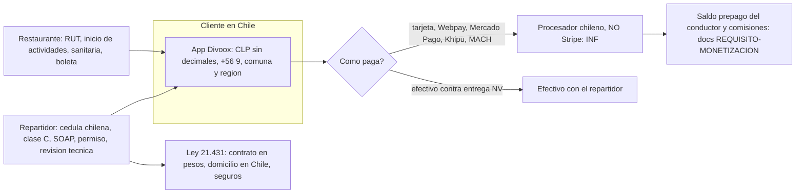

# Perfil de país: Chile. Investigación y decisión

**Fecha:** 10 de noviembre de 2026. **Rama:** sin rama (solo ficha; no se tocó código). **Quién pidió:** la fila de la fábrica, punto B4 de `docs/FALTA-PARA-PRODUCCION-2026-11-10.md`. **País que aplica:** Chile (única). Regla «cada país es su propio sistema» (Richard, 28 oct 2026).

**Ejecución de REA: ninguna.** Esta ficha es «sin ejecución de REA; fuentes [DOC]». Se leyeron páginas públicas y documentación como visitante; no se usó ninguna cuenta ni se descompiló ninguna app. No hay paquete de evidencia con hash. Quien lea la ficha debe saber que muchas fuentes son blogs y prensa, no el texto oficial; cada dato lo dice. **Todo lo legal y tributario se confirma con un contador o abogado chileno antes de lanzar (👤, lo decide Richard).**

## 1. Referencia estudiada

- **Software más usado en Chile:** PedidosYa, Uber Eats, Rappi, y Justo (marginal). Cómo se registra un comercio y un repartidor, y cómo se cobra.
- **Procesadores de pago en Chile:** Transbank (Webpay, Redcompra, Oneclick), Mercado Pago, Khipu, Flow, dLocal, MACH y otros.
- **Marco legal:** SII (inicio de actividades, boleta electrónica, IVA), autoridad sanitaria, Ley 21.431 de trabajadores de plataformas digitales, normas de tránsito.

## 2. Evidencia y sus limitaciones

### Moneda y formato

- **[DOC]** El peso chileno (CLP) usa 0 decimales. Fuente: documentación de dLocal para Chile, https://docs.dlocal.com/docs/chile
- **[INF]** Por eso el monto de un pedido en pesos va entero, como ya hacemos con COP (ver sección 5).
- **[DOC, fuente secundaria]** Teléfono móvil: +56 9 y ocho cifras más (por ejemplo +56 9 1234 5678). La numeración móvil empieza con 9; la fija usa código de área de un dígito (2 en Santiago) y ocho cifras. Fuente: plan de numeración de la ITU (https://itu.int/itudoc/itu-t/number/c/chl/76483_ww9-es.doc) y guías de numeración.
- **[DOC, fuente secundaria]** Dirección: calle, número, departamento si lo hay, **comuna**, ciudad y **región**, código postal y «Chile». El código postal tiene siete cifras (ejemplo 8320000 para Santiago). Una guía de salud del Estado trata comuna y región como campos separados. Fuentes: https://build.fhir.org/ig/HL7Chile/clcore_ig/StructureDefinition-cl-address-definitions.html y guías de formato de direcciones. **[NV]** No se verificó con Correos de Chile ni con la API de Google que el código postal sea de uso corriente al pedir comida; en la práctica lo que manda es comuna y calle.
- **[INF]** El documento de identidad de las personas es el RUN/RUT (8 o 9 caracteres con dígito verificador), igual que el RUT de las empresas. dLocal lo pide para pagos con el formato «CI o RUT, de 8 a 9 caracteres» (misma fuente).

### Formas de pago habituales

- **[DOC, fuente secundaria]** Billeteras digitales en Chile (2024, PCMI): Mercado Pago 34 %, Fpay 28 %, MACH Pay 15 %, PayPal 12 %, Onepay 10 %. Transferencia bancaria en línea: Webpay y Khipu, 74 % y 16 %. Fuente: https://paymentscmi.com/insights/pagos-comercio-electronico-tendencias-chile-2024/
- **[DOC]** Redcompra es el esquema de tarjetas líder en puntos de venta físicos, con 44 % (estudio de Worldpay 2024 citado por PCMI). Es de local físico, no de comercio electrónico.
- **[DOC, prensa]** Las billeteras dentro de Webpay pasaron de 3 % a 9 % de las compras entre 2022 y 2025 (24horas citando a Transbank). Un reporte de Tiendanube de 2026 indica que las compras con tarjeta de débito y billeteras superaron a las de tarjeta de crédito. Fuente: https://chocale.cl/2026/02/estudio-revela-una-caida-en-los-pagos-con-tarjeta-de-credito-en-las-compras-por-internet/
- **[DOC]** Métodos que ofrece dLocal en Chile: tarjetas Visa y Mastercard de crédito y débito, American Express, CMR, MACH (prepago); Webpay; Khipu; Fintoc; Mercado Pago; y tickets de efectivo Sencillito y Servipag. Mínimos: 50 CLP en la mayoría, 2 000 CLP en Khipu. Se puede cobrar un débito en dólares. Fuente: https://docs.dlocal.com/docs/chile
- **[INF]** El efectivo contra entrega es común en el reparto en América Latina. **[NV]** No se encontró un dato publicado del peso del efectivo en el reparto de comida en Chile.
- **[NV]** Cuánto se queda cada procesador (tarifas de Transbank, Mercado Pago, Flow): no hay tarifa pública verificable en esta consulta.

### ¿Stripe opera en Chile?

- **[OBS]** La página de disponibilidad global de Stripe (https://stripe.com/global), leída el 10 de noviembre de 2026, lista países de América Latina como Brasil y México pero **no incluye Chile**, y las páginas de Stripe para Chile (stripe.com/cl y variantes) responden «no encontrada». **[INF]** Concuerda con varias fuentes secundarias de 2026 que dicen que un comercio chileno no puede abrir una cuenta de Stripe (guías de Global66 y de Guía de Software). Otras fuentes comerciales dicen lo contrario sin fecha ni prueba, y una página de impuestos de Stripe habla de cobrar IVA de servicios digitales en Chile, que es otra cosa. **[NV]** No se pudo ver un anuncio oficial de Stripe; conviene confirmarlo con Stripe antes de decidir.
- **[DOC]** Los pagos transfronterizos de Stripe Connect solo se ofrecen entre plataformas y cuentas conectadas de Estados Unidos, Reino Unido, Espacio Económico Europeo, Canadá y Suiza; para otros países, «contacte a ventas» o use Global Payouts. Fuente: https://docs.stripe.com/connect/cross-border-payouts
- **[INF]** Conclusión: con la plataforma de Windoce LLC en Estados Unidos, un restaurante o repartidor chileno **no puede ser una cuenta conectada autoservicio de Stripe Connect**. Cobrar a una tarjeta chilena en pesos con nuestra cuenta de Stripe de Estados Unidos **[NV]**: no se verificó que CLP esté disponible como moneda de cobro para nuestra cuenta; revisar la lista de monedas de Stripe para Estados Unidos.
- **[INF]** El camino que ya tenemos documentado para América Latina encaja: `docs/REQUISITO-MONETIZACION-PREPAGO-MULTISERVICIO.md` dice que las comisiones se descuentan del saldo prepago del conductor y que Estados Unidos conserva Stripe Connect.

### Documentos del restaurante

- **[DOC, fuente secundaria]** Para vender comida normalmente se necesita: **RUT de la empresa**, **inicio de actividades en el SII** con un giro coherente (se hace en sii.cl con clave tributaria y entrega el RUT), **patente comercial municipal** y **autorización sanitaria** de la autoridad de salud (la SEREMI). ChileAtiende dice que la solicitud se hace en el sitio del Minsal con ClaveÚnica y vale tres años renovables; pide plano, descripción de procesos, materias primas y contrato de arriendo o permiso del propietario. El domicilio tributario debe coincidir con el local. Fuentes: https://chileatiende.gob.cl/fichas/172/1/pdf y https://www.lofwork.cl/como-obtener-permiso-para-negocio-de-comida/
- **[DOC, fuente secundaria]** **Boleta electrónica:** quien vende con inicio de actividades a consumidores finales debe emitir boleta electrónica; desde el 1 de mayo de 2025 se entrega su representación impresa y desde el 1 de marzo de 2026 también por vía digital (correo, SMS, WhatsApp o QR), según una guía no oficial. La asociación de restaurantes criticó esa resolución del SII. Fuentes: https://beancount.io/blog/2026/09/18/chile-paper-receipt-ban-digital-boleta-delivery-rules-guide y https://www.theclinic.cl/2025/02/27/un-retroceso-y-costo-adicional-la-dura-critica-del-sector-gastronomico-a-la-resolucion-del-sii-que-obliga-a-emitir-boletas-en-restaurantes/ **[NV]** Quién emite la boleta de un pedido por plataforma (el restaurante o la plataforma) no está resuelto en lo que se leyó; es pregunta para un contador.
- **[NV]** Factura electrónica para clientes empresa: existe en Chile, pero no se verificó cómo se pide en un pedido de comida.
- **[NV]** Qué documentos exige PedidosYa, Uber Eats o Rappi a un comercio chileno: una guía general de Rappi dice que piden «documentos que acrediten que el negocio es legal», sin lista para Chile (Crehana). Se asume la lista de arriba.

### Documentos del repartidor

- **[DOC, fuente secundaria]** Rappi pide: mayor de 18 años, **cédula de identidad chilena vigente**, **licencia clase C si usa moto**, teléfono Android y cuenta bancaria a su nombre. Fuente: https://practicatest.cl/blog/articulos-especiales/como-trabajar-rappi-moto
- **[DOC, fuente secundaria]** Moto: licencia clase C para cualquier moto, salvo las eléctricas de muy baja capacidad; a un extranjero se le da la clase C con residencia temporal o permanente. Documentos del vehículo que piden las ofertas de trabajo: **permiso de circulación, SOAP (seguro obligatorio) y revisión técnica**, y la patente. «Torito» de tres ruedas: licencia clase CR. Fuentes: https://practicatest.cl/blog/licencias-de-conducir/licencia-conduccion-delivery-chile y https://www.elmostrador.cl/datos-utiles/2024/09/22/licencia-de-conducir-para-motos-revisa-los-requisitos/
- **[NV]** Auto particular (clase B) y bicicleta eléctrica: no se encontró norma clara en lo leído. La bicicleta común no necesita licencia [INF]. Confirmar con Conaset o la municipalidad.
- **[DOC, fuente secundaria]** **Ley 21.431** (vigente desde el 1 de septiembre de 2022): regula a los trabajadores de plataformas digitales, dependientes e independientes. Para los independientes: la tarifa pactada no puede ser menor al ingreso mínimo mensual proporcional aumentado en 20 %, se paga dentro de un mes, solo por servicios completados; la plataforma retiene impuestos si está domiciliada en Chile y el trabajador emite boleta de honorarios; derecho a 12 horas continuas de desconexión en 24; acceso a seguros de salud, pensión, accidentes laborales (Ley 16.744) e invalidez; el contrato debe estar en pesos, con zona, reglas de datos, tiempo máximo de conexión, **domicilio en Chile** y causales de término; al ofrecer un servicio la plataforma debe informar lugar, identidad del usuario y forma de pago; confidencialidad de datos y acceso del trabajador a sus datos en 15 días hábiles. Para los dependientes: registro de jornada y pago mínimo con el mismo piso. Las propinas son del trabajador. Fuente: https://www.circuloverde.cl/normativa-que-regula-a-los-trabajadores-que-prestan-servicios-a-traves-de-plataformas-digitales/ (resumen), https://dt.gob.cl/portal/1627/w3-article-122872.html (Dirección del Trabajo) y la Biblioteca del Congreso Nacional.
- **[INF]** El repartidor que trabaja con la flota propia de un restaurante (ficha `2026-11-10-flota-propia-restaurante.md`) es dependiente del restaurante, no de Divoox; la ley para plataformas aplica a Divoox con quienes repartan por la flota general. **Esto es legal: lo decide Richard con un abogado chileno (👤).**

### IVA y tributos

- **[INF]** El IVA general de Chile es 19 %. No se abrió la fuente oficial del SII en esta ficha; confirmar en sii.cl.
- **[DOC]** El SII grava con IVA la intermediación cobrada como comisión por plataformas sin domicilio en Chile (presentación del SII sobre servicios digitales, con la Resolución Exenta 69 de 2026). Fuente: https://www.sii.cl/noticias/2026/PPTIVASD08062026_2.pdf. Y para un trabajador independiente de una plataforma, el documento debe cubrir solo el honorario del trabajador, sin la comisión de la plataforma (https://www.circuloverde.cl/como-se-documentan-tributariamente-las-rentas-por-servicios-personales-independientes-operados-a-traves-de-plataformas-digitales/).
- **[NV]** Si Divoox, siendo una empresa de Estados Unidos que cobra comisión a comercios chilenos, debe inscribirse o declarar IVA en Chile: pregunta para un contador. Está relacionado con la presencia o no presencia de una entidad en Chile.

### Qué apps mandan en Chile y cómo cobran

- **[DOC, prensa y estudios]** Cuota: PedidosYa, Uber Eats y Rappi juntas concentran 61 % de las ventas de reparto (Euromonitor 2024, citado por ODECU, mayo de 2025). Preferencia: PedidosYa 34,4 %, Uber Eats 23,9 %, Rappi 5,6 % (AIM Chile 2024). Por número de órdenes, La Tercera da 36 % a Uber Eats y 31 % a PedidosYa (sin fecha precisa). Fuentes: https://odecu.cl/practicas-de-las-plataformas-de-delivery-y-su-impacto-en-los-consumidores-en-chile-minuta-n15/minuta-15-delivery y https://www.latercera.com/etiqueta/uber-eats/
- **[DOC, prensa]** Rappi declaró en agosto de 2025 más de 10 000 restaurantes y 6 500 repartidores en Chile, con «Turbo» sobre 20 % de los pedidos. Fuente: https://www.eldinamo.cl/economia/negocios-economia/2025/08/22/rappi-celebra-una-decada-y-aterriza-cifras-en-chile-inversiones-por-us35-millones-6-500-repartidores-y-10-mil-restaurantes/
- **[DOC, prensa]** Justo es actor marginal. Didi Food llegó a Chile en 2022 (Bloomberg Línea); **[NV]** su estado actual.
- **[NV]** Comisión a restaurantes en Chile: ningún medio la publica. Referencias de otros países (no usar como cifra de Chile): Argentina, entre 20 % y 30 % en PedidosYa y entre 18 % y 28 % en Rappi (https://developargentina.com/blog/app-delivery-propia-vs-rappi-argentina-2026); Rappi, un promedio de 17 % en 2018 (Pauta, 3 de octubre de 2018); con reparto propio, 10 % en PedidosYa Argentina en 2021. Para que el cliente de Divoox compare, se pide la tarifa vigente a un restaurante chileno real.
- **[DOC, estudio de consumidores]** El mercado está concentrado y hay reclamos por cobros de cancelación (ODECU, 2025; reclamos.cl).

### Límites de esta investigación

- No hay evidencia capturada con REA ni hash. Las fuentes oficiales (SII, SEREMI, Dirección del Trabajo) se citan pero solo se leyó el resumen de terceros en varios puntos.
- Algunos portales respondieron de forma parcial (Stripe, dLocal, Crehana). Dónde hay conflicto se dice.

## 3. Diagrama técnico

## 4. Estándar que se copia

1. **Todo en pesos enteros**, con el formato chileno (punto de mil: 12.990) [DOC dLocal: 0 decimales].
2. **Teléfono +56 9** y dirección con **comuna y región** como campos propios.
3. **Medios de pago que el chileno espera:** tarjeta de débito y crédito, Webpay, Mercado Pago, MACH y transferencia (Khipu), sin obligar a una sola [DOC PCMI, dLocal].
4. **Alta del repartidor con cédula chilena vigente**, licencia clase C si es moto y documentos del vehículo (permiso de circulación, SOAP, revisión técnica) [DOC Rappi vía Practicatest].
5. **Alta del restaurante con RUT, inicio de actividades, patente y autorización sanitaria**, y la boleta electrónica a cargo del restaurante [DOC fuentes secundarias].

## 5. Comparación con Divoox

| Hallazgo                                             | Divoox hoy                                                                                                                                                               | Veredicto |
| ---------------------------------------------------- | ------------------------------------------------------------------------------------------------------------------------------------------------------------------------ | --------- |
| Monedas con distintos decimales                      | `DECIMALES_MONEDA` (`packages/compartido/src/dinero.ts`, líneas 21 a 26) trae USD, COP, VES y MXN; CLP no está. Una moneda desconocida se muestra como dólares           | A medias  |
| Perfil por país en una sola pieza                    | Existe para Flex: `flexPaises.ts` con `PaisFlex = 'VE' \| 'US'`, moneda, pagos, teléfono, documento. No hay perfil para comida/Chile                                     | A medias  |
| Cobro con procesador chileno                         | Hoy el cobro es Stripe (modo prueba) y el saldo prepago está diseñado para otros países; no hay integración con Transbank, Mercado Pago, Khipu ni Flow                   | Falta     |
| Cuentas conectadas de Stripe para Chile              | No aplica: Stripe no abre cuentas de comercios chilenos [OBS]                                                                                                            | Falta     |
| Documentos del restaurante y del repartidor por país | Hay verificación automática (KYC) y antecedentes en código; los documentos exactos por país no están como lista por Chile. Verificar `apps/servidor/src/antecedentes.ts` | A medias  |
| Validación de RUT/RUN                                | No encontrada en `packages/compartido`                                                                                                                                   | Falta     |
| Dirección con comuna y región                        | Verificar en `CampoDireccion` si Google Places entrega comuna y región para Chile                                                                                        | A medias  |
| Boleta electrónica                                   | No existe                                                                                                                                                                | Falta     |

## 6. Decisión recomendada para Divoox

1. **Perfil de país Chile en una sola pieza** (`packages/compartido`), igual que Flex: moneda CLP, 0 decimales, prefijo +56, ejemplo `+56 9 1234 5678`, documento RUT/RUN con dígito verificador, dirección con comuna y región, medios de pago habilitados, documentos pedidos a restaurantes y a repartidores. Se agrega `['CLP', 0]` a `DECIMALES_MONEDA` y `['CLP','CL']` a las regiones, con su prueba (C-MONEDA-LOCAL).
2. **No cobrar a chilenos con Stripe Connect.** Pagar al restaurante y al repartidor por el modelo de saldo prepago ya documentado; para cobrar al cliente en Chile, elegir un procesador chileno que ofrezca **Webpay (Transbank), tarjetas, Mercado Pago, MACH y Khipu**. Candidatos agregadores: dLocal (publica cada método y cada mínimo) o Mercado Pago. Se pide a Richard abrir la cuenta (👤, cuenta nueva y dinero: no lo decide un puesto).
3. **Primer lanzamiento con lo mínimo:** tarjeta (débito y crédito) y Webpay. Mercado Pago, MACH y Khipu en la segunda etapa. Efectivo contra entrega: solo si el restaurante lo decide, con interruptor (como con PIN y puerta de los estudios).
4. **Documentos por Chile** (lista para el panel de alta):
   - Restaurante: RUT de la empresa, comprobante de inicio de actividades del SII, patente municipal, autorización sanitaria vigente, y la boleta electrónica que emite él.
   - Repartidor: cédula chilena vigente (o residencia con permiso de trabajo; **legal, lo decide Richard con un abogado**), clase C para moto, y permiso de circulación, SOAP y revisión técnica del vehículo; cuenta bancaria a su nombre.
5. **Lo que sube a Richard (👤 en `PENDIENTES.md`):** abrir la cuenta con el procesador chileno; confirmar con contador si Divoox debe inscribirse o declarar IVA en Chile y quién emite la boleta; confirmar con abogado qué relación laboral rige para el repartidor (Ley 21.431) y si se admiten extranjeros; fijar la comisión para Chile.
6. **Primero estudiar al más popular** (regla del país): PedidosYa. Hacerlo con observación pública de su web y de su ayuda para comercios, sin cuenta. Esta ficha no lo pudo cerrar porque la ayuda de PedidosYa Partners no apareció en la búsqueda; **queda pendiente para otra ficha**.

Se pone en la fila `[para: desarrollador]` con los puntos 1 y 4, y a Richard los del punto 5.

## 7. Pruebas de aceptación

Cada una se comprueba primero en rojo.

1. Un monto de 12990 con moneda CLP se muestra «$12.990» (sin decimales) y `textoAMonto('12990','CLP')` da 12990, no 1299000.
2. Con país Chile, un teléfono «+56 9 1234 5678» se acepta y «+56 1234» se rechaza con mensaje claro.
3. Un RUT con dígito verificador correcto se acepta; con el verificador cambiado, se rechaza.
4. La dirección de un restaurante de Chile guarda comuna y región como campos; una dirección sin comuna no pasa.
5. El alta de un repartidor chileno con moto exige clase C, permiso de circulación, SOAP y revisión técnica; sin alguno, no se aprueba.
6. El alta de un restaurante chileno exige RUT, inicio de actividades, patente y autorización sanitaria.
7. Con país Chile no se ofrece Stripe Connect para el comercio ni para el repartidor.
8. El pago en el sitio de pruebas con el procesador chileno en modo de prueba, de punta a punta (pedido, cobro, entrega, comisión, saldo), antes de decir «listo» (regla de pagos).
9. Un cliente en Chile ve toda la app en español neutro y los precios en pesos; el inglés sigue disponible.
