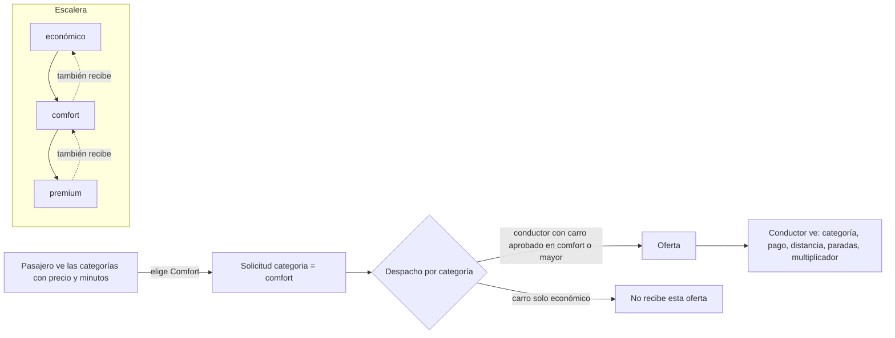
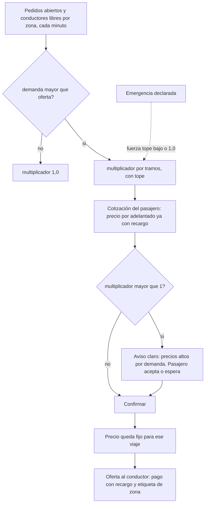

# Divoox Carro: paradas múltiples, categorías de vehículo y tarifa dinámica

**Fecha:** 14 nov 2026 · **Rama:** fase-carro-2 · **Quién pidió:** Richard (vía el jefe de la sesión) · **Países:** Venezuela (piloto) y EE. UU.; Colombia solo como referencia.
**Alcance:** solo investigación. No se tocó código. Sigue a `2026-10-30-carro.md` (ficha anterior de Carro) sin repetirla.

## 1. Referencias estudiadas

- Uber (EE. UU.): páginas públicas de producto, ayuda y blog sobre «Extra stops», cargos por espera, Comfort, Black, requisitos y surge.
- DiDi (Colombia y México): centro de ayuda y web pública.
- Yummy Rides (Venezuela): web pública como visitante. inDrive: la web bloqueó a REA (ver §2.6).
- Código abierto con licencia MIT: `aliabba3i/ridehailing-platform` y `Autofleet/locomotion`.
- Regulación del precio dinámico en emergencias (EE. UU.).
- Estudios de Richard (carpeta `Proyectos Para estudiar y copiar clonar ideas /`): son de **comida** (DoorDash, Uber Eats, Rappi). No dicen nada de paradas de pasajeros ni de categorías de carro. Solo aportan que el reparto usa «tarifa por adelantado: tiempo, distancia, paradas, demanda» y «precios dinámicos» como capacidades de Uber (Estudio_Delivery_Tumbite, comparación de pago del repartidor y tabla de administración) [DOC]. La brecha de pasajeros se cubre aquí.

## 2. Evidencia y límites

Paquete REA: `docs/investigaciones-rea/evidencia-rea-2026-11-14-carro-2.json`, huella del archivo `3cbdde33ffe8350c6c738d62e8c1bbd23ba7a69d1a91b5e825210b806d926472`. Dos escenarios, como visitante, sin cuenta, solo texto de accesibilidad y URL:

- Escenario A, evidencia `ev_6e52cf15608870523df5425948da89f4b763c76cdbb4c26863a6a342df2440b5` (Uber: paradas, surge, Black, requisitos de conductor).
- Escenario B, evidencia `ev_d94e03d429044536757e24d7fcd37f0c0bf6bfe3b774923117a82c74bde22402` (Uber Comfort, inDrive, Yummy, DiDi México).

### 2.1 Paradas múltiples

- [REA] Uber, «Extra stops» (huella del texto `23ff76713c5d2a35976107d4fa9e5baa52776bfb2d22ea47c140863af57ac3cc`, evidencia A), https://www.uber.com/us/en/ride/how-it-works/multiple-stops/ :
  - se pueden agregar **hasta 5 paradas extra** a lo largo de la ruta;
  - se agregan «al pedir o durante el viaje»; desde el feed del viaje se puede **agregar, cambiar o quitar** una parada;
  - las paradas se añaden solas a la ruta del conductor;
  - el precio se puede dividir entre los pasajeros en la app;
  - no existe en Uber Lite y «varía según ciudad y región».
- [DOC] Uber, blog 2017, https://www.uber.com/us/en/blog/multiple-destinations-us/ : antes el límite era **2 paradas más el destino final**; cada parada «debe durar menos de 3 minutos»; el conductor ve la ruta completa y desliza «confirmar parada» en cada una; la tarifa sigue siendo tiempo más distancia y al conductor se le **paga el tiempo de espera en cada parada**; no estaba en uberPOOL. Dato viejo: manda la cifra de 5 de la página actual.
- [DOC] Uber, https://www.uber.com/us/en/blog/wait-and-delays/ : «Stop fees»: con varias paradas, el cargo por parada empieza **después de 1 minuto** en cada parada adicional. El cargo por espera en la recogida empieza a los 2 minutos en UberX y a los 5 a 15 en Premium y Reserve.
- [DOC] Uber, ayuda del conductor https://help.uber.com/en/driving-and-delivering/article/making-multiple-stops-on-a-trip?nodeId=c4208f3e-dd0f-4db4-ad03-f51b9da2b9c7 (leída por búsqueda, no por texto completo): al agregar una parada o cambiar el destino, la tarifa del conductor se actualiza; el viaje no se termina hasta que el pasajero baja en el último destino.
- [DOC] Uber, ayuda de tarifas de espera https://help.uber.com/en/riders/article/wait-time-fees : umbral de 2 minutos en UberX, 5 en Black; no aplica a Share ni a accesibles; no se cobra espera si ya hay cargo de cancelación.
- [DOC] DiDi Colombia, centro de ayuda https://web.didiglobal.com/co/centro-de-ayuda/ («Paradas múltiples»): **máximo 2 paradas**; se pide el viaje al primer destino y, **cuando ya hay conductor asignado**, se toca «Editar ruta» y «+». Si el cobro cambia, la página no lo dice. [NV] los minutos de espera por parada en DiDi.
- [DOC] DiDi monitorea el viaje y avisa a soporte si hay paradas no previstas o muy largas (fuentes de prensa mexicana). Útil para seguridad: una parada **no declarada** es señal de riesgo.
- [OBS] La ficha de la tienda de inDrive en México menciona paradas adicionales como complemento del viaje; sin detalle. [NV] límite y cobro.
- [NV] Yummy Rides: la web pública no menciona paradas.

### 2.2 Categorías de vehículo

- [REA] Uber, «Driver requirements» (evidencia A, huella `d3d41661d6619132e422ce28ebf35c41df3089a991c6f296b156da41ac3b982c`), https://www.uber.com/us/en/drive/requirements/ : base de UberX = vehículo de **4 puertas** elegible, edad mínima 23 en Detroit, inspección aprobada, seguro, foto de perfil.
- [REA] Uber Black (evidencia A, huella `bd5c9b31ac68182fab34fcf07a5b97b467d38501e8d8cd7e31ce6886e6fde96d`), https://www.uber.com/us/en/ride/uberblack/ : «vehículo de gama alta, conductores de alta calificación»; usos: aeropuerto, negocios, ocasiones.
- [REA, negativo] `https://www.uber.com/us/en/ride/comfort/` y `.../ubercomfort/` devuelven la página «no encontramos tu página» (huella `288a72512e1849ec75d6b698a81174424d0487d6b72d5d35d509064a51abf982`). La web de pasajero de Comfort no existe con esas rutas; se usó la del conductor.
- [DOC] Uber Black, ayuda del conductor https://help.uber.com/en/driving-and-delivering/article/uber-black-requirements?nodeId=5d850c0d-a942-4265-841c-f1e3ca6b25ba : vehículo con **máximo 7 años** (2019 o más nuevo en 2026), en la lista de modelos elegibles, cumplir todo lo de UberX, no taxi ni de autoescuela ni marcado, **mínimo 20 viajes**, calificación **4,85 o más**, cancelación **menor a 15 %**, módulo en la app.
- [DOC] Uber Black en la web de conductor (resultado de búsqueda, no leído completo): exterior negro, interior de cuero negro o vegano, asiento para al menos 4 pasajeros, seguro comercial; la edad límite varía por mercado (5, 6 o 7 años) y la calificación mínima (4,85 a 4,90). México: aire acondicionado, 4 puertas y 5 plazas. [INF] por ser de resultados de búsqueda.
- [DOC] Uber Comfort, Earn https://earn.uber.com/offer/4dj0hj9kxdbw78zd6vg7gsx89g : vehículo elegible (el año mínimo «varía según marca y modelo»), **100 viajes** y calificación **4,85**. Colombia https://uber.com/co/en/drive/services/comfort : **4,80** sobre los últimos 500 viajes y más de 10 viajes en otras categorías. Comfort apunta a al menos 36 pulgadas de espacio para las piernas (tercera fuente: búsqueda). Es decir: **no hay un año único**; es una lista de modelos y la edad cambia por país.
- [DOC] Quién ve qué (Uber, preferencias del conductor, https://help.uber.com/en/driving-and-delivering/article/update-request-type-preferences?nodeId=2e6ebbdc-7ba5-4da9-9778-1fe02e0b9519 y https://www.uber.com/us/en/drive/services/uberblack/): el conductor activa o desactiva los tipos de viaje para los que es elegible; Comfort y Premier pueden venir incluidos con la preferencia de UberX; los conductores de Black **también pueden recibir** Premier, UberX, XL, Green, Comfort. Una página de Australia dice que el conductor elegible para Comfort sigue recibiendo UberX. Una fuente contradice (hace falta tener UberX activo para recibir Comfort). Conclusión: la regla del mercado es que **la categoría alta incluye a las bajas, con un interruptor del conductor**.
- [DOC] Tiempos de gracia por categoría (Uber): 2 minutos en UberX, XL, Comfort; 5 minutos en reservas de X, XL, Comfort; **15 minutos en Black, Premier, SUV, Elite**.
- [REA] Yummy Rides (evidencia B, huella `79ac08a5d3fbe20c0f8a960b02d594511359d2bfb063eeccf69bbb0485da5130`), https://www.yummysuperapp.com/ : en su demo de la web muestra dos categorías con tiempo y precio: **«Yummy · económico · 4 min · $3,20»** y **«Ejecutivo · más espacio · 6 min · $5,80»** (con un Chevrolet Aveo en la tarjeta del conductor). Cifras de demostración de marketing, no tarifa real. También: 35 ciudades, más de 100 mil conductores, 4 millones de usuarios. [OBS] Ejecutivo cuesta cerca de 1,8 veces el básico en esa muestra; además, viajes corporativos con categoría «Ejecutivo» cobrados a billetera corporativa.
- [REA] DiDi México (evidencia B, huella `76d6ab1905b918e2113a663ef67f39f0127a72211f92cb48a49f074fdf69ae06`), https://web.didiglobal.com/mx/ : modalidades para el conductor, «Pon tu precio», seguridad, conductora mujer solo con mujeres. Sin detalle de categorías en la página.
- [DOC] DiDi Colombia: Express, Pon Tu Precio, Taxi y Moto; Confort solo en Bogotá según una nota antigua; Premier no confirmado en Colombia (prensa: Valora Analitik, Portafolio). [NV] año mínimo del carro por categoría en DiDi.
- [DOC] inDrive: lanzó «Comfort» en Brasil (dic. 2025) y «Premium» en Egipto, con precio acordado entre pasajero y conductor (prensa: Canaltech, Tecnoblog, Alamrakamy). [NV] Venezuela: no se encontró nada.

### 2.3 Tarifa dinámica

- [REA] Uber, «How surge pricing works» (evidencia A, huella `309629060e1290f773129522ec4fd391ec0cedf77099d6abe5fa2a578915a3c4`), https://www.uber.com/us/en/drive/driver-app/how-surge-works/ :
  - sube cuando hay mucha demanda (clima, hora pico, eventos) y hay pocos carros;
  - «cuando las tarifas suben, la app avisa al pasajero»; algunos pagan y otros esperan unos minutos;
  - en la tarjeta de oferta del conductor sale **un multiplicador, un monto adicional o la tarifa total por adelantado con el recargo, según la ciudad**;
  - **el porcentaje de comisión de Uber no cambia** con el surge;
  - cambia en tiempo real y **por zona** de la ciudad;
  - en el mapa del conductor los barrios se pintan **de naranja claro a rojo oscuro** (más oscuro = más ganancia);
  - aviso final: pueden probar precios «de formas no descritas».
- [DOC] Uber, https://www.uber.com/us/en/ride/how-it-works/upfront-pricing/ : antes de pedir, la app muestra el **precio estimado por adelantado**, basado en tiempo y distancia estimados, **patrones de demanda de la ruta**, peajes, impuestos y cargos; no incluye cargos de espera. El precio final puede variar con el tiempo y la distancia reales (en California solo Pool paga siempre el precio mostrado).
- [DOC] Uber, ayuda https://help.uber.com/riders/article/why-is-my-price-different-for-the-same-route?nodeId=9191638e-08cb-453b-b5b5-37148c9fe4ee : el precio de la app incluye valores más altos cuando la demanda es excepcional; sugiere probar otro producto (UberX) o pedir más tarde. Uber ha dicho en blog que el pasajero debe **aceptar** la tarifa más alta antes de ser emparejado (fuente antigua; [INF] que sigue así).
- [DOC] Multiplicadores típicos: ninguna cifra oficial publicada. Un tercero habla de 1,2x a 3x o más [INF]. El código abierto `aliabba3i/ridehailing-platform` (MIT) limita el multiplicador a **entre 1 y 3** (`backend/src/pricing.ts`, commit `d83313ad62698203680a58c8d9e7e77570a04677`): `total = max(mínimo, round((base + km·precioKm + min·precioMin) · surge))`, y lanza error si el multiplicador no está entre 1 y 3.
- [DOC] Lyft usó un tope plano de 3x en su Prime Time en 2014 (prensa, Money.com y otras) [INF: dato viejo].
- [DOC] Regulación (EE. UU.), solo como referencia, hay que confirmar la vigente por estado:
  - Nueva York, 2014: Uber acordó con el fiscal limitar el surge en emergencias y aplicó la política a todo el país; las comisiones del surge en emergencias se donaron a la Cruz Roja (TechCrunch, https://techcrunch.com/2014/07/08/uber-caps-surge-pricing-during-emergencies). La fórmula exacta del tope no la da la fuente.
  - Pensilvania, Ley 164 de 2016, sección 57A17 (https://law.justia.com/codes/pennsylvania/title-53/chapter-57a/section-57a17/): en estado de emergencia declarado, la empresa de transporte con precio dinámico **debe limitar el multiplicador**. El número exacto no se pudo leer (la página dio 403 y la búsqueda lo cortó). [NV] el tope.
  - Massachusetts (2016): prohibió el surge en emergencias; Nevada levantó su prohibición pandémica en 2021; unos 39 estados más Puerto Rico y D.C. tienen leyes de abuso de precios en emergencias; California limita subidas a 10 % tras una declaración de emergencia (NCSL citado por KTVU, 2021).
- [NV] Venezuela: no se encontró norma pública de tope al precio dinámico de transporte privado. Antes de encender, pedir criterio legal (lo legal lo decide Richard).
- [DOC] Venezuela, mercado: Yummy tuvo una opción de **precio acordado** entre conductor y pasajero con hasta 40 % de uso en sus primeras dos semanas (prensa); en 2021 su tarifa mínima en Caracas era 2,5 dólares; comparativas de moto en 2025 y 2026 muestran tarifas distintas entre apps. [NV] si Yummy o Ridery aplican multiplicador por demanda. [OBS] DiDi México y Yummy compiten con **«poner tu precio»** como alternativa al precio dinámico.

### 2.4 Código abierto (licencia)

| Repositorio                      | Licencia | Qué sirve                                                                                                           | Archivo                                                              |
| -------------------------------- | -------- | ------------------------------------------------------------------------------------------------------------------- | -------------------------------------------------------------------- |
| `aliabba3i/ridehailing-platform` | MIT      | modelo de tarifa con multiplicador acotado 1 a 3, mínimo, redondeo                                                  | `backend/src/pricing.ts`, pruebas en `backend/tests/pricing.test.ts` |
| `Autofleet/locomotion`           | MIT      | la app de pasajero separa «tipo de servicio» (`ServiceTypeDetails`) y «puntos de parada» (`StopPointsVerticalView`) | `examples/client/Locomotion/src/Components/`                         |

Se vio solo su estructura de archivos y el archivo de tarifa. No se copió código. [NV] No se encontró un proyecto abierto con paradas múltiples ni clases de vehículo bien modeladas; no se debe inferir de ahí un estándar.

### 2.5 Lo que NO se pudo verificar

- [NV] La app de Uber, DiDi, inDrive y Yummy por dentro (prohibido: términos y límite legal). Lo que ve el conductor en la oferta sale solo de su documentación.
- [NV] Año mínimo del carro de DiDi, inDrive y Yummy por categoría.
- [NV] Tope legal numérico de Pensilvania y cualquier norma de Venezuela.
- [NV] Minutos de espera por parada en DiDi, inDrive y Yummy.

### 2.6 Bloqueos y cómo se trataron

- inDrive (`https://indrive.com/en/home`): la CDN respondió «403 – solicitud bloqueada» a REA (huella `ef46b1dcc4602aa2eb95fb48000db82b510654a1681e5c0716d719b07f15e1e5`). **No se esquivó el bloqueo**; se usó prensa y fichas de tienda como [DOC]/[OBS].
- La página de ayuda de Pensilvania (Justia) dio 403 a la lectura; se usó el resumen de búsqueda.

## 3. Diagramas

### 3.1 Paradas múltiples (estados del viaje) [DOC] Uber y DiDi; los nombres de estado son nuestros [INF]

```mermaid
stateDiagram-v2
    [*] --> Cotizando: pasajero pone recogida, destino y 0..N paradas
    Cotizando --> Pedido: confirma el precio (ya incluye paradas)
    Pedido --> ConductorAsignado
    ConductorAsignado --> ConductorAsignado: pasajero edita ruta (DiDi) / agrega, cambia o quita parada (Uber)
    ConductorAsignado --> EnCursoHaciaParada: pasajero sube con código
    EnCursoHaciaParada --> EnParada: conductor llega y confirma «llegué a la parada»
    EnParada --> EnCursoHaciaParada: pasa el tiempo de espera o el pasajero sube; conductor desliza «confirmar parada»
    EnCursoHaciaParada --> EnCursoDestinoFinal: no quedan paradas
    EnParada --> EnCursoDestinoFinal: era la última
    EnCursoDestinoFinal --> Terminado: el pasajero baja en el destino final
    Terminado --> [*]
    EnParada --> Terminado: pasajero decide terminar aquí (recalcula)
```

### 3.2 Categorías: elección y despacho [INF] sobre [DOC]

### 3.3 Tarifa dinámica [REA]/[DOC] Uber; la fórmula de zona es [INF]

## 4. Estándar del mercado, en reglas y números

**Paradas**

1. Máximo: Uber hoy **5 paradas extra** [REA]; Uber antes y DiDi Colombia **2** [DOC].
2. Se agregan al pedir; Uber también durante el viaje [REA]; DiDi solo con conductor asignado, desde «Editar ruta» [DOC].
3. Espera por parada: el pasajero debe estar listo en **menos de 3 minutos** [DOC 2017]; a la parada se le cobra después de **1 minuto** [DOC]. Recogida: gracia de 2 min (X) a 15 min (Black).
4. Cobro: tiempo más distancia; el precio por adelantado se recalcula al agregar o cambiar paradas; el conductor cobra el tiempo en cada parada; el destino final se confirma solo cuando el pasajero baja [DOC].
5. El conductor ve todas las paradas y confirma cada una con un deslizamiento [DOC]. No está en viajes compartidos [DOC].
6. Seguridad: una parada que no estaba en la ruta es motivo de alerta (DiDi) [DOC].

**Categorías**

1. El pasajero ve todas las categorías **con precio y minutos de llegada antes de pedir**; Uber las agrupa («Featured», «Extra room») [REA].
2. Requisitos: Uber en EE. UU.: 4 puertas y lista de modelos; Black = 7 años o menos (en algunos mercados 5), exterior e interior negros, 4,85 de calificación, 20 viajes; Comfort = lista de modelos, espacio extra, 4,80 a 4,85 y 10 a 100 viajes [DOC]. No hay un año único: es una lista por modelo y por país.
3. Escalera de despacho: la categoría alta recibe también las bajas, con interruptor del conductor [DOC].
4. Gracia de espera mayor y tiempo de cancelación mayor en las categorías altas [DOC].
5. Venezuela (Yummy): dos categorías públicas, básica y «Ejecutivo» (más espacio), la segunda cerca de 1,8 veces el precio en la muestra de su web [REA].

**Dinámica**

1. El precio por adelantado ya incluye la demanda; antes de confirmar se avisa al pasajero [REA]/[DOC].
2. El conductor ve un multiplicador, un monto o la tarifa total, según la ciudad; la comisión de la plataforma **no sube** con el surge [REA].
3. Por zona, en tiempo real; mapa de calor naranja claro a rojo oscuro para el conductor [REA].
4. Multiplicador típico: no publicado; prensa dice 1,2x a 3x [INF]; el código abierto lo limita a 1 a 3 [DOC].
5. En emergencia declarada se baja o se prohíbe (NY 2014, PA, MA) [DOC].
6. La alternativa popular en LatAm es «poner tu precio» (DiDi, inDrive, Yummy) [DOC].

## 5. Recomendación de valores por país [INF salvo donde diga lo contrario]

| Regla                          | EE. UU.                                                                                              | Venezuela (piloto)                                                                      |
| ------------------------------ | ---------------------------------------------------------------------------------------------------- | --------------------------------------------------------------------------------------- |
| Paradas máximas                | **3** (empezar bajo; subir a 5 como Uber cuando funcione)                                            | **2** (como DiDi, y las calles lo piden)                                                |
| Espera por parada incluida     | 1 minuto; el cobro empieza después (como Uber)                                                       | 2 minutos incluidos, luego cobro por minuto (el pasajero va a pie y la zona es difícil) |
| Espera en la recogida          | 2 min económico, 5 min comfort, 5 min premium                                                        | 3 min en todas (sin cargo de espera al inicio del piloto)                               |
| Cobro de parada                | tiempo y distancia recalculados; mínimo por parada igual a la tarifa por minuto                      | igual                                                                                   |
| Agregar durante el viaje       | sí, con aviso del nuevo precio al pasajero                                                           | sí                                                                                      |
| Quitar una parada ya pasada    | no                                                                                                   | no                                                                                      |
| Categorías al arrancar         | económico, comfort, premium                                                                          | **económico y comfort**; premium solo cuando haya flota (Yummy solo ofrece 2)           |
| Requisitos de carro, económico | 4 puertas, 5 plazas, **máx. 15 años** (2012 o más nuevo), aire, inspección                           | 4 puertas, 5 plazas, **máx. 20 años**, inspección; aire no obligatorio                  |
| Requisitos de comfort          | **máx. 8 años**, lista de modelos con espacio, calificación 4,80 y 50 viajes                         | **máx. 12 años**, calificación 4,80 y 30 viajes                                         |
| Requisitos de premium          | **máx. 6 años**, 4 puertas, calificación 4,85 y 20 viajes, interior en buen estado, seguro comercial | **máx. 8 años**, 4,85 y 20 viajes (solo piloto con flota elegida)                       |
| Precio de las categorías       | comfort = 1,25x del económico; premium = 1,8x (mismo orden que Yummy y Uber)                         | comfort = 1,3x; Ejecutivo/premium = 1,8x (cerca de la muestra de Yummy)                 |
| Ofertas por categoría          | escalera: premium ve comfort y económico; comfort ve económico; interruptor del conductor            | igual                                                                                   |
| Multiplicador dinámico         | máximo **2,0x** (empezar con tramos 1,0 / 1,2 / 1,5 / 2,0)                                           | máximo **1,5x** al inicio; mejor «poner tu precio» como alternativa                     |
| Redondeo                       | al centavo de dólar; mostrar a 0,10 más cercano                                                      | al centavo; mostrar a 0,10 más cercano (mismo hábito que la tasa BCV)                   |
| Aviso al pasajero              | franja «Precios altos por demanda, x1,5» y botón de confirmar, o esperar                             | igual, en español                                                                       |
| Aviso al conductor             | pago total de la oferta con etiqueta de zona activa; la comisión de la plataforma no sube            | igual                                                                                   |
| Emergencia                     | multiplicador forzado a 1,0 al declararse una emergencia local; interruptor del administrador        | igual, con el mismo interruptor                                                         |

Notas:

- Los topes y los años son decisión nuestra [INF]; el mercado no publica números. Empezar conservador es más fácil de explicar que bajarlos después.
- Si el pasajero acepta un multiplicador, ese precio queda **fijo** para ese viaje, igual que el precio por adelantado.
- Las cifras de comisión, aseguradora y tarifas siguen siendo decisión de Richard (regla de Carro, ficha anterior).
- La ley venezolana sobre precio dinámico queda [NV]: lo legal sube a Richard antes de encender el multiplicador en producción.

## 6. Comparación con Divoox

_(Sección reservada: la completa Richard.)_

## 7. Pruebas de aceptación sugeridas

**Paradas**

1. No se puede pedir con más paradas que el máximo del país; el botón se apaga y dice por qué.
2. Agregar una parada recalcula la cotización y muestra el precio nuevo **antes** de que el pasajero confirme.
3. Agregar una parada durante el viaje avisa al conductor con la ruta completa y la tarifa actualizada.
4. «Confirmar parada» no se puede saltar: el viaje no termina hasta el destino final.
5. La espera en cada parada cuenta desde que el conductor marca «llegué a la parada» y cobra solo después del tiempo incluido.
6. Quitar una parada ya recorrida no es posible; quitar una futura recalcula.
7. Una parada no declarada (el carro se detiene mucho fuera de la ruta) deja una alerta para soporte.
8. Los viajes con paradas se cobran con el precio nuevo y el conductor recibe su pago con la comisión del prepago como siempre.

**Categorías** 9. El conductor con carro aprobado solo en «económico» **nunca** recibe una oferta de «comfort» ni de «premium». 10. El conductor de «premium» sí recibe ofertas de comfort y económico; con el interruptor apagado, no. 11. Un carro que no cumple el año máximo de la categoría no puede activarla; el mensaje dice cuál requisito falla. 12. El pasajero ve todas las categorías con precio y minutos antes de pedir; un cambio de categoría antes de que haya conductor recalcula el precio. 13. Las tarifas por categoría (base, kilómetro, minuto, mínimo) se configuran por ciudad y país, no globales. 14. En Venezuela solo aparecen económico y comfort hasta que haya conductores premium aprobados (nada de categorías vacías: regla de solo mostrar lo terminado).

**Tarifa dinámica** 15. El multiplicador nunca sale del rango definido para el país (prueba en rojo con 3,0 forzado). 16. Con multiplicador mayor que 1, el pasajero ve el aviso **antes** de confirmar; sin aviso no se puede confirmar. 17. El precio mostrado al confirmar es el que se cobra, aunque el multiplicador cambie un minuto después. 18. La oferta del conductor muestra el pago con recargo y la comisión de la plataforma no sube. 19. El interruptor de emergencia deja el multiplicador en 1,0 en todas las zonas al instante. 20. Calcular el multiplicador de una zona no escribe en la base si no cambió (regla de presupuesto de escrituras). 21. Redondeo: el total en centavos enteros, sin decimales perdidos, igual que el resto del dinero. 22. Todo cambio queda en su país (la regla «cada país es su propio sistema»); en producción, apagado hasta la orden de Richard.
