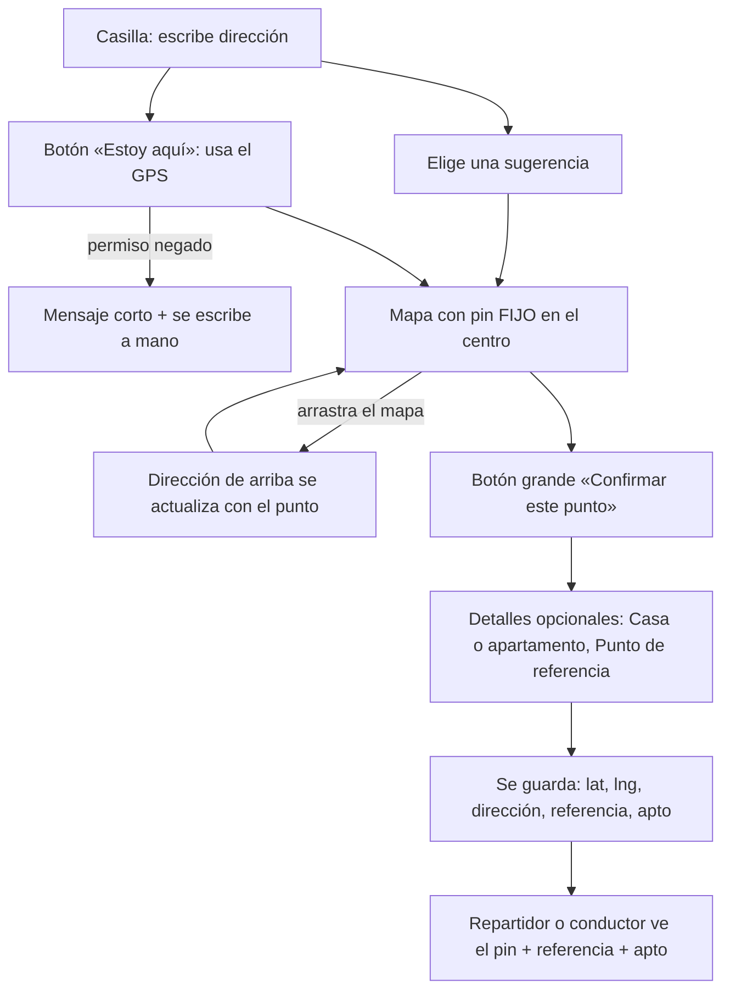

# Ficha: punto exacto de entrega y de recogida (fase cero)

Fecha: 2026-11-16. Puesto: investigador. Países: todos (Estados Unidos y Venezuela comparten el flujo; la lista de campos por país se decide en la implementación).

## 1. Referencia

Cómo Uber / Uber Eats, DiDi, Rappi, PedidosYa, inDrive y DoorDash (referencia) fijan el punto exacto donde se entrega un pedido o se recoge a un pasajero: mapa con pin, botón de confirmar, botón «usar dónde estoy», campos de detalle, punto de encuentro, falta de permiso de ubicación y lo que ve el repartidor o conductor.

Etiquetas: [REA] evidencia de REA con hash, [OBS] observación pública, [DOC] documentación o centro de ayuda publicado, [INF] inferencia, [NV] no verificable.

## 2. Evidencia y límites

### Límites de esta ficha (leer primero)

- **REA no se pudo usar.** Las herramientas de REA para web (`capture_web_screenshot`, `list_browser_targets`) exigen un navegador ya abierto con depuración local (CDP en 127.0.0.1) y en esta sesión no había ninguno. No hay captura ni hash. No hay ningún hallazgo [REA] en esta ficha. Queda como tarea: abrir un Chrome aparte con depuración y capturar como visitante la web de DoorDash y Uber Eats al poner una dirección.
- **Los centros de ayuda de Rappi, PedidosYa, DiDi e inDrive no publican (o no se encontraron) los textos exactos del flujo del mapa.** Lo que sigue de ellos es [NV] o [INF], marcado como tal. Nada de esto se presenta como confirmado.
- No se usó ninguna cuenta, no se descompiló ninguna app, no se capturó tráfico ajeno.
- Los estudios de Richard (carpeta `Proyectos Para estudiar y copiar clonar ideas /`) no se consultaron en esta pasada; queda como tarea de contraste antes de construir.

### Hallazgos por plataforma

**Uber (viajes)**
- [DOC] Para editar el punto de partida (México, español): tocar **«Editar»** junto al punto de partida, escribir otra dirección o **arrastrar el marcador** en el mapa, y tocar **«Confirmar»**. El marcador solo se mueve dentro de un **círculo gris**. El punto de partida se puede ajustar **una sola vez**. No se puede en Uber Pool. https://www.uber.com/mx/es/ride/how-it-works/change-location
- [DOC] «Pickup spots» (puntos de recogida): se puede elegir un punto distinto del sugerido moviendo el pin; hay zonas donde no se permite recoger y la app las bloquea y las resalta. https://www.uber.com/us/en/ride/how-it-works/pickup-spots
- [DOC] Definir recogida (Uruguay, español): el campo de arriba dice **«Dónde quieres que te recojamos»**; al elegir una sugerencia de la lista, **el pin se mueve solo** a ese lugar; se recomienda escribir la dirección en vez de confiar en la ubicación aproximada. https://www.uber.com/es-UY/blog/como-definir-tu-lugar-de-recogida
- [NV] Un sitio de terceros (no Uber) dice que el botón se llama «Confirm pickup»; la documentación oficial solo dice «Confirmar». Se usa «Confirmar» como el texto verificado.
- [INF] El flujo de Uber es: sugerencia, pin en el mapa, confirmar. El círculo gris evita que el pin se aleje del punto que dio el GPS o la dirección elegida.

**Uber Eats**
- [DOC] A los repartidores se les muestran los datos de entrega que dio el cliente, como el portero automático y el piso. https://www.uber.com/ar/es/deliver/basics/making-deliveries/how-to-deliver
- [NV] El mapa con pin fijo al elegir la dirección en la app de Uber Eats no está en documentación pública hallada; falta la captura [REA] como visitante.

**DoorDash (referencia)**
- [DOC] Agregar dirección: buscar la dirección, elegirla de los resultados, agregar **apartamento o suite** y **instrucciones de entrega** «si hace falta», y tocar **«Save»** / **«Save Address»** (web, iOS) o **«Save»** (Android). Para cambiar una dirección se borra y se vuelve a agregar. Con un pedido activo: **«Help»**, pestaña **«Change Addresses»**, **«Enter Address»**; las direcciones fuera de alcance del restaurante salen en gris. https://help.doordash.com/en-us/consumers/article/how-do-i-change-my-delivery-address
- [DOC] El ayuda oficial **no menciona un pin**; solo apartamento/suite e instrucciones. Apartamento y instrucciones son opcionales («si hace falta»).
- [DOC] Para quien integra su API de entregas, el repartidor puede recibir `dropoff_instructions` («instrucciones escritas para encontrar el punto exacto de entrega»), nombre del contacto y, para la recogida, `pickup_instructions`. No hay un campo de unidad propio: va dentro de las instrucciones. https://developer.doordash.com/docs/drive/how_to/pickup_dropoff_info
- [NV] Una nota de usuarios dice que en los ajustes de entrega se puede modificar el pin de una dirección guardada; no está en la documentación oficial.

**DiDi**
- [DOC] Centro de ayuda de Australia: el flujo de reserva es «escribe recogida y destino, elige vehículo, revisa y toca **CONFIRM**». No habla del pin. https://web.didiglobal.com/au/help-center/can-i-pre-book-a-trip
- [NV] Guías de viaje de terceros (no DiDi) dicen que se puede arrastrar el pin hacia un lugar donde el auto pueda parar, y que en aeropuertos y estaciones hay zonas de recogida numeradas. No son fuente oficial.
- [DOC] Para sus restaurantes en Colombia, el PDF de DiDi indica mantener y arrastrar el marcador en el mapa para fijar la posición y que la dirección se actualice desde ahí. https://web.didiglobal.com/co/restaurantes/como-cambiar-tu-direccion.pdf

**Rappi**
- [NV] No se encontró ninguna página de ayuda oficial con el texto de «punto de referencia» ni del mapa. La ficha de la app en la tienda dice que se pueden agregar direcciones precisas para evitar inconvenientes. https://apps.apple.com/MX/app/id984044296
- [OBS] Reclamos públicos de usuarios (reclamos.cl) describen pedidos entregados en otra dirección y direcciones que la app no reconoció: confirma que un error de punto es un problema real. https://www.reclamos.cl/rappi/reclamo/2025/jul/rappi-falla-en-la-aplicaci-n-en-toma-de-direcci-n
- [INF] Es muy probable que Rappi pida un campo de indicaciones o referencia para el repartidor (es el estándar de Latinoamérica), pero **no está verificado** con texto exacto.

**PedidosYa**
- [OBS] Un reclamo público de usuario cita el botón **«confirmar ubicación»** y el mensaje de que no se encontró resultado para la dirección. https://tuquejasuma.com/pedidos-ya/reclamos/no-puedo-ingresar-mi-ubicacion
- [NV] No se encontró el centro de ayuda con los campos «Referencias» ni «Piso/Depto». Se cita solo como pista.

**inDrive**
- [DOC] Noticia de producto (agosto de 2026, Sudáfrica): **Panorama View** (vista de 360 grados del punto de encuentro, aparece solo si hay imágenes de calle) y **Recommended Pickup Points** (sugiere lugares donde al conductor le es más fácil encontrar al pasajero). Si falta aclarar, pasajero y conductor siguen usando el chat de la app. https://www.itweb.co.za/article/indrive-gives-sa-riders-smarter-pickup-tool/kLgB1MezYozq59N4
- [NV] No se halló el texto exacto del botón de confirmar ni del campo de comentario de inDrive.

### Respuesta a las seis preguntas

| # | Pregunta | Lo verificado | Lo no verificado |
|---|---|---|---|
| 1 | Mapa con pin tras elegir sugerencia; botón; qué se ve arriba | Uber: elegir sugerencia mueve el pin; se arrastra el marcador y se toca «Confirmar» [DOC]. DiDi y Uber usan arrastrar el marcador [DOC]. | Si el pin queda fijo al centro y se mueve el mapa en cada app: [NV]. Texto de la dirección arriba: [INF]. |
| 2 | Botón de usar dónde está la persona | Nada con texto exacto en documentación pública. | Todo [NV]. Convención del mercado [INF]: botón con ícono de flecha de ubicación. |
| 3 | Referencia, apartamento, obligatorios | DoorDash: apartamento/suite e instrucciones, opcionales [DOC]. | Rappi y PedidosYa: [NV] (probable [INF] que tengan referencia/indicaciones). |
| 4 | Punto de encuentro en taxi/moto | Uber: «pickup spots», pin movible, zonas bloqueadas [DOC]. inDrive: puntos recomendados y panorama [DOC]. DiDi: zonas numeradas en aeropuertos [NV, terceros]. | Cómo lo confirman exactamente: Uber «Confirmar» [DOC]; el resto [NV]. |
| 5 | Sin permiso de ubicación | Uber: se escribe la dirección a mano [DOC]. | El resto [NV]. |
| 6 | Qué ve el repartidor/conductor | Uber Eats: portero automático y piso [DOC]. DoorDash: instrucciones de entrega y nombre del contacto [DOC]. | Si ve el pin exacto: [INF] que sí (navega al punto). |

## 3. Diagrama del flujo (estándar copiado)

Pin fijo al centro es [INF] del patrón de Uber/Google Maps: se mueve el mapa, no el pin. Es una decisión de Divoox, no un hecho confirmado de cada competidor.

## 4. Comparación con lo que Divoox tenía

| Parte | Mercado | Divoox antes | Brecha |
|---|---|---|---|
| Elegir dirección | Sugerencia, luego mapa con pin | Casilla con sugerencias; al elegir se guardaba sin mapa | Falta el paso del mapa; una calle o avenida larga queda con un punto cualquiera |
| Ajustar el punto | Pin movible, confirmar | El carrito tenía un mapa pequeño de tocar o arrastrar el pin | Pequeño y tarde: se mueve en el carrito, no al elegir |
| Usar dónde estoy | Botón (texto [NV]) | Sin botón dedicado | Falta |
| Referencia | Estándar en Latinoamérica [INF] | No había campo | Falta |
| Apartamento | DoorDash: opcional | No había campo propio | Falta |
| Quien entrega | Ve datos del cliente [DOC] | Solo la dirección | Falta pin y referencia |

## 5. Decisión recomendada

Una sola pieza reutilizable (sobre `CampoDireccion` y `useSugerenciasDireccion`), en web y en las tres apps, igual en todas:

1. Al elegir una sugerencia, se abre un **mapa con el pin fijo en el centro**; la persona arrastra el mapa. Arriba se ve la **dirección que sale del punto**.
2. Botón grande **«Confirmar este punto»** (en inglés **«Confirm this spot»**). Hasta que se toca, no se guarda.
3. Botón grande **«Estoy aquí»** / **«I'm here»**, con ícono de flecha, **sin la palabra «ubicación»**.
4. Dos campos opcionales: **«Punto de referencia»** (Reference point) y **«Casa o apartamento»** (House or apartment). Nunca obligatorios.
5. El mismo flujo en: entrega de comida, envíos (recogida y destino), y recogida de taxi/moto con el nombre **«Punto de encuentro»** (Meeting point) en lugar de «punto».
6. El repartidor o conductor ve el **pin en el mapa, la referencia y el apartamento**, en la oferta y en la navegación.
7. Sin permiso de GPS: mensaje corto, la casilla de escribir sigue funcionando; nunca un mapa en blanco.
8. Se guardan coordenadas reales de ese punto; el borrador del formulario se conserva (regla global de formularios).
9. Cada país mantiene su perfil: la lista de campos y los textos por país van en el perfil, no en condiciones sueltas.
10. Tarea pendiente de esta ficha: capturar con REA, como visitante, la web de Uber Eats y DoorDash, y revisar los estudios de Richard, antes de dar el diseño por cerrado. No frena la construcción.

## 6. Pruebas de aceptación

1. Elegir una sugerencia de una avenida larga abre el mapa con el pin en el centro y la dirección arriba; arrastrar el mapa cambia esa dirección.
2. Sin tocar «Confirmar este punto» no se guarda nada; al tocarlo se guardan latitud y longitud del centro.
3. «Estoy aquí» centra el mapa en el GPS; sin permiso muestra un mensaje y deja escribir a mano.
4. Los campos «Punto de referencia» y «Casa o apartamento» se pueden dejar vacíos y el pedido se hace igual.
5. Cada casilla de dirección del proyecto usa la pieza (prueba que falla si queda una suelta).
6. Pedido, viaje de moto o carro y envío terminan con coordenadas, referencia y apartamento guardados.
7. La app del repartidor y la del conductor muestran pin y referencia del pedido.
8. Cerrar y volver recupera lo escrito (borrador), salvo lo sensible.
9. Prueba en rojo comprobada: quitar el paso del mapa hace fallar la prueba.
10. Capturas reales en Docs (es e inglés) y la web, con datos de Novi en inglés.
