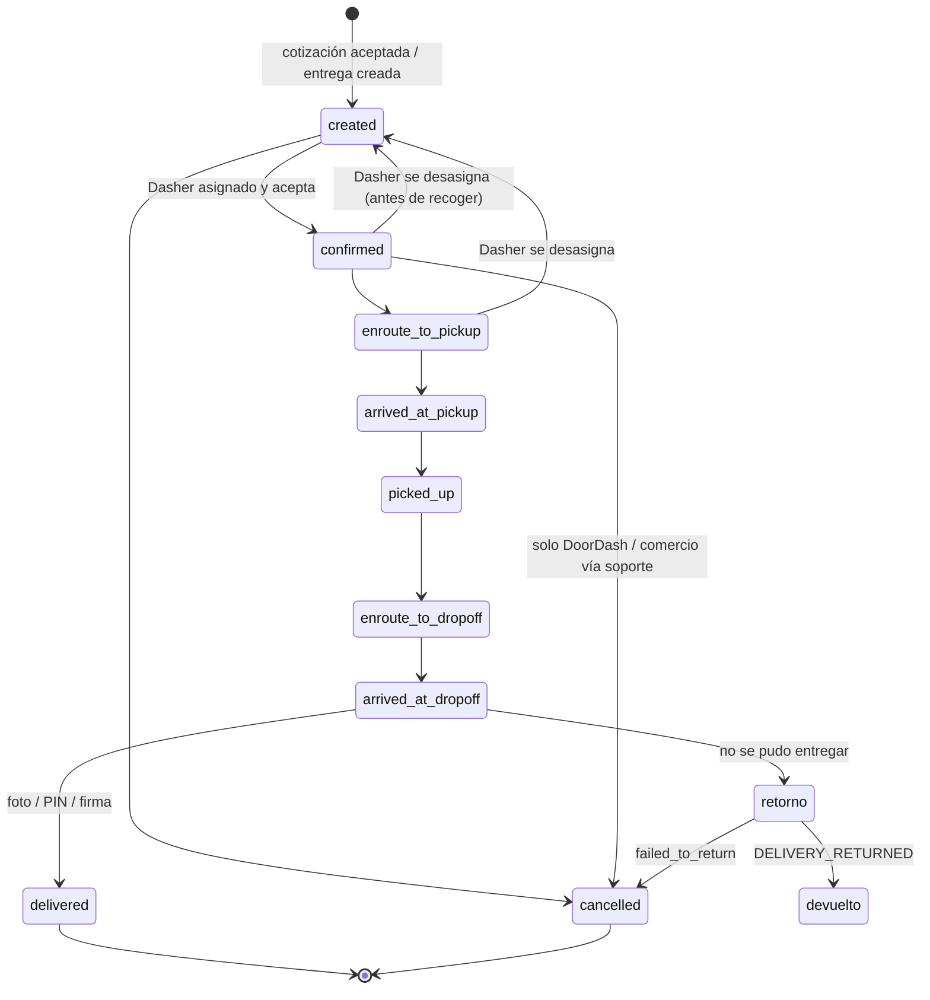
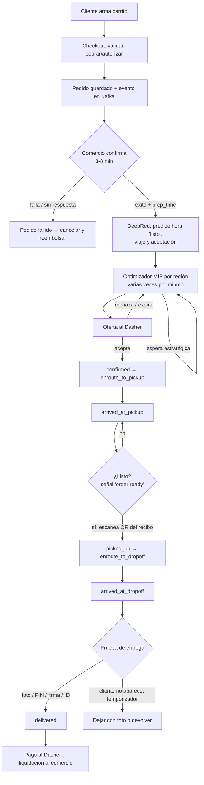
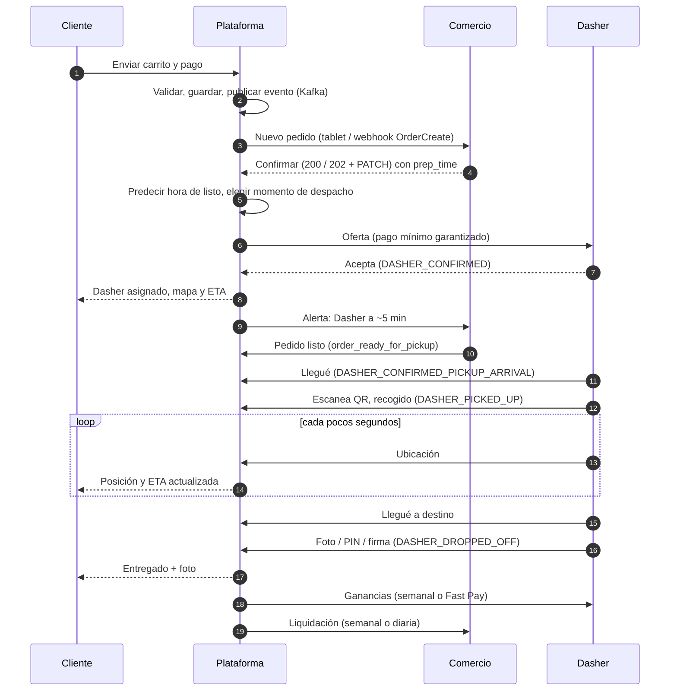

# DoorDash por dentro, según fuentes públicas — referencia técnica para Tumbite

> Fecha de la investigación: 16 de octubre de 2026.
> Alcance: solo fuentes públicas y legítimas (documentación para desarrolladores, centros de ayuda, blog de ingeniería, charlas, patentes). No se descompiló nada, no se usaron APIs privadas ni se inició sesión.

## Cómo leer este documento

- **[EVIDENCIA]**: lo dice una fuente pública. Va con el número de la fuente (lista al final).
- **[EVIDENCIA indirecta]**: el blog de ingeniería de DoorDash (careersatdoordash.com) responde **403 a cualquier acceso automatizado** (también con curl normal). No se eludió ese bloqueo. Lo que se cita del blog viene de los **extractos del buscador** sobre el post oficial o de resúmenes de terceros que lo citan. Es fiable en la idea general, menos en cifras exactas.
- **[INFERENCIA]**: deducción nuestra. No es un dato de DoorDash. Se marca para no confundirla con un hecho.
- **[TERCEROS]**: guías no oficiales; contexto, no autoridad.

Aviso importante sobre las APIs: la documentación pública describe **las APIs para socios** (Drive = DoorDash entrega pedidos de otros; Marketplace = el comercio recibe pedidos de DoorDash en su POS). Son la "cara externa" del sistema. **No describen** los servicios internos; los usamos como el mejor espejo público de cómo DoorDash modela estados, eventos y errores.

---

## Resumen ejecutivo

1. La entrega (Drive API) tiene **9 estados públicos**: `created → confirmed → enroute_to_pickup → arrived_at_pickup → picked_up → enroute_to_dropoff → arrived_at_dropoff → delivered`, más `cancelled`. Puede **volver a `created`** si el Dasher se desasigna antes de recoger. [EVIDENCIA 1]
2. Los webhooks son eventos en MAYÚSCULAS (`DASHER_CONFIRMED`, `DASHER_PICKED_UP`, `DASHER_DROPPED_OFF`, `DELIVERY_CANCELLED`…), se envían **hasta 3 veces** si no se responde 200, y la ubicación del Dasher llega **cada 30 s** en los 15 min previos a recogida/entrega. [EVIDENCIA 2]
3. `external_delivery_id` lo genera el socio y **es la llave de idempotencia**; un duplicado devuelve **409**. [EVIDENCIA 3, 4]
4. El comercio confirma el pedido en sí/no **en 3 a 8 minutos** o se da por fallido; puede mandar su propio `prep_time`; y debe enviar la **señal de "pedido listo"**, que dispara el despacho inmediato si está listo antes de lo previsto. [EVIDENCIA 6, 7]
5. El despacho (DeepRed) = **modelos de ML** (hora en que el pedido estará listo, tiempo de viaje, probabilidad de que el Dasher acepte) + **optimizador MIP** (Gurobi) que corre por regiones **varias veces por minuto**, decide agrupaciones y **retrasa a propósito** ofertas. [EVIDENCIA indirecta 20, 21]
6. Entrega con prueba: **foto obligatoria** en "dejar en la puerta", **PIN de 4 dígitos** en ciertos casos, firma o ID para restringidos; en la API: `proof_of_delivery: photo_required | pin_code`, `signature`, `id_verification`. [EVIDENCIA 4, 13, 14]
7. Cancelación del cliente: **reembolso total / parcial / ninguno** según si el restaurante confirmó y si hay Dasher asignado. [EVIDENCIA 11]

---

## A. App del cliente

### A.1 Búsqueda, descubrimiento y ranking de tiendas

- **[EVIDENCIA indirecta 23, 24]** La portada es un sistema de ranking **heterogéneo en 2D**: ordena tiendas y carruseles a la vez. Históricamente optimizado para **conversión**; luego evolucionó a multiobjetivo (satisfacción de largo plazo). Paper WSDM 2025 "Personalization at DoorDash".
- **[EVIDENCIA indirecta 25]** Usan un "universal ranker" de aprendizaje profundo con **exploración/explotación** (Upper Confidence Bound, tipo bandido multibrazo) para que tiendas nuevas tengan oportunidad.
- **[EVIDENCIA indirecta 26]** La búsqueda empezó con un ranking heurístico en **Elasticsearch (BM25 + popularidad)** y pasó a **learning-to-rank**; luego a búsqueda **personalizada** por historial de pedidos y búsquedas ("no hay un mejor orden global, depende de cada usuario").
- **[EVIDENCIA indirecta 27]** Carruseles generados con LLM y re-ranking por bloques que combina relevancia semántica con la señal de conversión.
- **[INFERENCIA]** Para una ciudad que arranca (Miami, pocas tiendas) basta un orden por distancia + disponibilidad + tiempo estimado + popularidad, y dejar un espacio de "nuevos" para exploración. El ML viene con volumen.

### A.2 Menú y modificadores

- **[EVIDENCIA 8]** Estructura pública del menú (Marketplace API): **categorías → artículos → "extras" (grupos de modificadores) → "opciones"** (los modificadores en sí). Cada nivel admite precio.
- **[EVIDENCIA 9]** Horarios por artículo y por opción (`item_special_hours`, `item_extra_option_special_hours`); si faltan, vale el horario de la tienda.
- **[EVIDENCIA 8]** Agotar en tiempo real ("86"): `PUT /api/v1/stores/{id}/items/status` y `.../item_options/status` con `is_active`. DoorDash además hace **sondeo automático de disponibilidad** tras actualizar el menú.

### A.3 Carrito, checkout y pago

- **[EVIDENCIA indirecta 28]** El checkout salió del monolito (Python, 2016) a un **microservicio en Kotlin** (2020). Su trabajo: **enviar el carrito, procesar el pago y conectar el pedido con logística**. Pila: **Cassandra** (sustituye a Postgres como almacén principal), **Kafka** para desacoplar, **Cadence** para lógica tolerante a fallos, **gRPC**. Flujo: cliente → gateway → servicio de pedidos que **valida, escribe en Cassandra y publica en Kafka**.
- **[TERCEROS 30]** Al cliente se le puede ver un **cargo pendiente (retención)** además del cargo final, que desaparece en días hábiles según el banco. DoorDash no tiene una página oficial que lo explique (no encontrada).
- **[EVIDENCIA 31]** Reembolsos: si el cargo aún está pendiente, se libera en ~3 días hábiles; si ya se asentó, el reembolso aparece en 5–7 días hábiles.
- **[INFERENCIA]** Patrón compatible con lo público: **autorizar al pagar, capturar al final** (o al confirmar), para absorber cambios (artículo agotado, propina). No hay fuente oficial de DoorDash que diga exactamente cuándo captura.

### A.4 Estimación de tiempo (ETA)

- **[EVIDENCIA indirecta 32, 33, 34]** El tiempo de entrega tiene **cola larga a la derecha**; no se modela con normal ni exponencial. Usan una base **probabilística (Weibull)** que da una _distribución_ de llegada, no un solo número; arquitectura de dos capas y multitarea; trabajo específico para eventos de cola larga (función de pérdida a medida, señales en tiempo real).
- **[EVIDENCIA 35]** Patente US11755906B2: red neuronal con **subredes, una por cada tramo entre dos eventos consecutivos del pedido** (ej. creado→confirmado, confirmado→recogido…), y ETA que se **actualiza** dinámicamente.
- **[EVIDENCIA indirecta 22]** Feature store en tiempo real: p. ej. **cuántos pedidos recibió la tienda en los últimos X minutos** alimenta el modelo de preparación (una cocina se vuelve lenta en hora pico).
- **[INFERENCIA]** Lo copiable: ETA = suma de tramos (preparación + ir a recoger + espera + viaje a entrega) y recalcularlo en cada evento. Mostrar rango ("25–35 min"), no un número.

### A.5 Seguimiento en vivo

- **[EVIDENCIA 36]** El cliente ve **tres etapas** (confirmado, en el restaurante, en camino), ETA, y un **mapa** con el Dasher en cuanto acepta. Botones para llamar o escribir al Dasher.
- **[EVIDENCIA indirecta 37]** El servicio Geo recibe la ubicación de los Dashers **en lotes cada pocos segundos a través de Kafka**. Construyeron un simulador de ubicación para probar esto.
- **[EVIDENCIA 2]** Hacia socios Drive: ubicación del Dasher **cada 30 segundos**, desde 15 min antes de la recogida o la entrega (eventos `dasher_enroute_to_pickup`, `dasher_enroute_to_dropoff`, `dasher_enroute_to_return`).
- **[INFERENCIA]** El ritmo "cada pocos segundos" es la ingesta interna; lo que se expone afuera es más espaciado (30 s). Para Tumbite: el celular manda cada 4–5 s mientras hay pedido activo; el cliente lee cada 5–10 s.

### A.6 Cambios y cancelaciones

- **[EVIDENCIA 11]** El cliente cancela desde Pedidos → Ayuda → Cancelar, **solo antes de la entrega**. Tabla oficial (pedidos que no van tarde):

| Restaurante confirmó | Dasher asignado | Reembolso |
| -------------------- | --------------- | --------- |
| No                   | No              | Total     |
| No                   | Sí              | Parcial   |
| Sí                   | No              | Parcial   |
| Sí                   | Sí              | Ninguno   |

- **[EVIDENCIA 11]** Si el problema no se resuelve con autoayuda (Dasher pide cancelar, restaurante cerrado), contactar soporte en vivo. Reembolsos y créditos a discreción de DoorDash.
- **[EVIDENCIA 5]** En Drive: `PATCH` para actualizar solo ciertos campos; para lo demás "cancelar y crear de nuevo". `PUT .../cancel`; la referencia dice que **no se puede cancelar una vez asignado el Dasher** (409 "Cancel is not allowed").

### A.7 Reembolsos y soporte

- **[EVIDENCIA 38]** Artículo faltante o incorrecto: Pedidos → Ayuda → "Missing or incorrect items" → asistente. **[TERCEROS]** La autoayuda puede dar crédito, reembolso o reenvío.
- **[EVIDENCIA 11]** Soporte 24/7 por chat y teléfono.
- **[EVIDENCIA 12]** El comercio también puede reembolsar desde su tablet (pedido completo, artículos, monto, parte de la propina), nunca más de lo pagado.

---

## B. App / tablet del comercio

### B.1 Cómo le llega el pedido ("protocolo de pedido")

- **[EVIDENCIA 15]** Opciones: **integración POS**, middleware, **tablet** (de DoorDash o Android propia) y **correo**. POS para volumen medio-alto (~300+ pedidos/mes), tablet para menor volumen, correo para muy bajo volumen. Con tablet también puede recibir por correo o fax. Impresora Bluetooth opcional.

### B.2 Recepción y confirmación (tablet)

- **[EVIDENCIA 12]** Llega con **alerta emergente**. Dos modos:
  - **Confirmación manual**: toca el pedido, ajusta minutos de preparación, confirma. Si no lo hace, queda en "Needs Action".
  - **Auto-confirm**: se confirma solo y **se asigna Dasher de inmediato**; aún puede ajustar el tiempo.
- **[EVIDENCIA 12]** Pestañas: New, In Progress, Scheduled, Needs Action, Active, All, Order History. Los programados pasan a Active según hora de recogida y tiempo de preparación.

### B.3 Confirmación por API (POS, Marketplace)

- **[EVIDENCIA 6]** Webhook `POST` con `event.type = "OrderCreate"`, `status = "NEW"` y el objeto `order` (incluye `estimated_pickup_time`, `delivery_short_code`, `fulfillment_type`, impuestos, propina al comercio).
  - **Síncrona**: responder 200 = éxito; no-2xx = fallo.
  - **Asíncrona**: responder 202 y luego `PATCH /api/v1/orders/{id}` con `order_status: success|fail`. **Si no confirma en 3–8 min**, DoorDash lo marca fallido por tiempo (la ventana la decide un planificador por pedido). Confirmar dos veces → 400.
  - Si falla, `failure_reason` obligatorio y `errors[]` con códigos: `ITEM_OUT_OF_STOCK`, `STORE_CLOSED`, `POS_OFFLINE`, `CAPACITY_THROTTLING`, `STALE_PICKUP_TIME`, `INVALID_ADDRESS`, `WEATHER_ISSUES`, etc.

### B.4 Tiempo de preparación

- **[EVIDENCIA 6]** Por defecto DoorDash calcula la recogida con su propio algoritmo. El comercio **puede** enviar `prep_time` (UTC). Advierten: **no devolver su `estimated_pickup_time` como prep_time** (infla las estimaciones). En programados apuntan a recoger 10 min antes de la ventana.
- **[EVIDENCIA 12]** En tablet: ajustar en saltos de 5 min, **solo mientras no hay Dasher asignado**.
- **[EVIDENCIA 6]** **Auto Order Release**: DoorDash retiene el pedido y lo **"libera" a cocina cuando el Dasher está cerca** (evento al endpoint del comercio, con datos del vehículo para curbside). Recomendado para comida rápida con tiempos estables.

### B.5 "Pedido listo"

- **[EVIDENCIA 7]** `PATCH .../orders/{id}/events/order_ready_for_pickup` → 202. Si el pedido está listo antes de lo estimado, **dispara la asignación del Dasher más cercano de inmediato**. Caso citado: menos llegadas tarde, menor tiempo total, menos quejas de comida fría.
- **[EVIDENCIA 12]** En tablet: botón **Ready for pickup**; si no hay Dasher, se asigna el más cercano. Recomiendan marcarlo apenas esté listo.
- **[EVIDENCIA 12]** Alerta de pantalla completa cuando el **Dasher está a ~5 minutos**. El contador de espera empieza después del tiempo de preparación confirmado.

### B.6 Artículos no disponibles

- **[EVIDENCIA 12]** Desde el pedido en vivo: marcar agotado (hasta fin de día, 4 horas o indefinido), **reemplazar**, reembolsar el artículo o añadir cargo de hasta $5 por pedido especial; luego "Confirm Order".
- **[EVIDENCIA 8]** Por API: endpoints de estado de artículo/opción.
- **[EVIDENCIA 12]** Solo el comercio puede iniciar chat con el cliente (también desde el flujo de agotado). Llamadas con **número oculto** (aparece DoorDash).

### B.7 Pausas y desactivación automática

- **[EVIDENCIA 16]** **Tablet Heartbeat**: si la tablet no puede recibir pedidos durante **5 minutos o más**, la tienda se **pausa sola**. Reabrir: tablet → Change status, o en el portal → Store Availability.
- **[EVIDENCIA 16]** Pausa voluntaria, horarios especiales, y **"Busy Kitchen"** (suma tiempo de preparación en hora pico en vez de cerrar).
- **[EVIDENCIA 16]** Desactivación temporal por calidad: esperas evitables, cancelaciones evitables (**dos o más en el mismo día** pueden pausar), artículos faltantes, problemas de recepción.

### B.8 Pagos a comercios

- **[EVIDENCIA 17]** **Semanal** (lunes–domingo; se deposita el jueves, llega ~viernes) o **diario opcional** (ventas con 3 días de atraso, solo días hábiles). Los informes muestran comisión, marketing y **"error charges"** (cargos por errores del comercio).

---

## C. App del Dasher

### C.1 Conectarse: zonas, "Dash Now" y horarios

- **[EVIDENCIA 18]** Mapa de calor con **zonas**: **roja** = se necesitan Dashers, "Dash Now" abierto; **gris** = no se necesitan, hay que **programar**; **dorada/reservada** = zona reservada para nuevos hasta un mínimo de entregas. El acceso cambia según cuántos Dashers ya hay.
- **[TERCEROS]** Turnos programados en tramos de 30 min.

### C.2 Modos de ganancia

- **[EVIDENCIA 19]** **Earn per Offer**: pago por entrega, se acepta o rechaza libremente, se ve un estimado que incluye propina.
- **[EVIDENCIA 19]** **Earn by Time**: garantía por **hora activa** (desde aceptar hasta completar) + 100% propinas; **solo 1 rechazo/desasignación por hora**; al segundo, terminar o pasar a por oferta.

### C.3 La oferta: aceptar/rechazar y métricas

- **[EVIDENCIA 10]** El monto en la pantalla de aceptación es la **ganancia mínima garantizada** para todas las entregas de esa oferta.
- **[EVIDENCIA 39]** **Tasa de aceptación** = aceptadas de las **últimas 100 ofertas**; **sin mínimo**, pero influye en el programa de recompensas. **Tasa de finalización** = completadas de las últimas 100 aceptadas; **mínimo 90%** (por debajo, riesgo de desactivación). Desasignar baja la finalización salvo ofertas "worry-free". Calificación de clientes mínima 4.2 (EE.UU.).
- **[EVIDENCIA 40]** Como contratista, el Dasher **puede rechazar cualquier oferta**.

### C.4 Asignación y despacho (DeepRed)

- **[EVIDENCIA indirecta 20]** DeepRed es el centro de la logística de última milla. Dos conjuntos de modelos:
  1. **ML** que estima cómo se desarrollaría un pedido si se le ofrece a un Dasher concreto: **cuándo estará listo**, **tiempos de viaje**, **probabilidad de aceptación**.
  2. **Optimización** que puntúa y ordena ofertas posibles, **decide agrupaciones** y **retrasa despachos estratégicamente** (despachar demasiado pronto = Dasher esperando; tarde = comida fría).
     Más plataformas de **simulación** y **experimentación**.
- **[EVIDENCIA indirecta 21]** El optimizador pasó del algoritmo húngaro a un **programa entero mixto (MIP)** resuelto con **Gurobi** (≈10× más rápido que el húngaro y ≈34× más que CBC en su prueba). Variables binarias Dasher↔pedido; la función objetivo pondera **rapidez de entrega** y **eficiencia del Dasher**. Se ejecuta en **varias instancias por región, varias veces por minuto**. El MIP permite rutas con varias entregas.
- **[EVIDENCIA indirecta 29]** Trabajo posterior: ML causal + optimización conjunta de **incentivos y tasa de agrupación**.
- **[INFERENCIA]** Para un arranque pequeño: ciclo cada 15–30 s por zona, puntuar pares (Dasher, pedido) con distancia + espera prevista en el local + retraso del cliente, y asignar el mejor. No hace falta solver comercial con pocas decenas de pedidos.

### C.5 Recogida

- **[EVIDENCIA 41]** Verificación en la tienda: el Dasher **escanea el código QR del recibo** pegado a la bolsa; la app confirma si es el pedido correcto (o se teclea el número). En la API: `pickup_verification_metadata` (p. ej. `SCAN_BARCODE`). [EVIDENCIA 4]
- **[EVIDENCIA 6]** El comercio puede dejar **instrucciones de recogida**, visibles al recibir la oferta y al llegar.
- **[EVIDENCIA 42]** Pedidos de compra (Shop & Deliver): **Red Card**, tarjeta prepago/virtual **cargada con el monto exacto** del pedido.

### C.6 Entrega con prueba

- **[EVIDENCIA 14]** "Dejar en la puerta": acordar un lugar, **foto** (puerta, número, el paquete), alejarse, marcar entregado; la foto se envía al cliente por SMS y correo. **No enviar foto puede llevar a desactivación**. La app **exige la foto** para completar.
- **[EVIDENCIA 13]** **PIN de 4 dígitos**: el cliente lo da y el Dasher lo teclea. Si no hay PIN, flujo "Cannot Collect PIN" (llamar, escribir, foto y descripción). **[TERCEROS]** Se exige en "ciertas situaciones" o si el cliente reporta problemas a menudo.
- **[EVIDENCIA 4]** En la API: `dropoff_options.proof_of_delivery` = `photo_required` o `pin_code`; `signature: required`; `id_verification: required`; `dropoff_pin_code_verification_metadata` (`pin_code_type`, p. ej. `customer_phone_number`). **El PIN solo vale si la entrega no es sin contacto ni desatendida.** Respuesta incluye `dropoff_verification_image_url`, `pickup_verification_image_url`, `dropoff_signature_image_url`.
- **[EVIDENCIA 43]** Cliente no disponible: llamar y escribir → "Can't reach customer" → **temporizador** de unos minutos → "Leave the Order" con foto y descripción, o devolución si el pedido lo exige (alcohol **nunca** se deja; se devuelve). En rutas, la devolución se crea sola y **se paga**.

### C.7 Pedidos agrupados (stacked)

- **[EVIDENCIA 44]** Dos formas: oferta que ya trae **dos o más pedidos**, o **"Add to Route"** mientras va a recoger el primero. La app sugiere el orden; el Dasher puede cambiarlo. Rechazar cualquier oferta afecta la tasa de aceptación.
- **[EVIDENCIA 2]** En Drive, `DELIVERY_BATCHED` con `force_batch_id`: entregas del mismo lote van al mismo conductor.

### C.8 Pagos y Fast Pay

- **[EVIDENCIA 10]** Pago = **base** ($2–$10+ según tiempo, distancia y atractivo) + **promociones** (Peak Pay, Challenges, Streaks, Boosts) + **100% de la propina**. La base **no cambia** según la propina.
- **[EVIDENCIA 45]** Semanal (lunes–domingo, llega ~miércoles). **Fast Pay**: retiro diario por **$1.99**, a tarjeta de débito (no prepago). DasherDirect terminó el 1 de abril de 2025 → **Crimson** (cuenta con Instant Pay).
- **[EVIDENCIA 46]** Fast Pay (Canadá, reglas publicadas): una vez al día, mínimo $2, **25 entregas** y **14 días** activos, tarjeta añadida hace **7 días**, no se pueden cobrar entregas en curso, no se cancela una vez iniciado.

---

## D. Transversal

### D.1 Estados públicos de la entrega (Drive API) — lista exacta

**[EVIDENCIA 1]** `created`, `confirmed`, `enroute_to_pickup`, `arrived_at_pickup`, `picked_up`, `enroute_to_dropoff`, `arrived_at_dropoff`, `delivered`, `cancelled`.
Nota oficial: puede pasar por `created` **más de una vez** si el Dasher se desasigna antes de recoger. La API "clásica" usaba otra lista (`scheduled`, `assigned`, `dropped_off`…).
La documentación **no publica una tabla de transiciones**; el diagrama de abajo es nuestra lectura. [INFERENCIA en las flechas]

### D.2 Eventos de webhook (Drive) — lista exacta

**[EVIDENCIA 2]**

- Todas: `DASHER_CONFIRMED`, `DASHER_CONFIRMED_PICKUP_ARRIVAL`, `DASHER_PICKED_UP`, `DASHER_CONFIRMED_DROPOFF_ARRIVAL`, `DASHER_DROPPED_OFF`, `DELIVERY_CANCELLED`.
- Con devolución: `DELIVERY_RETURN_INITIALIZED`, `DASHER_CONFIRMED_RETURN_ARRIVAL`, `DELIVERY_RETURNED`, y `DELIVERY_CANCELLED` con `reason = failed_to_return`.
- Lotes: `DELIVERY_BATCHED` (con `force_batch_id`).
- Seguimiento (a pedido): `dasher_enroute_to_pickup`, `dasher_enroute_to_dropoff`, `dasher_enroute_to_return` (ubicación cada 30 s).
- Motivos de cancelación publicados: `cancel_by_dispatch`, `cancel_by_merchant`, `cancel_by_order_placer`, `customer_requested_other`, `dasher_cannot_fulfill_other`, `dasher_not_responding`, `drive_order_picked_up_by_customer`, `duplicate_order`, `fraudulent_order`, `items_temp_unavailable`, `no_available_dashers`, `nontablet_protocol_issue`, `other`, `picked_up_by_other_dasher`, `store_cannot_fulfill_other`, `store_closed`, `test_order`, `too_busy`, `too_late`, `wrong_delivery_address`, `package_needs_redelivery`, `package_never_received`, `package_lost_at_facility`.
- Payload: `created_at`, `event_name`, `external_delivery_id`, `dasher_id`, `dasher_name` ("John D."), teléfonos del Dasher para recogida y entrega, `dasher_location`, vehículo, direcciones, `pickup_time_estimated/actual`, `dropoff_time_estimated/actual`, `fee`, `tip`, `support_reference`, `tracking_url`, `contactless`…

Marketplace (comercios): webhooks de **Orders**, **Menu Status**, **Menu Request**, **Order Release**, **Order Canceled**, **Dasher Status Updates**. [EVIDENCIA 47]

### D.3 Flujo del pedido de punta a punta

[EVIDENCIA para cada caja según secciones B, C y D; el orden "cobro antes de confirmación del comercio" es INFERENCIA compatible con el post del checkout]

### D.4 Secuencia entre las partes

### D.5 Comunicación entre componentes (lo que DoorDash explicó)

- **[EVIDENCIA indirecta 28, 48]** Migración de monolito Python a **microservicios en Kotlin** con **gRPC** (2019–2023 aprox.). Servicios **BFF** (backend for frontend) sin estado delante de servicios internos. [TERCEROS] ~500 servicios, ~100 involucrados en un pedido.
- **[EVIDENCIA indirecta 49]** Creación de la entrega: el servicio de pedidos **publica en un tópico Kafka**, workers del servicio Drive lo consumen; un registro en **Postgres** marca "en progreso". **Si falla, se lanza un workflow de Cadence** con reintentos configurables en caliente. Eligieron Cadence frente a Netflix Conductor, AWS Step Functions y soluciones propias (Kafka/Postgres), entre otras cosas para consultar workflows por ID de cliente.
- **[EVIDENCIA indirecta 49]** Reconocen que **no toda su lógica era idempotente**, y eso fue el mayor reto con Cadence; la solución principal: volver idempotente la operación.
- **[EVIDENCIA indirecta 50]** **Iguazu**: plataforma de eventos con proxy Kafka → Kafka → **Flink**; de miles de millones a **cientos de miles de millones de eventos/día**, 99,99% de entrega; latencia a Snowflake de un día a minutos.
- **[EVIDENCIA indirecta 22]** Feature store en tiempo real para decisiones de marketplace.

### D.6 Errores, reintentos e idempotencia

- **[EVIDENCIA 3]** "external_delivery_ID actúa como llave de idempotencia para evitar pedidos duplicados" (notas de versión 0.1.0). **[EVIDENCIA 4]** Duplicado → **409**.
- **[EVIDENCIA 2]** Webhooks: hasta **3 intentos** si no hay 200.
- **[EVIDENCIA 6]** Confirmación del comercio: re-confirmar → 400; tiempo vencido → fallo; códigos de error tipados.
- **[EVIDENCIA 5]** Endpoint `/drive/v2/...`; errores 400, 401, 403, 404, 409 (duplicado / "Update is not allowed" / "Cancel is not allowed"), 422 ("Delivery is not allowed"), 500. Autenticación con **JWT HS256** (`aud: doordash`, `iss` = developer id, `kid`, `exp` máx. 30 min) como `Authorization: Bearer`. [EVIDENCIA 51]
- **[EVIDENCIA indirecta 52]** Incidente de 2021: latencia en el servicio de **pagos** + **reintentos agresivos** de los clientes → falla en cascada. Resultado: **load shedding** en pagos, **circuit breaker** en el lado del Dasher para no depender de pagos, y migración a **service mesh (Envoy)**; aprendieron que el circuit breaker compartido de Envoy se comporta como un límite de tasa global.
- **[INFERENCIA]** Reglas mínimas para Tumbite: toda escritura con llave de idempotencia; webhooks entrantes deduplicados por (id de evento, id de pedido, tipo); transiciones de estado con "solo avanza si el estado actual es X"; reintentos con espera creciente y aleatoria; nunca reintentar en bucle contra pagos.

### D.7 Relación pagos–pedidos

- **[EVIDENCIA indirecta 28]** El mismo servicio de checkout envía el carrito, **procesa el pago** y engancha logística.
- **[EVIDENCIA 11, 31, 12]** Reembolsos según estado; reembolsos parciales por artículo desde el comercio.
- **[EVIDENCIA 10, 45, 17]** Dasher: base + promos + 100% propina, semanal o al instante. Comercio: semanal o diario, con comisión y cargos por error descontados.
- **[EVIDENCIA 4 (integración)]** En Drive, "el 100% de las propinas cobradas al cliente debe pasarse íntegro a DoorDash" y la propina va en **centavos**.
- **[INFERENCIA]** Tres libros separados: lo cobrado al cliente, lo que se debe al comercio, lo que se debe al Dasher; cada movimiento atado al id del pedido y conciliado contra el procesador.

---

## Lo que Tumbite puede copiar ya (INFERENCIA, priorizado)

1. **Estados con nombres de la Drive API** y la regla "vuelve a buscar Dasher si se desasigna antes de recoger".
2. **Confirmación del comercio con reloj** (3–8 min) y **pausa automática** si la tablet no responde 5 min (Heartbeat).
3. **Botón "Pedido listo"** que adelanta la asignación; **alerta "Dasher a 5 min"** en la tablet.
4. **Verificación en la recogida** con QR del recibo, y en la entrega **foto obligatoria** + **PIN opcional** (solo si no es sin contacto).
5. **Temporizador de cliente ausente** con salida "dejar con foto" o "devolver" (alcohol: siempre devolver).
6. **Tabla de reembolso por cancelación** (confirmado × asignado).
7. **Oferta con pago mínimo garantizado**, tasa de aceptación sin mínimo y finalización con mínimo.
8. **Idempotencia** por id externo en todo lo que crea algo; webhooks con 3 reintentos.
9. ETA como **suma de tramos** recalculada en cada evento, mostrada como rango.

## Lo que NO se pudo confirmar en fuentes públicas

- Momento exacto de **captura** del pago al cliente (solo terceros hablan de retención).
- Tiempo que dura una oferta en la pantalla del Dasher antes de expirar.
- Frecuencia exacta de GPS en la app del Dasher y del mapa del cliente (solo "cada pocos segundos" internamente y 30 s hacia socios).
- Tabla formal de transiciones de estados.
- Texto completo de los posts del blog de ingeniería (bloqueado a lectura automatizada; se usaron extractos).

---

## Fuentes

1. Drive — Delivery statuses: https://developer.doordash.com/docs/drive/reference/delivery_statuses
2. Drive — Webhooks reference: https://developer.doordash.com/en-US/docs/drive/reference/webhooks
3. Drive — Release notes: https://developer.doordash.com/docs/drive/overview/release_notes
4. Drive — API spec (v2): https://developer.doordash.com/en-US/api/drive
5. Drive — Integration requirements: https://developer.doordash.com/en-US/docs/drive/overview/integration_requirements
6. Marketplace — Receive orders: https://developer.doordash.com/docs/marketplace/how_to/order_integration
7. Marketplace — Order ready signal: https://developer.doordash.com/docs/marketplace/how_to/order_ready_signal
8. Marketplace — Item status (86): https://developer.doordash.com/docs/marketplace/how_to/item_status
9. Marketplace — Item level hours: https://developer.doordash.com/docs/marketplace/how_to/item_level_hours
10. Dasher — How Dasher pay works: https://help.doordash.com/en-us/dashers/article/how-is-dasher-pay-calculated
11. Cliente — How do I cancel my order: https://help.doordash.com/en-ca/consumers/article/how-do-i-cancel-my-order
12. Comercio — Tablet order manager overview: https://help.doordash.com/es-us/merchants/article/tablet-order-manager-overview
13. Dasher — PIN deliveries: https://help.doordash.com/en-us/dashers/article/doordash-pin-deliveries-or-tasks
14. Dasher — No-contact delivery / drop-off photos: https://help.doordash.com/en-us/dashers/article/confirming-delivery-drop-off-photos y https://help.doordash.com/en-ca/dashers/article/dasher-no-contact-delivery-requests
15. Comercio — Order protocol: https://help.doordash.com/en-us/merchants/article/what-order-protocol-should-i-choose-tablet-email-or-fax
16. Comercio — Temporary deactivation: https://help.doordash.com/en-us/merchants/article/temporary-deactivation
17. Comercio — Financials: https://get.doordash.com/en-us/learning-center/financials
18. Dasher — Reserved zones / Heatmap: https://help.doordash.com/en-us/dashers/article/new-dasher-navigating-reserved-zones
19. Dasher — Earn by Time: https://help.doordash.com/en-us/dashers/article/time-earnings-mode
20. Blog — Using ML and Optimization to Solve DoorDash's Dispatch Problem: https://careersatdoordash.com/blog/using-ml-and-optimization-to-solve-doordashs-dispatch-problem/
21. Blog — Next-Generation Optimization for Dasher Dispatch: https://careersatdoordash.com/blog/next-generation-optimization-for-dasher-dispatch-at-doordash/
22. Blog — Marketplace decision-making with real-time knowledge: https://careersatdoordash.com/blog/supercharging-doordashs-marketplace-decision-making-with-real-time-knowledge/
23. Paper — Personalization at DoorDash (WSDM 2025): https://dl.acm.org/doi/pdf/10.1145/3701551.3706132
24. Blog — Powering Search & Recommendations: https://careersatdoordash.com/blog/powering-search-recommendations-at-doordash/
25. Blog — Homepage recommendation with exploitation and exploration: https://careersatdoordash.com/blog/homepage-recommendation-with-exploitation-and-exploration/
26. Blog — 3 changes to expand product search: https://doordash.engineering/2022/05/10/3-changes-to-expand-doordashs-product-search/
27. Blog — GenAI homepage: https://careersatdoordash.com/blog/doordashs-next-generation-homepage-genai/
28. Blog — Building a more reliable checkout service with Kotlin: https://doordash.engineering/2021/02/02/building-a-more-reliable-checkout-service-with-kotlin/
29. Blog — Causal ML and joint optimization: https://careersatdoordash.com/blog/supercharging-doordash-logistics-through-causal-ml-and-joint-optimization/
30. [TERCEROS] Retenciones de tarjeta (contexto, no oficial): https://www.asktech.support/software/sbwfs-gm-door-dash-yesterday-using-code.html
31. Cliente — Status of credit or refund: https://help.doordash.com/consumers/s/article/How-can-I-check-the-status-of-my-Credit-or-Refund
32. Blog — Deep learning for smarter ETA predictions: https://careersatdoordash.com/blog/deep-learning-for-smarter-eta-predictions/
33. Blog — Improving ETAs with multi-task models: https://careersatdoordash.com/blog/improving-etas-with-multi-task-models-deep-learning-and-probabilistic-forecasts/
34. Blog — ETA long-tail events: https://careersatdoordash.com/blog/improving-eta-prediction-accuracy-for-long-tail-events/
35. Patente US11755906B2 (resumen): https://www.hotelmanagement-network.com/data-insights/doordash-gets-grant-for-dynamic-estimated-time-of-arrival-predictive-updates-for-delivery/
36. Cliente — Where is my order: https://help.doordash.com/en-us/consumers/article/customer-where-is-my-order
37. Blog — Location-based delivery simulator: https://careersatdoordash.com/blog/scaling-geospatial-innovation-with-a-location-simulator/
38. Cliente — Missing or incorrect item: https://help.doordash.com/en-us/consumers/article/my-order-was-missing-an-item-incorrect-order
39. Dasher — Ratings explained: https://help.doordash.com/en-us/dashers/article/dasher-ratings-explained
40. Política Dasher (Colorado): https://cdle.colorado.gov/sites/cdle/files/doordash_english.pdf
41. Dasher — Merchant to Dasher pickup verification: https://help.doordash.com/en-us/dashers/article/merchant-to-dasher-pickup-verification
42. Dasher — Red Card: https://help.doordash.com/en-us/dashers/article/how-do-i-setup-and-use-the-dasher-red-card
43. Dasher — Customer unavailable: https://help.doordash.com/en-us/dashers/article/how-to-complete-a-delivery-when-the-customer-is-unavailable
44. Dasher — Batched offers explained: https://dasher.doordash.com/en-us/blog/batched-offers-explained
45. Dasher — When do Dashers get paid: https://help.doordash.com/en-us/dashers/article/when-do-dashers-get-paid
46. Dasher — What is Fast Pay (Canadá): https://help.doordash.com/en-ca/dashers/article/what-is-fastpay
47. Marketplace — Receive delivery updates / webhooks: https://developer.doordash.com/docs/marketplace/how_to/receive_delivery_updates
48. JetBrains — DoorDash Kotlin case study: https://blog.jetbrains.com/kotlin/2020/12/doordash-building-scalable-backend-services-with-kotlin/
49. Blog — Cadence as a fallback for event-driven processing: https://careersatdoordash.com/blog/building-reliable-workflows-cadence-as-a-fallback-for-event-driven-processing/
50. QCon / InfoQ — Real-time event processing (Iguazu): https://www.infoq.com/presentations/doordash-event-system/
51. Drive — JWTs: https://developer.doordash.com/docs/drive/how_to/JWTs
52. [TERCEROS] ByteByteGo — Service mesh at DoorDash: https://blog.bytebytego.com/p/how-doordash-moved-to-a-service-mesh
