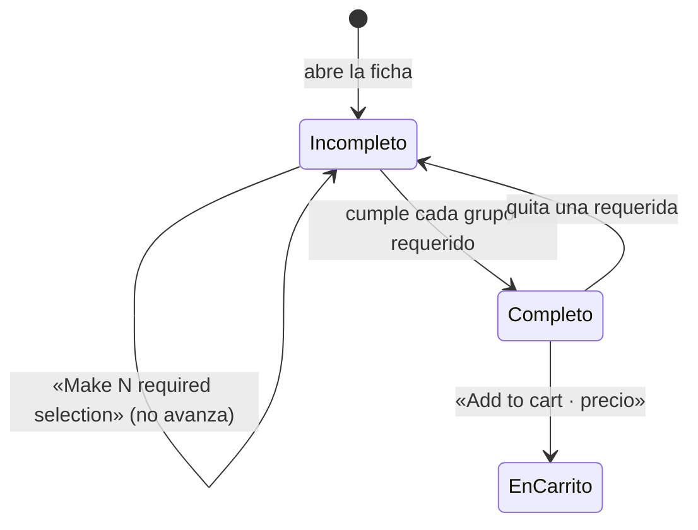
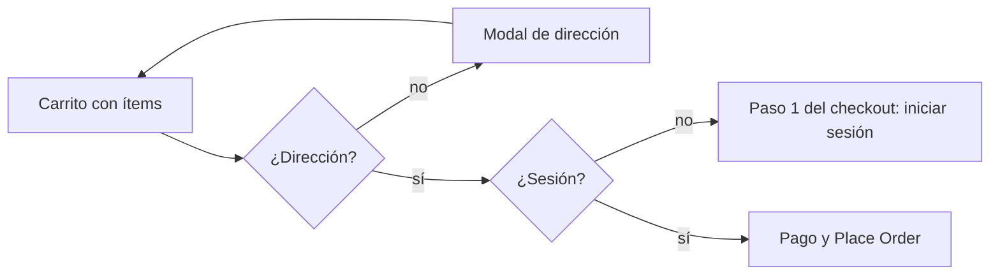

# Investigación directa de DoorDash (observación como visitante)

**Fecha:** 16 de octubre de 2026. **Rama:** `investigacion-rea`. Complementa `EVIDENCIA-DOORDASH-FUENTES-PUBLICAS.md` (52 fuentes) y `../ARQUITECTURA-REFERENCIA-DOORDASH.md`.

## Cómo se leen las etiquetas

| Etiqueta  | Significa                                                                                                 |
| --------- | --------------------------------------------------------------------------------------------------------- |
| **[OBS]** | Observación directa: lo vi en la web pública de DoorDash, como visitante sin cuenta, con captura guardada |
| **[DOC]** | Documentación pública (centro de ayuda, API para socios, blog); número de fuente en la evidencia          |
| **[INF]** | Inferencia técnica nuestra                                                                                |
| **[NV]**  | No verificable sin una cuenta o sin acceso a componentes privados; **no se intentó**                      |

## 1. Método y límites

1. **REA primero.** Lancé un Chrome oculto con `capture_browser_scenario` sobre doordash.com. La respuesta fue la **verificación anti-robots de Cloudflare** («Performing security verification», con su Ray ID en la evidencia). **No se intentó saltar**: está prohibido. Evidencia: registro 1 del paquete `evidencia-rea-2026-10-16.json`.
2. **Navegador integrado, como visitante.** Con un navegador normal la verificación pasó sola (no hubo ningún reto que completar). Se navegó **sin cuenta**: no se creó ninguna, no se inició sesión, no se entregaron datos personales. La dirección usada es pública (Bayfront Park, 301 Biscayne Blvd).
3. **Dónde se paró.** En el paso de pago, DoorDash exige iniciar sesión. Ahí terminó la observación. No se pagó nada.
4. **Lo que no se hizo:** descompilar apps, analizar su JavaScript con REA, capturar su tráfico interno, abrir la tablet del comercio ni la app del Dasher (requieren cuenta).
5. **REA sobre lo nuestro.** La misma captura se corrió sobre `staging.tumbite.com/app/` (registro 2 del paquete), para tener el mismo tipo de evidencia de nuestro lado.

Capturas: `docs/capturas/doordash-observacion/01…11.jpg`.

## 2. Experiencia del cliente (observada)

### 2.1 Navegación y descubrimiento

- **[OBS]** La portada pide dirección; al tocar el campo sin cuenta abre **el inicio de sesión** (Google, Facebook, Apple o correo) en vez de dejar escribir (captura 01). La exploración sin cuenta entra por las **páginas públicas de ciudad y de tienda** (`/food-delivery/miami-fl-restaurants/`, `/store/<nombre>-<id>/<id>/`), indexables por Google.
- **[OBS]** La página de ciudad lista «Best Nearby Restaurants Open Now»: nombre, calificación y número de reseñas, tipo de cocina, «$0 delivery fee», distancia en millas y minutos estimados, promociones («$5 off on $35+»), aviso «Farther away», y dos reseñas de clientes por tienda.
- **[OBS]** La tienda sin dirección muestra: foto, calificación, DashPass, cocina, botones **Delivery / Pickup / Group Order**, «$0 delivery fee, first order» con enlace «pricing & fees», **«Enter address to see delivery time»**, «Deals & benefits», «Featured Items» con porcentaje de aprobación y número de votos por plato (captura 02).
- **[OBS]** El menú está **partido por franja horaria** (Breakfast / Lunch / Dinner) con horario «7:00 am – 9:05 pm» y categorías repetidas por franja; «Most Ordered» es una categoría generada. Pie: «Prices on this menu are set directly by the Merchant. Prices may differ between Delivery and Pickup».
- **[OBS]** Con la dirección puesta, la tienda muestra **«4.3 mi»** y la barra de promoción «Add $13.01 to get a $5 off deal» cambia con el carrito (captura 09).

### 2.2 Catálogo y modificadores

- **[OBS]** La ficha del plato (captura 03) trae: nombre, porcentaje de aprobación y votos, descripción, foto grande, y **«Your recommended options»**: combinaciones ya elegidas por otros («#1 · Ordered recently by 10+ others: White Rice & Beans + Tostones, $23.74»), seleccionables de un toque.
- **[OBS]** Grupos de modificadores (captura 04): **«Required»** con el botón «+» por opción y **cantidad por opción** (al elegir White Rice aparece «– 1 +»), recargo por opción («Cauliflower Rice +$1.99», «Tostones +$1.75»); **opcionales** con casillas («Remove Toppings you don't like: NO Mojo Sauce, NO Sautéed Onions») y «Add a Beverage» (captura 05).
- **[OBS]** El botón inferior es **de estado**: «Make 1 required selection · $21.99» hasta cumplir lo requerido; después «Add to cart · $21.99» con el selector de cantidad del plato (captura 06). El precio del botón se recalcula con las opciones.
- **[DOC 8, 9]** Coincide con la estructura pública del menú: categorías → artículos → grupos → opciones, con precio y horario en cada nivel.

### 2.3 Dirección y preferencias de entrega

- **[OBS]** Al agregar al carrito **sin dirección**, DoorDash abre «Enter your delivery address — This will help us confirm the store's availability and delivery fees» (captura 07): la dirección es la compuerta para calcular **disponibilidad y tarifas**. Sugerencias de autocompletado con «Add a new address / Enter address manually».
- **[OBS]** «Edit Address» (captura 08): mapa con el pin y **«Adjust Pin»**, apartamento o suite, **«Drop-off Options: Hand it to me / Leave it at my door»** (por defecto «Leave it at my door») e instrucciones libres. **La preferencia de entrega vive en la dirección**, no en cada pedido.

### 2.4 Carrito

- **[OBS]** Cajón lateral (captura 10): «Your cart from Sergio's Restaurant», línea con el plato, su opción y «– 1 +»; **«Complement your cart»** (ventas cruzadas del mismo local: croquetas, pastelitos, café); **«Add items with no extra delivery fee»** con pestañas de otras tiendas cercanas (McDonald's, Chipotle…): pedidos de **varias tiendas en un solo viaje**; «Treat yourself».
- **[OBS]** El carrito **persiste en el servidor sin cuenta**: la dirección de pago lleva `order_cart_id=<uuid>` y las coordenadas de la dirección.

### 2.5 Pago (hasta donde se puede ver sin cuenta)

- **[OBS]** El checkout (captura 11) es un formulario en pasos: **1. Sign in or sign up to place order** (obligatorio), **2. Shipping details** (ya trae la dirección), **3. Payment details**; a la derecha el resumen del carrito con **«Place Order» desactivado** y «Add more items».
- **[NV]** Desglose de tarifas, propina, hora estimada y el momento de la captura del cobro: requieren sesión. **[DOC 11, 31]** reembolsos y **[DOC 30, terceros]** retención del cargo están en la evidencia.

### 2.6 Estados, confirmación, asignación y seguimiento

- **[NV]** No se puede observar un pedido en curso sin cuenta ni sin pagar. Lo que se sabe está en la referencia: **[DOC 1, 2]** nueve estados y seis eventos de la entrega; **[DOC 12]** confirmación manual o automática y tiempo de preparación; **[DOC 36]** tres etapas, mapa y botones de llamar y escribir para el cliente.

### 2.7 Errores y recuperación (observados)

- **[OBS]** Tocar la dirección sin cuenta → pide sesión, no deja a medias.
- **[OBS]** Agregar sin dirección → modal de dirección, el ítem queda en el carrito.
- **[OBS]** Un intento de abrir `identity.doordash.com` en ventana nueva fue bloqueado por el navegador; la página siguió funcionando (el inicio de sesión también existe en la misma página).
- **[OBS]** Opción requerida sin elegir → el botón explica qué falta en vez de fallar.

## 3. Experiencia del restaurante y del repartidor

- **[NV]** La tablet del comercio y la app del Dasher exigen cuenta verificada (comercio con contrato; Dasher con antecedentes). **No se intentó.**
- Lo público está en la referencia: **[DOC 12, 15, 16, 17]** tablet, protocolos, pausa automática, liquidación; **[DOC 10, 18, 19, 39, 41, 43, 44, 45]** zonas, modos de ganancia, oferta, verificación con QR, cliente ausente, agrupados, pagos.

## 4. Diagramas respaldados por la observación

### Secuencia del visitante (todo [OBS])

```mermaid
sequenceDiagram
    autonumber
    participant V as Visitante
    participant W as Web DoorDash
    V->>W: Abre la ciudad (/food-delivery/miami-fl-restaurants/)
    W-->>V: Lista pública: tiendas abiertas, distancia, minutos, reseñas
    V->>W: Abre una tienda
    W-->>V: Menú por franja horaria; «Enter address to see delivery time»
    V->>W: Abre un plato
    W-->>V: Opciones recomendadas + grupos requeridos y opcionales; botón de estado
    V->>W: Elige lo requerido y agrega
    W-->>V: Modal «Enter your delivery address» (disponibilidad y tarifas)
    V->>W: Dirección + pin + «Hand it to me / Leave it at my door»
    W-->>V: Tienda con distancia; carrito con ventas cruzadas y otras tiendas sin cargo extra
    V->>W: Continue
    W-->>V: Checkout: 1 sesión (obligatoria) · 2 dirección · 3 pago; «Place Order» apagado
```

### Estados de la ficha de un plato (máquina de estados [OBS] + [INF] en los nombres)



### Compuertas antes de pagar ([OBS])



## 5. Comparación con Tumbite, hallazgo por hallazgo

| Hallazgo [OBS]                                                  | Tumbite hoy (archivo)                                                                                          | Veredicto                                                                            |
| --------------------------------------------------------------- | -------------------------------------------------------------------------------------------------------------- | ------------------------------------------------------------------------------------ |
| Páginas públicas de ciudad y de tienda, indexables, con reseñas | La landing es pública; las tiendas solo dentro de la app (`apps/cliente`)                                      | ❌ Brecha: página pública por restaurante (SEO) — después del MVP                    |
| Dirección como compuerta para tarifas y disponibilidad          | La lista se pide con GPS o dirección guardada (`comida/useRestaurantes.ts`); el envío se calcula en el carrito | 🟡 Igual en espíritu; nosotros no bloqueamos el carrito sin dirección                |
| Menú por franja horaria con horas                               | Categorías sin franja (`catalogo.ts:416-495`); horarios solo de la tienda (`Horarios.tsx`)                     | ❌ Brecha: horario por categoría o plato — después del MVP                           |
| Modificadores con cantidad por opción y recargo                 | Grupos con mínimo y máximo (`restaurant/[id].tsx:104-121`; `pedidos.ts:316-359`), sin cantidad por opción      | 🟡 Agregar «cantidad por opción» cuando un restaurante lo pida                       |
| Opciones recomendadas (combinaciones de otros clientes)         | No existe                                                                                                      | ❌ Después del MVP (necesita volumen)                                                |
| Botón de estado «Make 1 required selection» → «Add to cart»     | Validación al agregar (`restaurant/[id].tsx`)                                                                  | 🟡 Copiar el botón de estado: es claridad, no una función                            |
| Preferencia en mano / en puerta guardada en la dirección        | Se elige por pedido y se guarda en la orden (Etapa 2½)                                                         | ✅ Nuestro modelo es más preciso para el repartidor; se puede **recordar** la última |
| Pin ajustable en el mapa                                        | `ElegirEnMapa` en `cart.tsx` guarda el punto (Hito 1)                                                          | ✅                                                                                   |
| Carrito persistente sin cuenta (`order_cart_id`)                | Carrito en el teléfono (`carrito.tsx`), con borrador                                                           | 🟡 Suficiente para una app; para la web pública haría falta carrito de visitante     |
| Ventas cruzadas en el carrito                                   | No existe                                                                                                      | ❌ Después del MVP                                                                   |
| Varias tiendas en un viaje sin cargo extra                      | Agrupados solo del mismo restaurante (`operacion.ts:1203-1250`)                                                | ❌ Después del MVP (depende del despacho)                                            |
| Checkout en pasos con sesión obligatoria                        | Registro antes de pedir (`ConSesion`)                                                                          | ✅                                                                                   |
| Porcentaje de aprobación por plato                              | Calificación de comida y repartidor por pedido (`operacion.ts:2197`)                                           | 🟡 Mostrar el «% le gustó» por plato cuando haya datos                               |

## 6. Evidencia REA de nuestro lado (registro 2 del paquete)

Captura de `staging.tumbite.com/app/` a 375 px, sin sesión, 6 s: **5 peticiones** (documento, hoja de estilos de Leaflet, el único bundle `entry-….js`, el beacon de Cloudflare Insights y su `cdn-cgi/rum`), **ninguna a `/datos`** (la app muestra «Sign in» y no pide el catálogo ni lo público hasta tener sesión), sin WebSocket, almacenamiento vacío, un aviso de consola («Password field is not contained in a form»). Confianza: `observed`.

**[INF]** Dos cosas que salen de ahí: el bundle único de ~3 MB es la primera carga de cada visitante (ver el diseño WebP y el plan v2), y el campo de contraseña fuera de un `<form>` impide que el navegador ofrezca guardar la clave.
