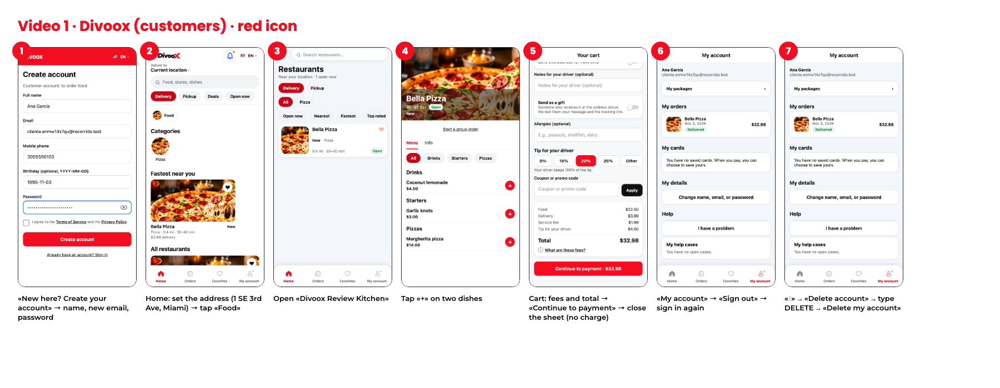
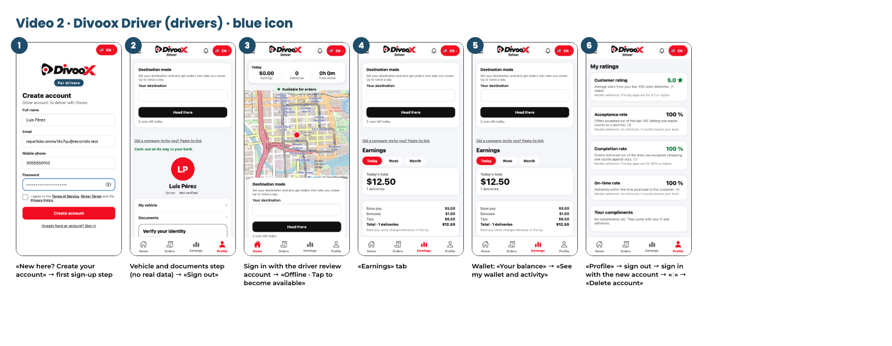
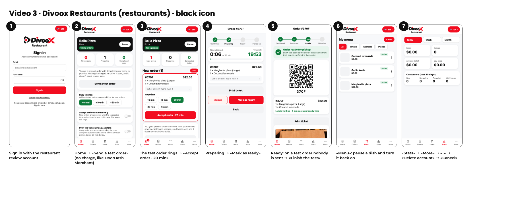

# Guion de los tres videos para Apple (versión final, 3 nov 2026)

Complementa el guion de Gerencia (GUION-VIDEOS-APPLE-DIVOOX, en la carpeta Gerencia). Aquí van los nombres exactos de los botones en inglés, una lámina por video con la captura de cada paso, y cómo se hace el pedido de prueba sin cobro real.

Se graba con las compilaciones de TestFlight que traen los íconos nuevos (cliente rojo, Driver azul, Restaurants negro). Gerencia avisa cuándo están.

## El pedido de prueba sin cobro real: qué quedó

Producción cobra con Stripe en vivo, y la tarjeta de prueba no funciona ahí. Probar con una tarjeta real está prohibido (regla del proyecto). Activar el efectivo en Estados Unidos sería cambiar la configuración de dinero del país entero, así que se descartó. Queda así, con lo que ya existe y ya tiene candado:

1. **Restaurants: «Send a test order»**, igual que el «Create test order» de DoorDash Merchant (candado C-PEDIDO-PRUEBA, en producción desde el 2 nov). Llega un pedido de mentira con platos del menú, con su alarma y la insignia «TEST». El restaurante lo acepta, lo marca listo y lo termina con «Finish the test». No se cobra nada, no se manda repartidor y no cuenta en las ventas. Vive en su propia tabla, fuera de la conciliación y de los pagos.
2. **Cliente: se llega hasta la hoja de pago y se cierra sin pagar.** Así lo dicen las notas para el revisor desde el 31 oct: «Paying is optional for review: everything up to the payment sheet can be reviewed without a charge». Las compras son bienes físicos y servicios entregados en persona, por eso van con Stripe y no con las compras dentro de la app de Apple.
3. **Driver: entrega de práctica** (C-ENTREGA-PRACTICA, ordenada por Gerencia el 3 nov). El «Send a test order» de la cuenta de revisión del restaurante, una vez aceptado, le llega como oferta SOLO a la cuenta de revisión del repartidor, con $0.00 y la nota «Practice delivery: nothing is charged or paid». Se acepta, se recoge y se entrega igual que una de verdad, sin cobro, sin pago y fuera del dinero.

## Video 1: Divoox (clientes), ícono rojo

1. Pantalla de inicio del iPhone → tocar el ícono rojo de **Divoox**.
2. **«New here? Create your account»** → «Full name», «Email» (un correo nuevo), «Mobile phone», «Password» → marcar «I agree to the Terms of Service…» → **«Create account»**.
3. Arriba, **«Deliver to»** («Current location»): en Novi, con la ubicación de Richard, ya sale «Divoox Review Kitchen» (27500 Novi Rd, a unas 2 mi). Si no, en **«Delivery address»** escribir 27500 Novi Rd, Novi, MI 48377 y elegir la sugerencia.
4. Tocar **«Food»** → abrir **«Divoox Review Kitchen»** (sale abierto aunque nadie tenga abierta la app Restaurants).
5. Tocar **«+»** en dos platos → abrir el carrito → mostrar «Food», «Delivery», «Service fee», «Tip for your driver» y «Total» → **«Continue to payment»** → cerrar la hoja de pago sin pagar.
6. Pestaña **«My account»** → **«Sign out»** → **«Sign in»** con el mismo correo.
7. **«My account»** → **«⋮»** junto a «Your account» → **«Delete account»** → escribir **DELETE** → **«Delete my account»** → la app vuelve a la pantalla de entrar.

## Video 2: Divoox Driver (repartidores), ícono azul

1. Pantalla de inicio del iPhone → tocar el ícono azul de **Divoox Driver**. La pantalla de entrar dice «For drivers» en azul.
2. **«New here? Create your account»** → nombre, correo nuevo, celular y clave → aceptar los términos → **«Create account»** → mostrar el primer paso del alta (vehículo y documentos), sin datos reales.
3. **«Profile»** → **«Sign out»** → **«Sign in»** con la cuenta de revisión del repartidor.
4. Aceptar los permisos de ubicación cuando la app los explique → tocar **«Offline · Tap to become available»** → queda «Online: receiving orders» y se ve el mapa.
5. **La entrega de práctica:** en la Mac, con el panel del restaurante de revisión abierto, tocar **«Send a test order»** y **«Accept order»**. En el iPhone llega la oferta con $0.00 → **«Accept»** → **«Take a photo of the order»** (recoger) → sale en camino → **«Take the delivery photo»** (entregar). En la práctica no hace falta estar en el restaurante ni en la puerta. Si el restaurante todavía no marcó **«Mark as ready»**, se marca en la Mac.
6. Pestaña **«Earnings»** (Today, Week, Month) → la billetera: **«See my wallet and activity»**.
7. **«Profile»** → **«Sign out»** → entrar con la cuenta nueva del paso 2 → **«⋮»** junto a «Your account» → **«Delete account»** → escribir **DELETE** → **«Delete my account»**.

## Video 3: Divoox Restaurants (restaurantes), ícono negro

1. Pantalla de inicio del iPhone → tocar el ícono negro de **Divoox Restaurants**.
2. Mostrar el texto «Restaurant accounts are created at divoox.com/panel» → **«Sign in»** con la cuenta de revisión del restaurante.
3. En el inicio → **«Send a test order»**.
4. Suena la alarma y llega el pedido con la insignia **«TEST»** → **«Accept order · 20 min»**.
5. **«Mark as ready»** → **«Finish the test»**.
6. Pestaña **«Menu»** → pausar un plato y volver a activarlo → **«Stats»**.
7. **«More»** → **«⋮»** junto a «Your account» → **«Delete account»** → mostrar la confirmación → **«Cancel»** (la cuenta de revisión no se borra).

## Las cuentas

Qué cuenta va en cada app y en qué orden está en el archivo privado de cuentas de prueba (docs/CUENTAS-DE-PRUEBA.md, fuera de git). Las contraseñas no van en el chat.
