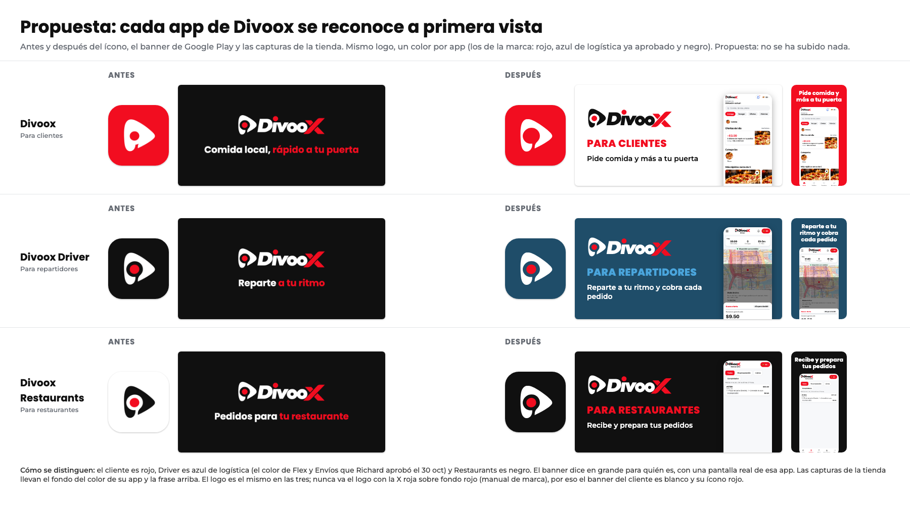

# Propuesta: que cada app de Divoox se reconozca a primera vista (3 nov 2026)

Pedido de Richard (por Gerencia). En Google Play las tres apps se ven iguales: los tres banners son el mismo fondo negro con el logo y una frase pequeña. Apple puede leer eso como apps repetidas (pauta 4.3). **Es solo una propuesta: no se ha subido nada a ninguna tienda.**

## La idea

Mismo logo en las tres. Cada app tiene su color, y su banner dice en grande para quién es, como en DoorDash, que tiene una app para clientes, otra para repartidores (Dasher) y otra para comercios (Merchant). Los colores son los que la marca ya permite:

| App                | Color                                                               | Ícono                                      | Banner de Google Play                                                          | Capturas de la tienda               |
| ------------------ | ------------------------------------------------------------------- | ------------------------------------------ | ------------------------------------------------------------------------------ | ----------------------------------- |
| Divoox             | Rojo #F20D20                                                        | Igual que hoy (rojo con el isotipo blanco) | Blanco, logo para fondo claro, «PARA CLIENTES» en rojo, pantalla real          | Fondo rojo, frase arriba en blanco  |
| Divoox Driver      | Azul de logística #1F4D69 (el de Flex y Envíos, aprobado el 30 oct) | Cambia de negro a azul, mismo isotipo      | Azul, logo para fondo oscuro, «PARA REPARTIDORES» en azul claro, pantalla real | Fondo azul, frase arriba en blanco  |
| Divoox Restaurants | Negro #101010                                                       | Cambia de blanco a negro, mismo isotipo    | Negro, logo para fondo oscuro, «PARA RESTAURANTES» en rojo, pantalla real      | Fondo negro, frase arriba en blanco |

Reglas del manual que se respetan:

- **El logo no se dibuja de nuevo.** Se usan los vectores aprobados de la carpeta identidad-divoox.
- **La X roja nunca va sobre rojo.** Por eso el banner del cliente es blanco y su ícono rojo lleva solo el isotipo.
- **Sin colores nuevos.** El azul es el color de logística que Richard ya aprobó.
- **Pantallas reales.** Las que salen en banners y capturas son de la app de verdad: las del recorrido.

Antes de hacerlo, la ficha REA tiene que confirmar cómo se ven hoy las fichas públicas de DoorDash, Dasher y DoorDash Merchant, mirándolas como cualquier visitante.

## Qué se puede cambiar sin subir una compilación nueva

**Apple (App Store Connect).** La versión 1.0 de las tres apps está «Rechazada», y en ese estado la ficha se puede editar.

- **Sin compilación nueva:** las capturas de pantalla, el texto promocional, la descripción, las palabras clave, el subtítulo y el nombre de la ficha (por ejemplo, «Divoox Driver: para repartidores»).
- **Con compilación nueva:** **el ícono.** En iPhone el ícono viene dentro de la compilación, y la tienda muestra el de la compilación que se adjunta. Cambiar el ícono de Driver y de Restaurants exige compilar otra vez y adjuntar esa compilación a la versión. Eso queda prohibido mientras siga la pausa de Gerencia.

**Google Play (Play Console).**

- **Sin compilación nueva:** el banner (gráfico destacado de 1024 × 500), el ícono de la ficha (512 × 512), las capturas y los textos. Ojo: cambiar la ficha la manda a revisión de Google. Antes se comprueba que no haya una revisión en curso (candado C-PLAY-NO-CANCELAR).
- **Con compilación nueva:** el ícono que queda en el celular al instalar la app.

## Cómo se haría, cuando Gerencia y Richard lo aprueben

1. Generar los íconos y banners desde los vectores aprobados (scripts/marca/generar-identidad.mjs), nunca a mano.
2. Rehacer las capturas de la tienda de cada app con su fondo y su frase (scripts/tiendas/capturas-app-store.mjs y capturas.mjs).
3. Apple: cargar las capturas nuevas en la ficha rechazada (sin compilación). El ícono va en la próxima compilación, con la pausa ya levantada.
4. Google: subir el banner, el ícono de la ficha y las capturas cuando no haya revisión en curso.
