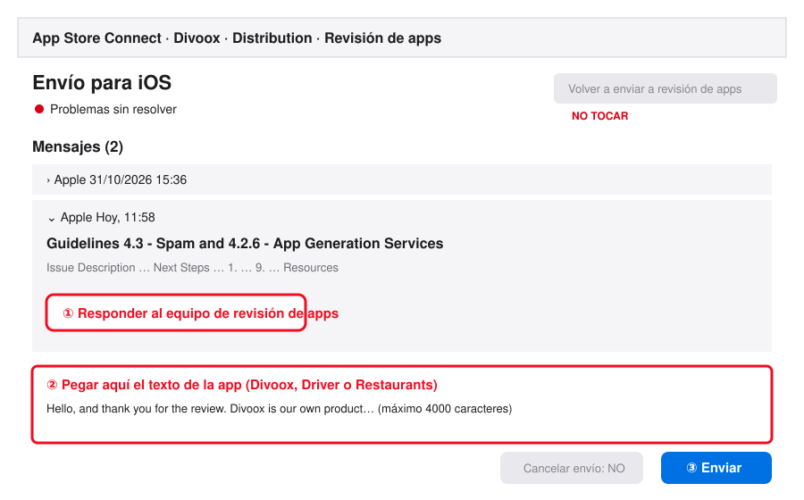

# Tutorial: el rechazo de Apple a las tres apps de Divoox (3 nov 2026)

Apps: Divoox (cliente, compilación 11), Divoox Driver (compilación 7) y Divoox Restaurants (compilación 2), versión 1.0. Rechazadas el 3 nov 2026 a las 11:58 de Miami, el mismo minuto que las demás apps de la cuenta de Windoce LLC.

**Regla mientras dure esto (orden de Richard, por Gerencia):** nadie reenvía a revisión, nadie sube compilaciones a App Store Connect, nadie cancela envíos y nadie le escribe a Apple hasta que Richard apruebe el estudio común de la cuenta.

---

## 1. Qué dijo Apple

Dos mensajes en cada app, leídos en App Store Connect → la app → Distribución → Revisión de apps → el envío de iOS. Motivo que figura en el envío: **«4.3.0 Design: Spam»**.

**Mensaje del 3 nov, 11:58 (el rechazo), literal:**

> Guidelines 4.3 - Spam and 4.2.6 - App Generation Services
>
> Issue Description
>
> The app does not appear to meet App Store requirements to prevent the distribution of spam submissions.
>
> Specifically, the app appears to match one or more of the following kinds of spam, which make it harder for users to find the apps they want:
>
> - Apps that duplicate content or functionality already on the App Store. See guideline 4.3(a).
> - Apps that are indistinguishable from what's already widely available or is an opportunistic variant of an existing category or popular app. See guideline 4.3(b).
> - Apps that are created from a commercialized template or app generation service but are not submitted directly by the provider of the app's content. See guideline 4.2.6.
>
> Next Steps
>
> If any of the above descriptions apply to this submission, do not resubmit for review until significant changes have been made to resolve this issue. If the app is resubmitted without substantial improvements, it will be rejected again, and may be rejected for additional issues.
>
> If you believe the app already meets the requirements of guidelines 4.3(a), 4.3(b) and 4.2.6, do not resubmit the app. Instead, reply to this message and answer all of the following questions in full:
>
> 1. Describe in detail what this app does and the primary problem it solves for users. Do not use the App Store marketing description as your response.
> 2. Who is the intended user of this app? Provide a detailed description of the specific target audience.
> 3. What need or gap in the market does this app address that existing apps do not currently address, or address less effectively? Provide a detailed, substantive explanation.
> 4. What beta testing did you conduct before submitting the app for review? Provide examples of user feedback provided in beta that was applied to the production build.
> 5. Is this app intended to function as a standalone product, or is it part of a suite of related apps published under your developer account? If part of a suite, provide a detailed description of how this app's scope and functionality differ from each other app in the suite.
> 6. Could the functionality of this app be fully delivered as an in-app purchase, feature expansion, or content addition within any other app on your developer account? If so, provide a detailed explanation of why this functionality was not consolidated into that existing app.
> 7. Does this app's binary share any significant code, frameworks, or assets with any other app on your developer account, beyond standard third-party frameworks? If so, identify each shared component and describe its role in detail.
> 8. Does this app share any codebase, SDK, or content library with any third-party app, beyond standard third-party frameworks? If so, identify the shared component and provide a detailed explanation of the original functionality this app adds beyond it.
> 9. Was this app created for a client, partner, or other third party who provided the app's content, concept, or branding? If so, identify who provided the content and provide a detailed explanation of why the app is submitted under your developer account rather than theirs. Note that guideline 4.2.6 requires apps built from a commercial template or app generation service to be submitted directly by the provider of the app's content, not on their behalf by the template or service provider.
>
> Resources
>
> - Learn more about requirements to prevent spam on the App Store in guideline 4.3.
> - Learn more about requirements for apps created from a template or app generation service in guideline 4.2.6.
> - Use TestFlight to share the app with beta testers and gather feedback before resubmitting.

**Mensaje anterior, 31 oct, 15:36 (pidió información; motivo «2.1.0 Performance: App Completeness»), lo que importa para el video, literal:**

> 1. A screen recording captured on a physical device, running the latest operating system, demonstrating the app's functionality. The recording must begin with launching the app and show the typical user flow. If the app has any of the following, include them in the recording:
>
> - Account registration, login, and account deletion flows. Account deletion is required in apps that support account creation.

Ese mismo mensaje pidió también, en las notas para el revisor: el propósito y el público, cómo entrar (con la cuenta de cada tipo de usuario), los servicios externos y las diferencias por país. Eso ya está cargado en las notas de las tres apps.

## 2. Por qué pasó

Lo que dicen las pautas oficiales de Apple (App Review Guidelines, leídas el 3 nov 2026):

- **4.3(a):** «Don't create multiple Bundle IDs of the same app». Tres apps de la misma marca, con la misma pantalla de entrar, se pueden leer como tres copias de una misma app.
- **4.3(b):** «Don't submit apps that are indistinguishable from what's already widely available». Una app de reparto con la estructura de DoorDash y Uber Eats, sin algo propio a la vista, encaja ahí.
- **4.2.6:** las apps hechas «from a commercialized template or app generation service» se rechazan si no las sube el dueño del contenido. La misma pauta pone como ejemplo válido de modelo agregado «a restaurant finder app with separate customized entries or pages for each client restaurant».

Lo que vimos en nuestras apps y en lo que recibió el revisor (hechos, no suposiciones):

1. **Es una revisión de la cuenta entera.** Apple rechazó en el mismo minuto casi todas las apps de Windoce LLC (Kipuu, FinTwin, QRbott, Escenia, Mercatren y otras). Muchas apps nuevas de una misma cuenta, en pocos días y hechas con las mismas herramientas (Expo y React Native), son justo lo que la pauta 4.3 vigila. Esto se contesta igual en todas las apps (línea común de Gerencia).
2. **Las tres apps de Divoox se ven iguales al abrirlas.** En los videos, la pantalla de entrar de Divoox Driver tiene la misma cabecera roja «Divoox» y el mismo formulario que la del cliente; solo cambia una línea de texto.
3. **El revisor ve contenido de prueba.** En el video del cliente aparecen un restaurante llamado «Café Fountain Walk (prueba)», ofertas marcadas «Sample» y un restaurante «Divoox Review Kitchen» sin pedidos. Eso se parece a una plantilla rellena.
4. **Los videos no cumplen lo que Apple pidió el 31 oct** (punto 3 de abajo).

## 3. El video que grabó Richard: no sirve y hay que rehacerlo

Los tres videos (cliente, 53 segundos; Driver, 60; Restaurants, 64; grabados en un iPhone de verdad) están adjuntos en App Store Connect. No cumplen lo que pidió Apple el 31 oct:

| Lo que pide Apple (mensaje del 31 oct)                    | Lo que muestra el video                                                                                                                                                                                   |
| --------------------------------------------------------- | --------------------------------------------------------------------------------------------------------------------------------------------------------------------------------------------------------- |
| «must begin with launching the app»                       | Empieza ya dentro de la app, en la pantalla de entrar.                                                                                                                                                    |
| «show the typical user flow»                              | El cliente llega al pago y no lo termina; nadie ve el pedido llegar al restaurante ni al repartidor.                                                                                                      |
| «Account registration, login, and account deletion flows» | Se ve entrar a la cuenta. No se ve crear una cuenta. «Delete account» aparece como botón, pero no se usa.                                                                                                 |
| (nada que confunda)                                       | Aparece el gestor de contraseñas con correos de otras empresas de Richard, un restaurante «(prueba)», ofertas «Sample» y, al final del de Restaurants, la pantalla de inicio con otras apps de la cuenta. |

### Guion de los tres videos nuevos

**Antes de grabar (los tres):**

- iPhone con la última versión de iOS, en inglés, con «No molestar» activado y sin notificaciones a la vista.
- La app en inglés (selector «EN» arriba).
- **Gestor de contraseñas apagado para el video**: Ajustes → General → Autorrelleno y contraseñas → apagar «Autorrellenar contraseñas y llaves de acceso». Así no salta la ventanita con correos de otras empresas. Se vuelve a encender al terminar.
- Un correo nuevo para cada cuenta que se crea en el video (no el de la cuenta de revisión, porque esa no se borra), y la contraseña escrita a mano.
- Los tres videos se graban con la grabación de pantalla del iPhone (Centro de control → botón de grabar). Al terminar, el video se corta para que empiece en la pantalla de inicio del iPhone y no en el Centro de control.
- Si los restaurantes de prueba siguen saliendo con «(prueba)», no se graba hasta que se arreglen (punto 4).

**Video 1, Divoox (cliente), unos 2 minutos:**

1. Pantalla de inicio del iPhone → tocar el ícono rojo de Divoox.
2. «New here? Create your account» → nombre, el correo nuevo y una contraseña → crear la cuenta.
3. Permitir la ubicación o escribir una dirección de entrega (se ve cómo sugiere direcciones reales).
4. En la portada, tocar Comida → abrir un restaurante → agregar dos platos → ver el carrito con el envío, las tasas y el total.
5. Pagar con la tarjeta de prueba o llegar hasta la hoja de pago y explicar en las notas que el pago es con Stripe. Si se paga, mostrar el pedido con sus pasos y el mapa.
6. Mi cuenta → «Sign out» → volver a entrar con el mismo correo (se ve el inicio de sesión).
7. Mi cuenta → los tres puntos → «Delete my account» → confirmar → se ve que la cuenta se borró y la app vuelve a la pantalla de entrar.

**Video 2, Divoox Driver, unos 2 minutos:**

1. Pantalla de inicio del iPhone → tocar el ícono negro de Divoox Driver.
2. «New here? Create your account» → crear la cuenta de repartidor con el correo nuevo y mostrar el primer paso del alta (vehículo y documentos), sin datos personales reales.
3. «Sign out» y entrar con la cuenta de revisión de repartidor (ya aprobada), para mostrar el trabajo de verdad: explicación de los permisos, «Go online», el mapa con las zonas, una oferta con el pago antes de aceptar, aceptar, recoger con foto y entregar.
4. Ganancias y billetera en las pestañas de abajo, y el botón de seguridad.
5. Salir, entrar con la cuenta nueva del paso 2 → Perfil → «Delete account» → confirmar → se ve que la cuenta se borró.

**Video 3, Divoox Restaurants, unos 2 minutos:**

1. Pantalla de inicio del iPhone → tocar el ícono blanco de Divoox Restaurants.
2. Mostrar que los restaurantes se dan de alta en la web (el texto de la pantalla de entrar lo dice) y entrar con la cuenta de revisión del restaurante. Desde este momento el restaurante sale abierto para el cliente: sin la app de Restaurants abierta, el cliente lo ve cerrado.
3. Llega un pedido nuevo con su alarma (que alguien haga un pedido desde la app del cliente en otro teléfono) → aceptarlo → «Ready» → se ve al repartidor que viene.
4. «My menu» → pausar un plato y volver a activarlo → Horario → Estadísticas → Ganancias.
5. More → «Delete account» → mostrar la confirmación y cancelarla (la cuenta de revisión no se borra). En las notas se explica que la cuenta del restaurante se borra igual que en las otras apps.

**Al terminar:** los tres videos se guardan con su nombre (video-apple-divoox, video-apple-driver, video-apple-restaurants) en la carpeta Divoox-privado, videos-apple. La IA los sube como adjunto de cada app solo cuando Gerencia y Richard den el «sí».

## 4. Qué arreglamos nosotros (y qué falta)

Ya en vivo (no se ha subido a Apple, por la orden de no subir nada):

- La portada del cliente ya no muestra ofertas «Sample» ni servicios «Pronto»: solo lo que funciona (C-SOLO-LO-TERMINADO, 3 nov).
- La pantalla de un servicio que todavía no llega a tu ciudad ya no muestra la lista «Ejemplo» / «Sample» (3 nov, con su prueba en rojo).
- La tarea de tiendas alcanzó a subir a TestFlight la compilación 25 del cliente y la 21 de Driver antes de la pausa: solo TestFlight, no revisión. Esas sirven para grabar los videos nuevos.
- Las respuestas a las nueve preguntas están escritas, con la línea común de la cuenta y por debajo de 4000 caracteres: RESPUESTA-APPLE-4.3, en esta misma carpeta.

Lo que queda para cuando Richard apruebe el estudio común (no se empieza antes):

- Dar a cada app su propia cara desde la primera pantalla, con los colores oficiales de sus íconos: cliente en rojo, Driver en negro, Restaurants en blanco.
- **Necesita el sí de Richard (base de producción):** en Novi, Michigan, producción muestra cuatro restaurantes de prueba con «(prueba)» en el nombre: Burger Town Center, Pizzería Novi, Tacos Twelve Oaks y Café Fountain Walk. La recomendación es pausarlos (no se borra nada) y que el revisor y el video usen el restaurante de la cuenta de revisión, con menú y fotos reales. En Miami solo aparece el restaurante de la cuenta de revisión.
- Grabar los tres videos nuevos (punto 3) y cambiarlos en las notas para el revisor.
- Mandar la respuesta en cada app. Es un mensaje en nombre de Windoce y lo autoriza Richard.

## 5. Qué tiene que hacer Richard, paso a paso

Hoy solo dos cosas: aprobar el estudio común de Gerencia y, cuando lo apruebe, grabar los videos nuevos. No toques nada en App Store Connect hasta entonces.

Cuando se autorice responder, se hace así en cada una de las tres apps:

1. Entra a App Store Connect con tu cuenta (go@windoce.com) → Apps → Divoox → Distribution → Revisión de apps → el envío de iOS con «Problemas sin resolver».
2. En «Mensajes», abre el de hoy y toca **«Responder al equipo de revisión de apps»**.
3. Pega el texto de esa app desde RESPUESTA-APPLE-4.3 (uno distinto para Divoox, Driver y Restaurants).
4. Toca **Enviar**.

**No toques:**

- «Volver a enviar a revisión de apps»: si se reenvía sin cambios grandes, Apple la rechaza otra vez.
- «Cancelar envío» ni «Eliminar»: se pierde el hilo de mensajes con el revisor.
- No subas compilaciones nuevas mientras se espera la respuesta.

**Cómo se sabe que salió bien:** tu mensaje aparece en «Mensajes», debajo del de Apple. La respuesta del revisor llega por correo a go@windoce.com y aparece en esa misma página.

## 6. Preparación final (3 nov 2026, plan aprobado por Richard: Divoox primero, las tres apps el mismo día)

Nada de esto sale hacia Apple hasta el último «sí» de Richard, con los videos ya grabados. No se sube ninguna compilación a revisión.

### 6.1 Cuentas de prueba (una por app, las que ya están cargadas en App Store Connect)

| App         | Cuenta                          | Qué ve hoy en producción (leído el 3 nov, sin entrar)                                                                                                                                                                        |
| ----------- | ------------------------------- | ---------------------------------------------------------------------------------------------------------------------------------------------------------------------------------------------------------------------------- |
| Divoox      | revisor.cliente@windoce.com     | Desde el 3 nov el restaurante de revisión está en Novi, Michigan (27500 Novi Rd), abierto sin depender de su app (C-REVISION-SIN-SENAL). En Novi (Michigan), cuatro restaurantes con «(prueba)».                             |
| Driver      | revisor.driver@windoce.com      | Perfil «Soporte Revisor Driver», verificado.                                                                                                                                                                                 |
| Restaurants | revisor.restaurante@windoce.com | «Divoox Review Kitchen (Soporte)»: descripción «Restaurante de prueba para los revisores» / «Test restaurant for the app store reviewers», teléfono +1 305 000 0000, sin foto, cerrado, un solo plato con un error («Papá»). |

**Hecho el 3 nov 2026, ~14:20 Miami, por orden de Gerencia (plan aprobado por Richard):** los cuatro de Novi quedaron pausados y el restaurante de revisión se llama «Divoox Review Kitchen», con descripción limpia, abierto, y el plato con la descripción corregida. Comprobado en vivo: en Novi el cliente ya solo ve «Restaurante el Beef USA»; en Miami, «Divoox Review Kitchen», sin «prueba», «Sample» ni «Ejemplo». Copia de las filas de antes en la carpeta privada Divoox-privado, estudios, apple-4.3-2026-11-03.

**Ojo para el revisor y el video:** como en DoorDash, un restaurante solo recibe pedidos mientras su app o su panel está encendido (C-PAUSA-SIN-SENAL). Para que «Divoox Review Kitchen» salga abierto, la app Divoox Restaurants tiene que estar abierta con la cuenta de revisión. Va en las notas nuevas y en el guion.

Lo que se hizo y lo que queda:

1. ✅ **Pausar** los cuatro restaurantes de prueba de Novi (Burger Town Center, Pizzería Novi, Tacos Twelve Oaks y Café Fountain Walk). Solo pausar: `estado = 'pausado'`, `abierto = 0`; no se borra nada. **Cómo se reactivan:** superadmin → Restaurantes → cada uno → «Reactivar» (o `estado = 'aprobado'` y `abierto = 1` en esos cuatro id: 8c5f8a00…, 6902e5b5…, 43bf58d8…, 87052162…).
2. ✅ (nombre, descripción, abierto y plato) / ⏳ (foto de portada y menú de seis platos con fotos: falta subir las fotos) **Dejar limpio el restaurante de la cuenta de revisión:** nombre «Divoox Review Kitchen», descripción sin «prueba» («Pizzas, salads and drinks, made to order in downtown Miami.» / «Pizzas, ensaladas y bebidas, hechas al momento en el centro de Miami.»), abierto todos los días de 7 am a 11 pm, foto de portada, y un menú de seis platos con foto y descripción correcta en los dos idiomas, sin el plato con error.

3. ✅ **4 nov 2026 (orden de Gerencia, dictamen previo del auditor):** se pausó también «Restaurante el Beef USA» (a8b18e82…, `estado = 'pausado'`; no se borró; se reactiva con `estado = 'aprobado'` o desde el superadmin). En Novi solo sale «Divoox Review Kitchen». Su teléfono de relleno («+1 305 000 0000») pasó al número de Divoox, +1 866 569 5258.

**La comprobación entrando con cada cuenta la hace Richard** (la IA no escribe contraseñas en producción): abrir cada app de TestFlight (cliente 25, Driver 21, Restaurants) y entrar con su cuenta; las contraseñas están en las notas para el revisor de cada app y en el archivo privado de revisores. Debe verse: el cliente encuentra «Divoox Review Kitchen» abierto en Miami; Driver entra y puede conectarse; Restaurants ve su panel y su menú de seis platos.

### 6.2 Notas para el revisor (texto nuevo, se carga junto con la respuesta)

> **4 nov 2026:** el texto completo y corregido de Divoox (cliente) está en NOTAS-REVISOR-DIVOOX (esta carpeta): Novi en vez de «any location», el correo confirmado, el camino exacto del borrado y el video. Lo de abajo queda como historia.

Se mantiene lo de hoy (propósito, cómo usarla, cuentas, servicios externos, contenido) y cambian tres párrafos:

- **Arriba, nuevo:** «ONE MARKETPLACE, THREE APPS: Divoox, Divoox Driver and Divoox Restaurants are the three sides of one delivery marketplace owned and operated by Windoce LLC, like DoorDash, Dasher and DoorDash Merchant. Each app is for a different person with a different job and different permissions. To see one order end to end: sign in to Divoox with the customer demo account, use an address in Novi, Michigan (for example 27500 Novi Rd, Novi, MI 48377), order from Divoox Review Kitchen; the order arrives in Divoox Restaurants (restaurant demo account) and the driver demo account receives the delivery offer in Divoox Driver.»
- **SCREEN RECORDING, corregido** (el de hoy dice «starting from launch», y no era así): «Attached: one screen recording per app, recorded on a physical iPhone running the latest iOS. Each starts on the Home Screen, opens the app, creates a new account, shows the main flow, and deletes the account.»
- **Contacto:** se queda Pedro Llerena (nombre legal de Richard, que es el que va en Apple), go@windoce.com y el teléfono ya cargado.

### 6.3 La respuesta final

En RESPUESTA-APPLE-4.3 (esta carpeta): la línea común de la cuenta, «tres personas con tres trabajos, como DoorDash, Dasher y DoorDash Merchant», y la de Divoox (cliente) pide una llamada con Apple. Largo: cliente 3866, Driver 3361 y Restaurants 3183 caracteres (límite 4000).

### 6.4 El guion final de los videos

El de la sección 3 de este tutorial. Se graba después de los cambios de 6.1, con las compilaciones de TestFlight (cliente 25, Driver 21).

### 6.5 Orden del día del envío (cuando Richard tenga los videos y dé el último «sí»)

1. La IA sube los tres videos como adjunto (y quita los viejos), y carga las notas de 6.2 en las tres apps.
2. Richard (o la IA, con su «sí») responde en cada envío con su texto de RESPUESTA-APPLE-4.3.
3. No se toca «Volver a enviar a revisión de apps» ni «Cancelar envío».

### 6.6 Enviado (4 nov 2026, 23:53)

Richard tocó «Responder» en el envío del cliente. El hilo tiene 3 mensajes y el nuestro es el último, con la compilación 30 adjunta. Constancia en la carpeta capturas, archivo 2026-11-04-respuesta-enviada-apple. Desde aquí no se toca la versión ni se reenvía nada hasta que Apple conteste; el gerente de correo avisa cuando llegue algo.
